# Sound Local

**One sentence:** a voice game where you learn real accents and slang by **talking out loud to local
characters who judge you by ear**, and you win when they believe you're from there.

> *"Ye're no fae roon here, are ye? Prove it."*
> The Devin Otter, Buchanan Street, Glasgow

Built in one day at the Devin game jam (devkick 005) by three people and their AI agents: **30 merged PRs,
55 passing tests, a playable 3D game.** Screenshots and diagrams are in the appendix. The full PRD is in
`docs/prd/PRD.md`.

---

## 1. The core idea

**The insight:** every speech app is built to make you sound *less* like where you're from (accent
reduction, "neutral" English). Nobody helps you sound *more* like somewhere. Yet that's what people actually
try to do: actors prepping a role, comedians doing voices, teens making accent TikToks, people moving abroad
who want to fit in.

**Sound Local is accent acquisition, as a game.** You land on a world map, pick a place, and a proud,
cheeky local stops you. You hold a button and talk. They listen to *what* you say and *how* you say it, and
decide whether you belong.

**Unique selling point: same language, different voice.** It's the only product made for **English speakers
learning other Englishes** (accents, melody, slang), taught through **conversation with characters who
judge you by ear**, not flashcards.

| | Sound Local | Duolingo | ELSA / BoldVoice | YouTube tutorials |
| --- | --- | --- | --- | --- |
| Teaches | Accents and slang of English | Other languages | "Standard" (mostly American) English | Accents |
| Direction | Sound *more* local | n/a | Sound *less* accented | Sound more local |
| Feedback on how you sound | ✅ by ear, live | partly | ✅ | ❌ |
| Characters who react to you | ✅ | partly | ❌ | ❌ |
| Fun, social, a game | ✅ | ✅ | ❌ | ❌ |

---

## 2. What the player does in the first 30 seconds

1. **Play → world map → Glasgow** (3 taps, no sign-up).
2. The 3D street: rain on sandstone tenements, the statue with a traffic cone on its head. The **Devin Otter**
   squints at you: *"Ye're no fae roon here, are ye? Prove it."*
3. He says a line, *"It's a braw day"* (it's a lovely day), and you **hold Talk and say it back**. While you
   talk, **your voice draws as a blue line over his amber melody**, with a live **Match %**.
4. Instant result: a chime, a **trust meter** jump (+18 trust), his face lights up, and he answers in his
   **real Glaswegian voice**: *"Braw indeed! Ye've been here before."* Or, if you flop: *"Ye sound like a
   tourist on a bus tour."* Plus one tip: *"Tap the R in braw."*
5. Three lines later you're placed: **Tourist → Visitor → Neighbour → Local**, with a voiced celebration:
   *"Get in! Good job, mate! Ye could be ma neighbour!"*

**Then the real game: quests.** Walk down the street and talk your way through real situations:

- **Senga the seagull's chippy:** order like a Glaswegian ("a fish supper an' a bottle o' ginger"). Ask
  for "salt 'n' sauce" and she's scandalised: *that's Edinburgh!* Win: a free pizza crunch. Lose: she
  nicks your chips.
- **Big Hamish's bus:** a deadpan Highland cow driver. Name your stop the local way ("the toon"), thank the
  driver, or the doors shut: *"Next!"*
- **Free talk:** say anything, for up to 8 turns. The character improvises, judges your Scots words and
  your accent, and challenges you to **"say it back"**. A tray of 12 local words lights up with rising
  chimes when you use them; weather and music warm up as trust rises. Win every local: **LOCAL LEGEND**.

**How it feels:** the comedy is always on *you*, the outsider, never on the locals. Being roasted by a
seagull is funny; being accepted by her feels earned.

---

## 3. Creativity and AI in the gameplay

AI isn't just making assets here; **AI is the game's ears and mouth**.

| Layer | What happens | Tech |
| --- | --- | --- |
| **Ears: words** | Hears dialect words ("aye", "dinnae") that standard recognisers drop | ElevenLabs Scribe speech-to-text |
| **Ears: accent** | Compares your voice's **melody and rhythm** with a real local recording, in the browser, instantly | YIN pitch tracking every 10 ms, semitones relative to *your* voice, time-warped comparison (DTW), loudness rhythm |
| **Brain** | Each character decides, in character, whether you sound local, and returns their reply, mood, body action, trust change, a tip and two "Try saying" suggestions | Claude with a strict JSON schema; the accent score is fed in as the character's "ears" |
| **Mouth** | Every character has their own **designed Glaswegian voice**, with emotion ([laughs], [suspicious]) | ElevenLabs Voice Design + TTS v3 |
| **Body** | Meshy 3D characters with animations; the otter's face (brows, blinks, blush, a **mouth that moves with the voice**) is code | Meshy, Three.js |

**The twist:** your accent moves the trust meter *by itself*, on top of the AI's judgment (up to ±6 trust
normally, ±15 on "say it back" challenges, where your attempt is compared with a clip of that exact
phrase). So the character can like your words and still say *"ye don't sound fae roon here"*.

**The interaction model:** like voice-driven games where you talk and a character reacts and acts on what
you said, but this one also listens to **how** you said it.

---

## 4. Sound and voice

Sound *is* the game.

- **Three designed local voices:** the Devin Otter (warm, cheeky, mid-30s), Senga (brassy chippy owner in
  her 50s), Big Hamish (deep, slow, deadpan bus driver). No real person's voice is cloned.
- **22 voiced otter lines**, 4 "thinking" fillers so waits feel alive, and **4 level celebrations mixed over
  music stings** that grow with your level (a gentle jingle for Tourist, a stadium-sized pipe anthem for
  Local).
- **A world you hear:** rain on cobbles, a passing bus, seagulls; a 30-second fiddle-and-guitar loop that
  **warms up as trust rises** and ducks under every voice line.
- **Feedback you hear:** a mic blip, good/ok/bad cues, chimes that **climb in pitch** as you collect local
  words.
- **Captions on every line**, a mute toggle and a reduce-motion setting.

Every sound is logged with its exact prompt in `assets/manifest.json`.

---

## 5. Who it's for, and the business

**First users:**

1. **Fun and social (16–30):** a party trick, accent-offs with friends, shareable score cards. Biggest and
   most viral.
2. **Performers:** actors and drama students cast with an accent, comedians, voice actors, impressionists.
   A clear, urgent need, and they pay.
3. **Expats and travellers:** "help me understand my new city and not sound like a tourist."

**Business model: freemium, Duolingo-style.**

| Plan | Price (to test) | For |
| --- | --- | --- |
| Free | $0: placement tests, fundamentals, 3 quests a day, 1 free-talk chat a day | Everyone |
| **Pro** | $59.99/year or $9.99/month: all regions, unlimited quests, fair-use free talk | The core |
| **Party Pass** | $2.99/week, with party mode (up to 8 players) | Teens, game nights |
| **Production Pass / Actor** | $39 for 8 weeks or $24.99/month: script upload, line-by-line drills | Actors during a role |
| Later | School and coach seats, a native-speaker creator marketplace (revenue share), licensed impression packs | |

**The hard number we're honest about:** an AI conversation costs real money (speech-to-text + LLM +
voice on every turn), roughly **$0.25–$0.55 per 8-turn chat** today (estimate). So quests are mostly
authored beats with cached voice lines (cheap), with AI used where it adds magic, plus small models for
most turns and caching. Target: under $0.05 per conversation.

**How it grows:** short clips of players being roasted by Senga; **local creators rating tourists'
accents** (duets); share cards and accent-offs; each new region launched as a local-press event.

---

## 6. Respect: how we do accents without being racist

Accent games slide into mockery fast, especially for non-white accents. Our rules:

- **Locals are the experts and the heroes.** The player is the outsider being tested. Characters tease
  *you*, never their own culture.
- **Every region is made with paid native speakers** (an Accent Lead with veto power), credited in the game,
  with revenue share.
- **We teach real varieties of English** (Scottish, Indian, Singaporean), not "broken English". No
  caricature features. For example, no L/R swap lesson: it's a well-known racist trope.
- **AI guardrails:** no slurs, no mocking any group, nothing sectarian; one-tap reporting.

We stress-tested this with a 30-persona **synthetic audience simulation** (AI personas, not real people;
real playtests are next):

| Launch framing | Positive at the end (of 30) | Negative | Would sign up |
| --- | --- | --- | --- |
| **Respect:** "Can you convince Senga you're from Glasgow? Made with locals." | **21** | 2 | **17** |
| Stereotype: "Master the funniest accents! Party trick." | 6 | **19** | 9 |
| Performer: "Your dialect coach in your pocket." | 15 | 2 | 12 |

Stereotype framing spread fastest for one round, then collapsed into backlash. Respect is the strategy
*and* the growth engine.

---

## 7. Path to finished

**Product shape (decided):** placement test → a **short fundamentals on-ramp** (5–8 lessons: tonality and
grammar/slang patterns like *cannae/dinnae*) → **quests and open speech as the core**. When a quest shows a
weakness ("your R was English three times"), a 60-second drill fixes it and sends you back in.

**Next regions:** Indian English (with Indian comedians and creators; a two-way market, since Indian users
also want to learn British and Scottish accents), then Singapore English/Singlish (order at a hawker centre,
*chope* a table), plus a safe London "prove you're from ends" street.

**The one thing we'd build next:** **sound-level scoring**, telling you *which sound* was off ("tap your
R", "round the oo in aboot"), not just melody and rhythm. It's the key to trusting the score, to the Actor
tier and to drama schools.

**Roadmap:**

| When | Milestone |
| --- | --- |
| By 7 Jan 2027 | **Chroma Awards entry:** quest-first flow, tutorial, share cards, mobile pass, rate limits, gameplay video |
| Feb–Mar 2027 | Closed beta: accounts, the quest engine, a second region, cost-down |
| Apr–Jun 2027 | Public beta, creator programme, apps, Pro and passes; Indian English region |
| H2 2027 | Singapore region, Actor tier, school pilots |

**Honest gaps today:** the lesson path is UI only; nothing is saved between sessions; scoring hears melody
and rhythm but not individual sounds; the Devin Otter is Cognition's mascot (we'll replace it with our own
character after the jam); the AI endpoints need rate limits before a public launch.

---

## 8. Team

| Who | Built |
| --- | --- |
| **Sadman** | Game shell, the 3D Glasgow street, Meshy characters and faces, the live sing-along view, NPCs, phone layout, deploy |
| **Vu** | Accent scoring (pitch tracking, time-warped melody and rhythm comparison, calibration, tests), the flower-stall scene |
| **Paul** | Character voices, every voice line, sound effects, ambience, music and celebrations, the first AI free-talk mode |

Three lanes, GitHub issues as the message board between our AI agents (Devin, Claude Code, Cursor), a PR per
working step. That's how a playable game landed in an afternoon, and how we'll keep shipping.

**Built with Devin. Voices, music and sound: ElevenLabs. 3D: Meshy.**

---

\newpage

# Appendix A: Screenshots

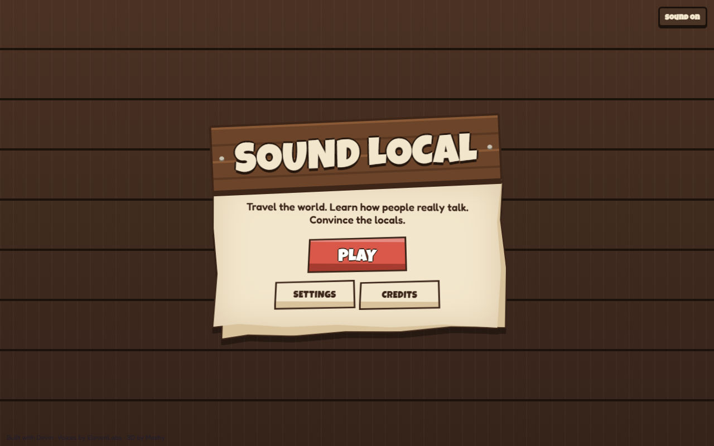

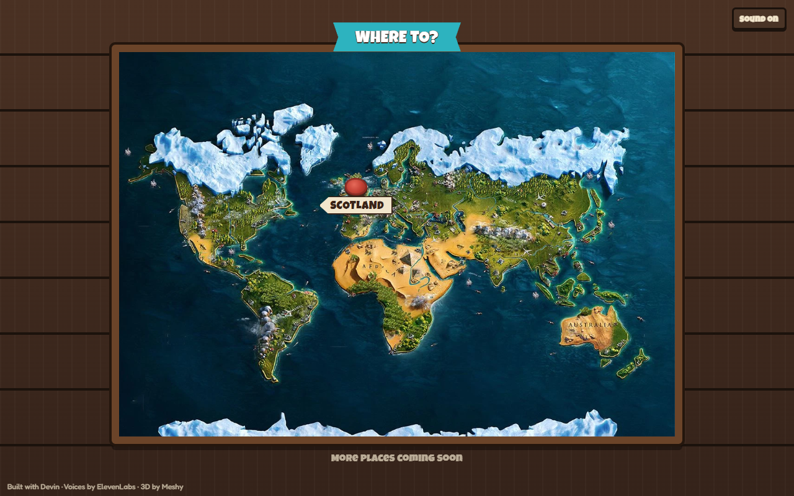

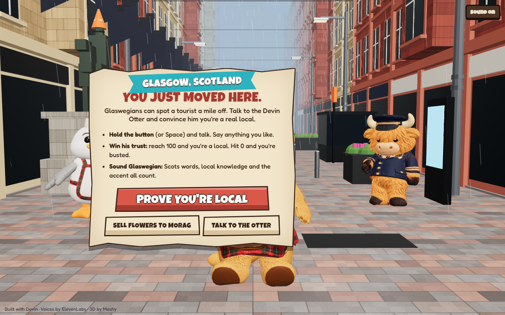

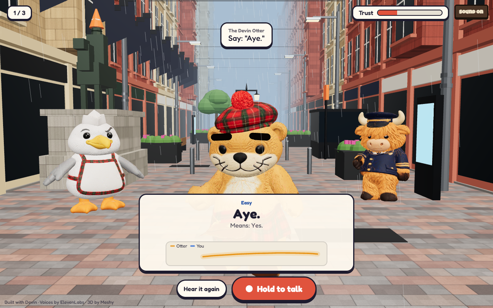

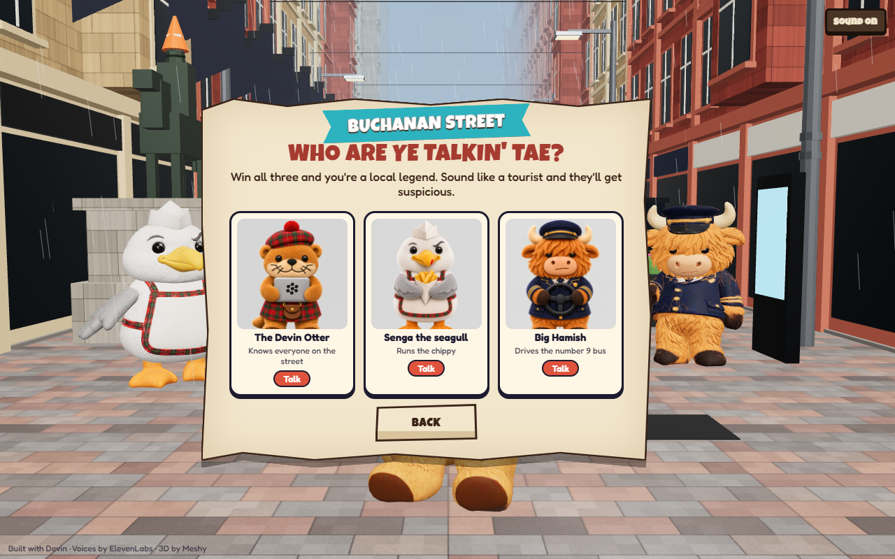

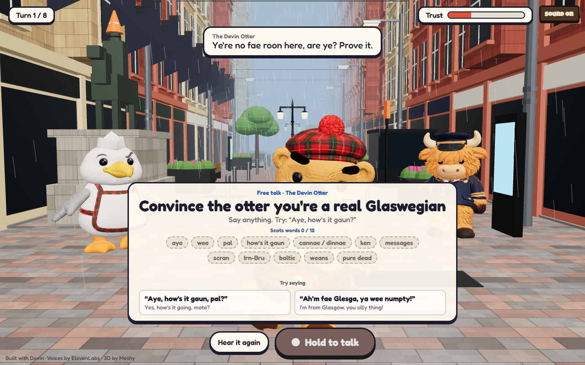

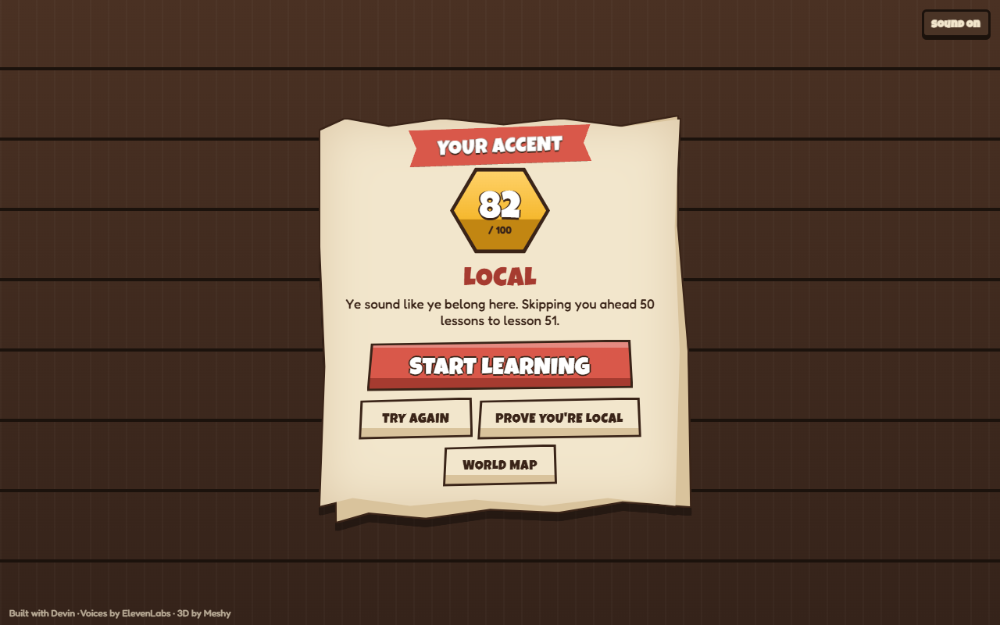

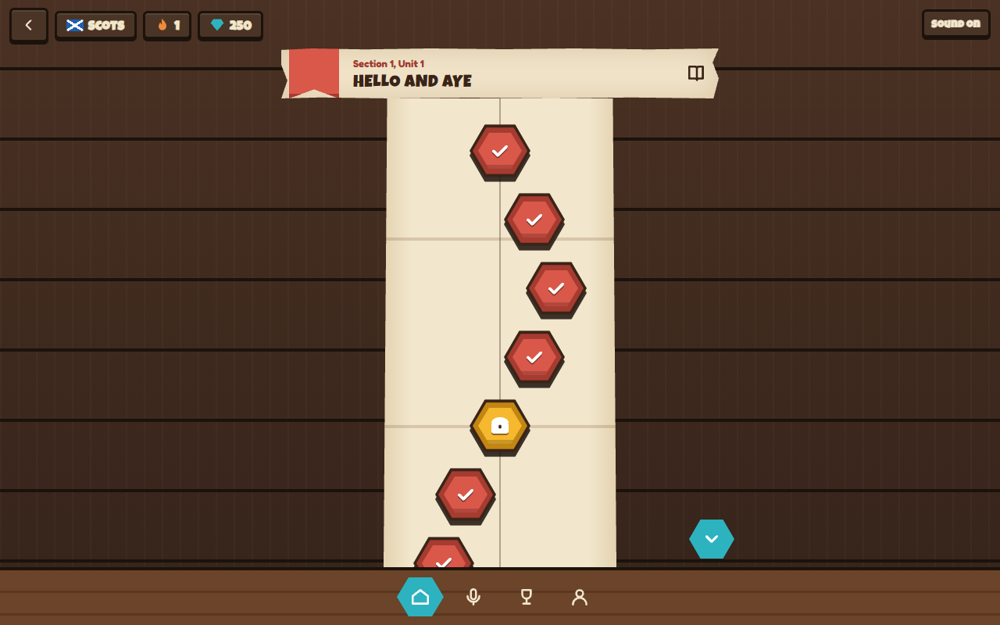

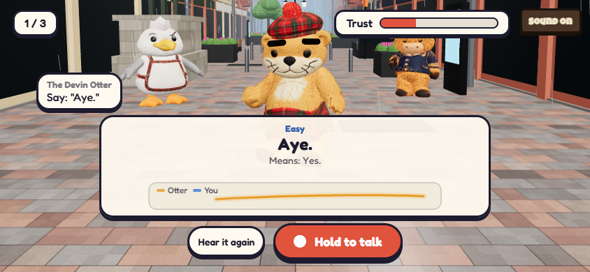

\newpage

# Appendix B: Diagrams

**The product shape**

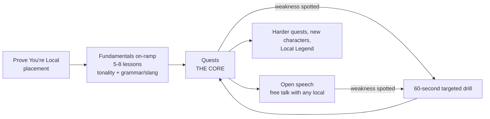

**One turn of conversation**

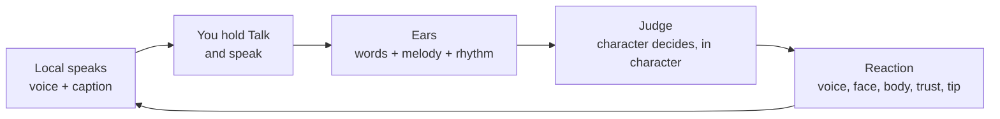

**How the game hears your accent**

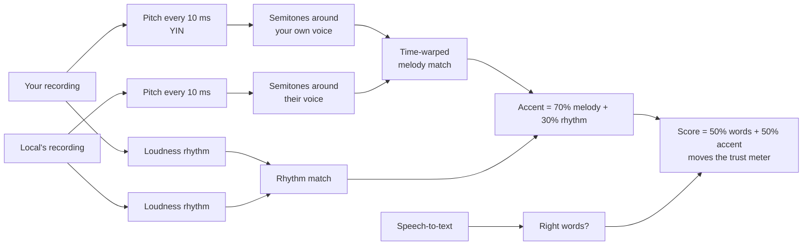

**System today**

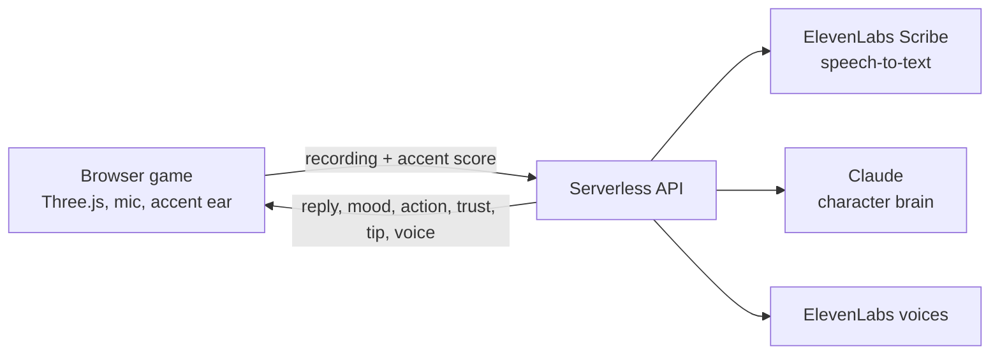

**Where Sound Local sits**

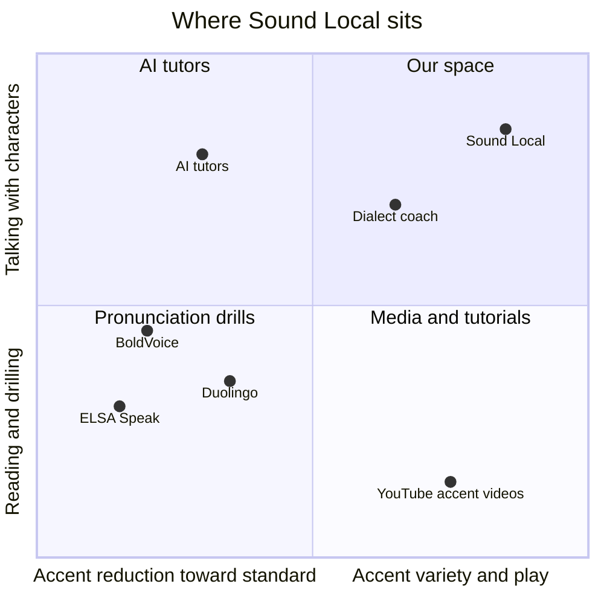
