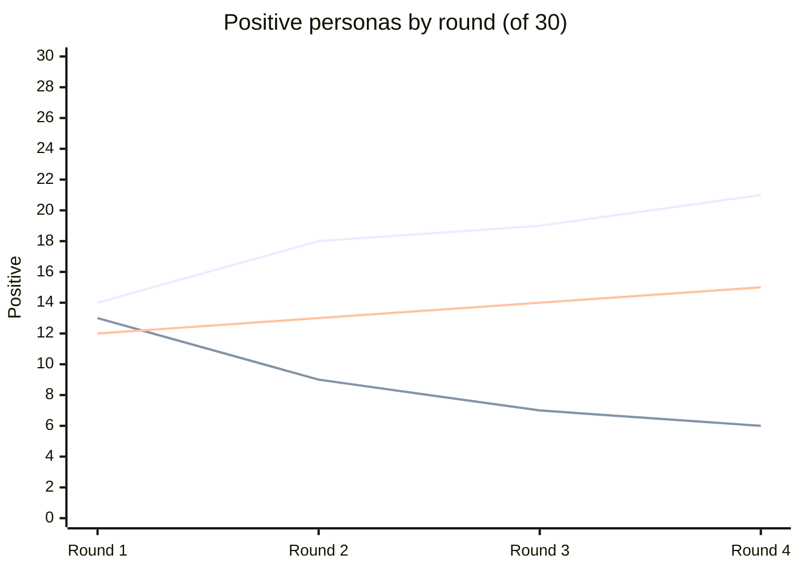

# Synthetic audience simulation: Sound Local launch

> **What this is:** a MiroFish-style simulation run by hand by an AI (Devin) on 14 Nov 2026, from the seed
> in `seed.md`. 30 synthetic personas react over 4 rounds in three parallel "worlds", one per launch variant.
> **What this isn't:** real people or real data. The same AI wrote the PRD, so it shares the PRD's
> assumptions and blind spots. Treat every finding as a **hypothesis to test** with real users (the research
> plan is in PRD section 21.10). The real MiroFish engine is installed at `../MiroFish` and can re-run this
> seed with a free LLM key and a Zep key.

## 1. Method

- **Personas:** 30, in four groups (fun and social, performers, locals and natives, market and critics),
  each with a background, goals and a social graph (who follows whom).
- **Worlds:** the same 30 personas see one launch variant each:
  - **A, respect framing:** "Can you convince Senga you're from Glasgow? Learn real accents from the locals
    who speak them. Next: Indian English, made with Indian creators, and Singlish."
  - **B, stereotype framing:** "Do the funniest accents in the world! Master the Indian and Chinese accent.
    Perfect party trick."
  - **C, performer framing:** "Your dialect coach in your pocket. Prep any accent for your next role."
- **Rounds:**
  1. Launch post and a 20-second gameplay clip (a player gets roasted by Senga for asking for "salt 'n'
     sauce").
  2. Reactions spread: reposts, duets, quote posts, comments.
  3. Pricing revealed; players hit the free limit; quests vs. lessons experience.
  4. India and Singapore announcement, plus a tech-press article.
- **Each persona, each round:** action (post, share, comment, ignore, sign up, pay, attack), sentiment
  (+ / 0 / −) and a quote. Counts below are counts of these 30 personas.

## 2. Personas

| # | Persona | Group | Background |
| --- | --- | --- | --- |
| 1 | Jordan, 17 | Fun | Ohio, posts accent TikToks |
| 2 | Aisha, 19 | Fun | London uni student, MLE speaker |
| 3 | Tyler, 24 | Fun | Texas, watches streamers |
| 4 | Mei, 21 | Fun | Toronto, Chinese-Canadian Gen Z |
| 5 | Rohan, 20 | Fun | Mumbai college student |
| 6 | Chloe, 16 | Fun | Glasgow schoolgirl (a minor) |
| 7 | Liam, 26 | Fun | Sydney, party host energy |
| 8 | Kayla, 23 | Fun | New York, hosts game nights |
| 9 | Maya, 22 | Performer | Drama student, London, cast as a Glaswegian |
| 10 | Marcus, 34 | Performer | Working actor, Los Angeles |
| 11 | Dev, 28 | Performer | Indian-Canadian stand-up comic |
| 12 | Sam, 35 | Performer | Voice actor and streamer |
| 13 | Grace, 52 | Performer | Dialect coach, sceptical expert |
| 14 | Tom, 40 | Performer | Head of voice at a drama school |
| 15 | Lena, 29 | Performer | Impressionist with 400k followers |
| 16 | Fiona, 45 | Local | Glaswegian, fiercely proud of the city |
| 17 | Ewan, 30 | Local | Glasgow TikTok comedian |
| 18 | Priya, 31 | Local | Bangalore tech worker moving to Glasgow |
| 19 | Arjun, 38 | Local | Delhi stand-up comedian |
| 20 | Nisha, 27 | Local | British-Indian anti-racism creator |
| 21 | Wei Ling, 33 | Local | Singaporean marketer, Singlish lover |
| 22 | Kenny, 41 | Local | Hong Kong English teacher |
| 23 | Jason, 25 | Local | Chinese-American activist |
| 24 | Hannah, 36 | Critic | Consumer-tech journalist |
| 25 | Raj, 42 | Critic | Consumer and edtech investor |
| 26 | Paula, 39 | Critic | PM at a big language-learning app |
| 27 | Carmen, 45 | Critic | ESL teacher, Mexico City |
| 28 | Karen, 47 | Critic | Parent of a 15-year-old |
| 29 | Prof. Okafor, 55 | Critic | Sociolinguist |
| 30 | Ben, 36 | Critic | Privacy advocate |

## 3. Results by world

### 3.1 Summary table

| Metric (of 30 personas) | A: respect | B: stereotype | C: performer |
| --- | --- | --- | --- |
| Shared or reposted in round 1 | 11 | **15** | 7 |
| Shared or reposted by round 4 | **18** | 9 (6 deleted their shares) | 10 |
| Positive at round 4 | **21** | 6 | 15 |
| Neutral at round 4 | 7 | 5 | 13 |
| Negative at round 4 | 2 | **19** | 2 |
| Would sign up | **17** | 9 | 12 |
| Would pay something | 7 | 2 | **8** |
| Backlash cascades | 0 (one question thread, answered) | **3** | 0 |
| Press angle by round 4 | "The accent app that hired the locals" | "Racist accent app" | "AI dialect coach: does it work?" |

*Lines, top to bottom at round 4: A (respect), C (performer), B (stereotype).*

### 3.2 World A: respect framing

**Round 1.** The Senga clip lands with the fun group. Jordan: *"she said SALT AND SAUCE IS EDINBURGH like
I committed a crime 💀"*. Ewan (Glasgow comic) duets it: *"Rating Americans ordering at a Glasgow chippy,
part 1"*. Fiona: *"Finally someone gets it right. It's a fish supper, pal."*

**Round 2.** Ewan's duet is the biggest spreader: locals judging tourists. Chloe (16) and Aisha share it.
Priya: *"I'm literally moving to Glasgow, this is homework."* Lena (impressionist) asks for a creator code.
Nisha posts a question: *"Made with Indian creators: who, and are they paid?"* It gets traction until
the team's reply (named Accent Lead, revenue share) is pinned, then turns neutral to positive.

**Round 3 (pricing).** Teens balk at $9.99/month; Kayla and Liam like a **$2.99 weekly party pass**. Jordan
hits the 1-quest-a-day limit on day one: *"one quest?? that's it??"* Fun personas skip lessons after one or
two; they want quests. Maya is happy to pay for the Actor tier *during her production* but wants a pass she
can buy once. Rohan and Priya: *"$9.99 is a lot in India."*

**Round 4 (India and Singapore).** Arjun (Delhi comic) wants to *make* the India pack. Rohan's reaction
flips the market: *"Can I learn the Glasgow one? And British for interviews?"* Wei Ling: *"Singlish
hawker quest? Shiok. Just don't call it broken English."* Kenny: *"Do Hong Kong English next."* Jason is
neutral: *"Fine if Singaporeans made it."* Hannah's article leads with the Respect Charter.

### 3.3 World B: stereotype framing

**Round 1.** Fastest early spread: 15 shares, mostly the fun group and Tyler and Kayla. *"lmao the Chinese
accent one"*.

**Round 2.** Jason quote-posts: *"An app teaching people to do 'the Chinese accent' in 2026."* Mei stitches
it. Nisha amplifies. Rohan, Priya and Arjun: *"Our accent isn't a party trick."* Dev (comic) publicly
distances himself: *"I do my aunties with love. This is the opposite."*

**Round 3.** Hannah writes the backlash story. Tom's drama school declines a pilot. Raj (investor) passes:
*"Headline risk."* Six of the 15 early sharers delete their posts. Pricing is barely discussed.

**Round 4.** The India and Singapore announcement is read as confirmation. Wei Ling: *"Singlish deserves
better than this."* Even Glaswegians are neutral at best. Recovery would need an apology, a full rebrand and
months.

### 3.4 World C: performer framing

**Round 1.** Performers lean in (Maya, Marcus, Sam, Lena share). Fun personas scroll past: *"sounds like
homework."*

**Round 2.** Grace (dialect coach): *"A pitch line isn't dialect coaching. Show me vowels."* Tom: *"If it
scored sounds, I'd put it in our first-year curriculum."* Marcus wants to paste his sides (audition script).

**Round 3.** The highest willingness to pay: five personas would pay the Actor tier; Tom asks about seats
for 60 students. Teens: nothing.

**Round 4.** India announcement: Dev and Arjun interested as creators. Press: *"AI dialect coach: does it
work?"*, which is fair, and the answer depends on per-sound scoring.

## 4. Cross-cutting findings

| # | Finding | Evidence (personas) | Confidence |
| --- | --- | --- | --- |
| F1 | **Stereotype framing wins round 1 and loses everything after.** Shares halve, sentiment collapses, partners and investors leave | World B: Jason, Mei, Nisha, Hannah, Tom, Raj | High (it matches real accent-app controversies) |
| F2 | **"Locals judge tourists" is the most shareable format.** Local creators reacting to players spread further than the product's own posts | Ewan, Fiona, Chloe, Aisha in World A | Medium-high |
| F3 | **Casual players want quests now; performers want drills.** Fun personas drop lessons after 1–2; performers want targeted practice and their script | Jordan, Kayla, Liam vs. Maya, Marcus, Grace | High |
| F4 | **The free tier must include enough quests to feel generous.** One per day felt stingy | Jordan, Liam | Medium |
| F5 | **Teens and party players want a short pass, not a subscription** | Kayla, Liam, Jordan | Medium |
| F6 | **Performers pay per production.** A one-off "production pass" beats a monthly sub for them | Maya, Marcus | Medium |
| F7 | **India is a two-way market.** Indian users want to learn Glaswegian, British and American accents | Rohan, Priya | Medium-high |
| F8 | **"Who made it and who gets paid" is the key question for non-white regions.** A named Accent Lead and revenue share turn critics neutral or positive | Nisha, Jason, Wei Ling | High |
| F9 | **Pros won't trust pitch-only scoring.** Per-sound feedback unlocks schools and coaches | Grace, Tom | High |
| F10 | **Privacy questions come early:** where does my voice go; teens need parental consent | Ben, Karen | Medium-high |
| F11 | **Brash characters spread better than the mascot.** Senga's roast travelled furthest; the otter is nice but not shareable | Jordan, Ewan | Medium |
| F12 | **A new segment appears: ESL teachers** who want students to understand real regional English | Carmen | Low-medium |
| F13 | **Investors ask about retention and AI cost first** | Raj; Paula: "we'd watch; we'd test an accents course if it trends" | High |

## 5. What we changed in the strategy

| Finding | Change (in the PRD) |
| --- | --- |
| F1 | **Never use stereotype framing**, in ads, store copy or content. Respect framing is the default message (21.2). |
| F2 | **Creator programme first:** recruit 1–3 local creators per region *before* launch for "locals rate tourists" duets (21.4). |
| F3 | **Onboarding asks your goal** (fun / a role / moving there). Fun goes **quest-first** right after placement (fundamentals optional and offered as drills); performers go fundamentals-first with an Actor trial (12.0, 21.3). |
| F4 | Free tier: **3 quests a day** (quests mostly scripted beats + cached lines, so cheap) and 1 free-talk conversation (20.3). |
| F5 | Add a **$2.99 weekly Party Pass** (20.3). |
| F6 | Add an **8-week Production Pass** for the Actor tier (20.3). |
| F7 | India launch includes **"learn Glaswegian, British and American"** for Indian users, with regional pricing (10.2, 20.3). |
| F8 | Public **"Who made this region"** page: Accent Lead, creators, revenue share (9, 21.6). |
| F9 | Don't market to pros as a dialect coach until **per-sound scoring** ships; until then, sell the Actor tier as practice, not coaching (16.3, 20.3). |
| F10 | On-device scoring by default, "your voice isn't stored" on screen, a teen mode with parental consent (27). |
| F11 | Pick the **breakout character as the brand face** (a Senga-style local) when replacing the Devin Otter (22, Q2). |
| F12 | Note ESL teachers as a later segment (8.1). |
| F13 | Pitch deck leads with D7 retention and cost per conversation (20.8). |

## 6. Limits

- One AI played all 30 personas, so their views are correlated and shaped by the same training data.
- No real distribution dynamics (algorithms, timing, luck).
- The counts are judgments, not measurements.
- **Next:** test F2–F7 with real people (section 21.10): 5 playtests per segment, a landing-page test of
  variants A and C (never B), and a price test.
