# Accent science: what makes accents different, measured

*Sound Local research, overnight 2026-11-15. All outside sources were read on 2026-11-15 (the access
date for every link in this report). Our own numbers come from scripts in [`scripts/`](scripts/) run on
real, openly licensed recordings; see [README.md](README.md) to rebuild them. Labels used:
**UNVERIFIED** = we could not check it; **ASSUMPTION** = our judgement, not a measured fact.*

## One-page summary (plain words)

**The question.** Do accents have measurable patterns in pitch, frequencies and timing, can a
computer tell them apart from the data alone, and can we draw them so a player sees the difference?

**Short answer: yes, but mostly not in the pitch melody that the game scores today.** The patterns that
most reliably separate English accents are in the *vowels* (where the tongue sits, shown by the first
two resonances of the voice, called F1 and F2) and in a few *consonants* (above all whether the "r"
after a vowel is pronounced, shown by a dip in the third resonance, F3). These can be drawn as simple
pictures: a vowel map with dots and target zones, an arrow for vowels that glide, and an "R strength"
meter.

**What we found in real recordings (52 VCTK speakers + 7 CMU ARCTIC speakers, 5 accent groups:
Scottish, Canadian, US American, Indian English, Southern English):**

1. **The current Sound Local accent score barely tells accents apart.** We ported the live scorer
   (`src/voice/pitch.js`) to Python, confirmed it gives identical numbers to the JavaScript, and ran it
   on 64,000 same-sentence speaker pairs. Same-accent pairs averaged 0.895, different-accent pairs
   0.878. An "AUC" of 0.54 means it is right about which pair is the same-accent pair only 54% of the
   time, where 50% is a coin toss ([chart 14](#14-the-current-game-score-does-not-separate-accents)).
   It mainly rewards saying the sentence with natural English melody, which every accent does.
2. **Vowels separate accents best among things we can explain to a player.** Comparing speakers by
   their normalised vowel positions gave AUC 0.82; the vowels alone named the accent of a never-seen
   speaker from one sentence 52% of the time across 5 accents (chance 20%).
3. **Rhoticity (the "r") is a strong single cue where accents differ on it.** Southern English speakers'
   F3 near "r" sits about 500-700 Hz higher than every rhotic group (AUC 0.77).
4. **Pitch range and rhythm numbers do not separate these accents** (pitch range AUC 0.49, rhythm
   metrics AUC 0.55; classifier accuracy 18% and 24%, around chance). The research literature agrees
   that popular rhythm metrics are fragile ([Arvaniti 2012](https://doi.org/10.1016/j.wocn.2012.02.003)).
5. **An AI speech model knows the most, but cannot explain itself.** A self-supervised model (WavLM,
   layer 7) named the accent of an unseen speaker 64% of the time per sentence and 71% per speaker. It
   cannot tell the player *what* to change, so it is best used as a hidden check, not as the picture.
6. **On a phone, some measures survive and some do not.** After a WebRTC-style codec (Opus) every
   feature survived (r = 0.90 to 1.00, except pitch range at 0.70). Old-style telephone band-limiting
   destroyed the "r" measure (r = 0.12), damaged vowel F2 (r = 0.48) and pitch range (r = 0.35).
   Median pitch survived everything; vowel F1 survived everything except room echo (r = 0.66).

**What Sound Local should do (ranked; details in [section 4](#4-what-sound-local-should-do)):**

1. **Add a vowel-target score** on 3-6 "signature words" per accent (e.g. Glasgow: *book/boot* sounding
   alike, a steady vowel in *face* and *go*; Toronto: *about* with a raised start; London: *bath* with a
   back vowel). Show it as a vowel map with a target zone. Biggest gain for moderate effort.
2. **Add an "R" meter** (F3 dip after vowels) for accents that differ in rhoticity
   (Glasgow/US/Canada/Mumbai vs London).
3. **Keep the pitch melody, but lower its weight** and score specific known tunes (for example the
   Glasgow rising statement) instead of whole-sentence similarity.
4. **Add a hidden embedding check** (WavLM-style distance to local speakers) on the server, as a guard
   against gaming and as a second opinion.
5. **Drop rhythm metrics as an accent score;** use speech rate only to normalise.

**The biggest risk** is data: VCTK has only 3 Indian English speakers, and the accent the classifier
confused most (Canadian vs US) is exactly the one where we had the least targeted material. To build
real accent targets we need roughly 15-30 local speakers per accent reading the same prompts
(ASSUMPTION, extrapolated from corpus practice; no paper gives a minimum).

---

## Contents

1. [Data and method](#1-data-and-method)
2. [Results from real recordings (15 charts)](#2-results-from-real-recordings)
3. [Which features are graphable and phone-reliable: summary table](#3-feature-scorecard)
4. [What Sound Local should do](#4-what-sound-local-should-do)
5. [Literature: segmental features](#5-literature-segmental-features)
6. [Literature: prosody and voice quality](#6-literature-prosody-and-voice-quality)
7. [Literature: machine learning and scoring](#7-literature-machine-learning-and-scoring)
8. [Datasets and licences](#8-datasets-and-licences)
9. [Study catalogue (all sources)](#9-study-catalogue)
10. [Limitations, UNVERIFIED items and assumptions](#10-limitations)

---

## 1. Data and method

| | CMU ARCTIC | VCTK |
|---|---|---|
| Speakers used | 7: awb (Scottish M), jmk (Canadian M), ksp (Indian M), bdl, rms (US M), slt, clb (US F) | 52: 14 Scottish, 8 Canadian, 14 US, 3 Indian, 13 Southern English (all Canadian and Indian speakers in the corpus) |
| Material | The same 200 sentences per speaker (1,400 recordings) | The same 12-24 prompts per speaker (1,220 recordings) |
| Phone boundaries | Labels shipped with ARCTIC | Montreal Forced Aligner 3.4.3, `english_us_arpa` model, for everyone (it locates sounds; it does not judge accent) |
| Licence | CMU licence (`COPYING` in each archive): commercial use allowed with notice | CC BY 4.0 |
| Source | [festvox.org/cmu_arctic](http://festvox.org/cmu_arctic/) | [Edinburgh DataShare 10283/3443](https://datashare.ed.ac.uk/handle/10283/3443) |

**Measurements** (all in [`features.py`](scripts/features.py), via Praat/Parselmouth
([Jadoul et al. 2018](https://doi.org/10.1016/j.wocn.2018.07.001))):
F0 (pitch) median and 5th-95th percentile range in semitones; F1/F2 at 20%, 50% and 80% of every vowel
longer than 40 ms, normalised per speaker with Lobanov z-scores
([Lobanov 1971](https://doi.org/10.1121/1.1912396)); lowest F3 around post-vocalic /r/; rhythm metrics
%V, deltaC, nPVI-V, rPVI-C, VarcoV and speech rate from the phone boundaries; 13 mean MFCCs; and
mean-pooled hidden layers of two self-supervised models, WavLM Base+
([Chen et al. 2022](https://doi.org/10.1109/JSTSP.2022.3188113)) and wav2vec 2.0 Base
([Baevski et al. 2020](https://arxiv.org/abs/2006.11477)).

**Classifier test.** Logistic regression, *leave-one-speaker-out*: the speaker being tested is never in
the training data, so the model cannot just recognise voices. Scores are balanced accuracy over 5
accents (chance = 20%). A "sex only" classifier is included as a confound check: it scored 16%, below
chance, so the accent results are not explained by the different mix of men and women per group.

**Current game score.** [`game_score.py`](scripts/game_score.py) is a line-by-line port of
`src/voice/pitch.js`. [`parity_check.py`](scripts/parity_check.py) runs both on real recordings:

| Pair (ARCTIC sentence) | JavaScript | Python |
|---|---|---|
| awb vs bdl, a0005 | 0.9070 | 0.9070 |
| ksp vs jmk, a0012 | 0.6572 | 0.6572 |
| slt vs rms, a0024 | 0.9328 | 0.9328 |

**Big caveats up front.** Few speakers per accent (3 Indian). VCTK's "American" speakers come from
mixed US regions and its "Scottish" speakers from several Scottish towns, so neither is one city
accent. Studio microphones, read speech. Results show what is *measurable*, not population averages.

---

## 2. Results from real recordings

### 01. Vowel space by accent (ARCTIC)

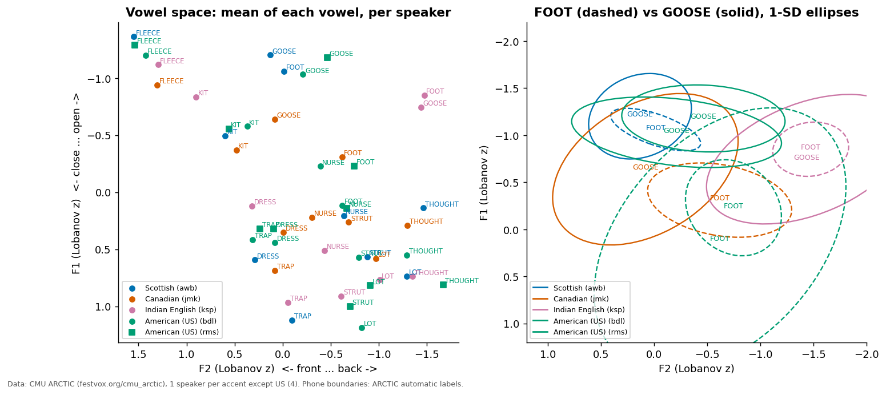

Each accent's vowels sit in slightly different places. Example: the gap between FOOT (*book*) and GOOSE
(*boot*) on the front-back axis is 0.15 z for the Scottish speaker and 0.04 for the Indian speaker, but
0.70 for the Canadian and 0.28-0.43 for the Americans ([`arctic_results.json`](results/arctic_results.json)).
Scottish English is described as merging these two vowels; the data agree for this speaker.

### 02. Why normalisation matters

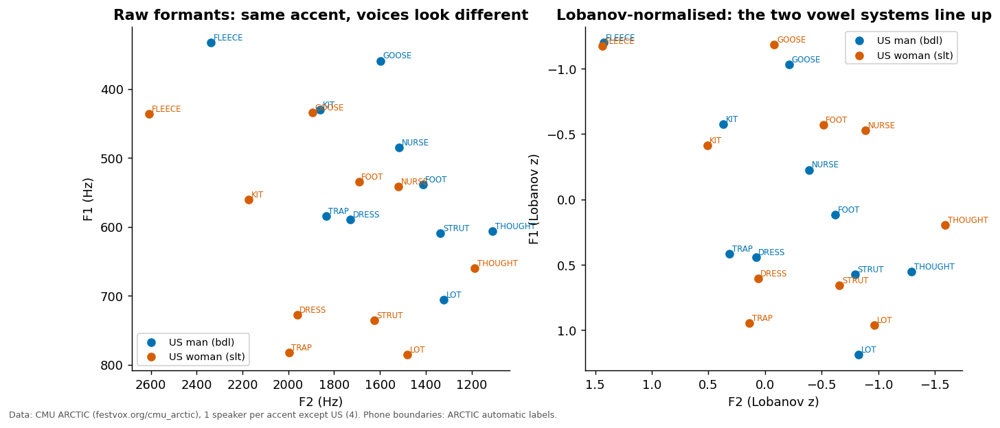

In raw Hertz, women's vowels sit far from men's simply because of vocal-tract size, so a woman speaking
in exactly the target accent would score as "wrong" against a male reference. After Lobanov
normalisation the vowel systems line up. **Any vowel score must be normalised per speaker.** The
literature agrees ([Adank et al. 2004](https://doi.org/10.1121/1.1795335)).

### 03. Diphthong glides

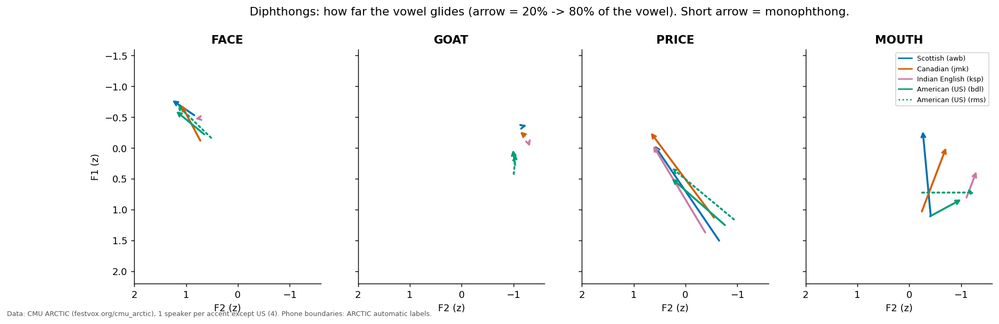

Arrows show how far vowels like FACE (*day*) and PRICE (*my*) glide. Glide length for FACE: Indian
speaker 0.16 z, Scottish 0.56, Canadian 0.74, Americans 0.73-0.92. Monophthongal (steady) FACE is a
textbook feature of both Indian and Scottish English, and it shows up here as a short arrow.

### 04. Canadian raising

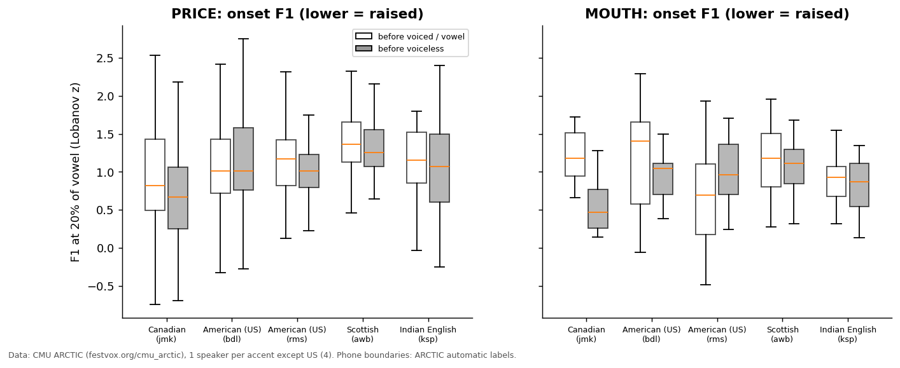

Canadian raising means the start of MOUTH (*out*) is higher before voiceless consonants (*out*,
*house*) than elsewhere (*loud*). For the Canadian speaker the MOUTH onset F1 is 1.37 z before voiced
sounds and 0.54 z before voiceless ones (lower F1 = higher tongue), a drop of 0.83. The other speakers
drop 0.07-0.21 or rise. PRICE raising is not visible for this speaker. This is a one-speaker result with
11-23 tokens per cell.

### 05. Rhoticity via F3 (ARCTIC)

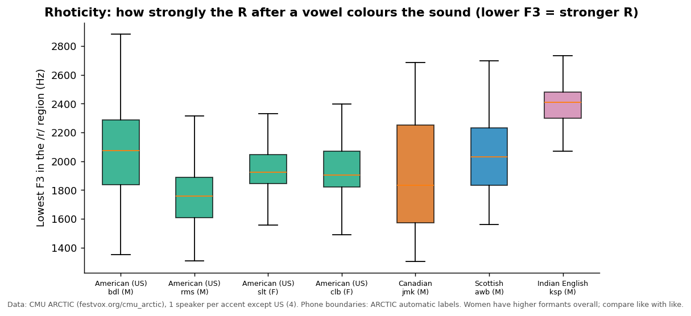

Median lowest F3 near post-vocalic /r/: Indian speaker 2,409 Hz (weakest r-colouring), Scottish 2,031,
US/Canadian men 1,758-2,075. Women have higher formants overall, so compare within sex or normalise.

### 06. Pitch melody, same sentence

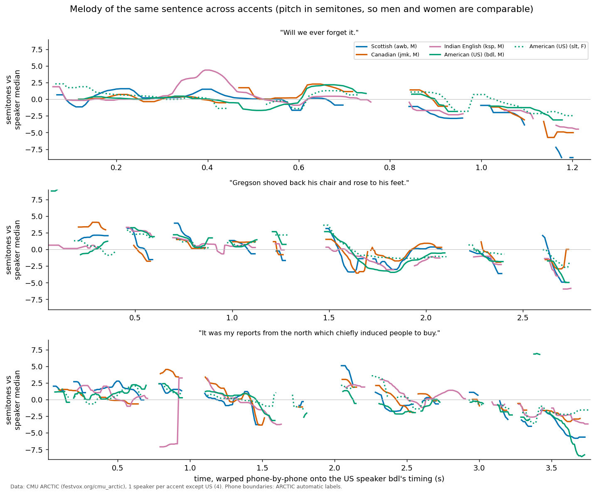

Pitch traces, in semitones relative to each speaker's own median and time-aligned phone by phone, look
broadly alike across accents for read sentences. This is why the current pitch-DTW score struggles to
separate them (chart 14).

### 07. Vowel space with 52 speakers (VCTK)

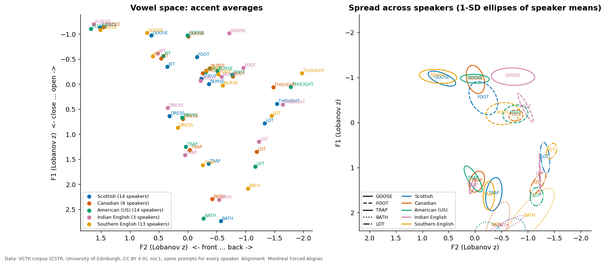

The TRAP-BATH split is clearly visible: Southern English BATH (*ask, after, path*) sits far back
(BATH minus TRAP F2 = -0.78 z), while US (-0.31), Canadian (-0.39) and Scottish (-0.22) BATH stay near
TRAP. Indian English GOOSE is much further back than any other group. Spread across speakers (right
panel) is large: Scottish FOOT-GOOSE gap averages 0.79 z with SD 0.44, so several VCTK Scottish
speakers do *not* merge them, unlike the ARCTIC speaker. **Accent targets must be distributions, not
single points.**

### 08. Rhythm metrics

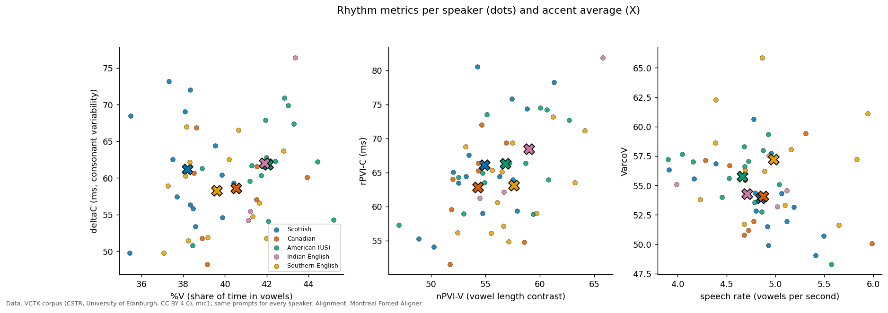

%V vs deltaC and nPVI-V vs rPVI-C: the accent averages (X) differ a little (e.g. %V 38.2 Scottish vs
42.1 US) but the speaker clouds overlap almost completely.

### 09. Pitch range and rhoticity per speaker

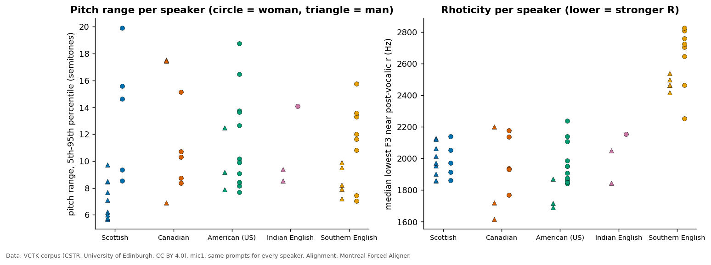

Pitch range varies more between individuals (6-21 semitones) than between accents (means 9.5-11.9).
Rhoticity separates cleanly: Southern English median F3 2,477 Hz (men) and 2,648 Hz (women) vs
1,758-1,990 Hz for US, Canadian and Scottish groups.

### 10. Which features identify the accent?

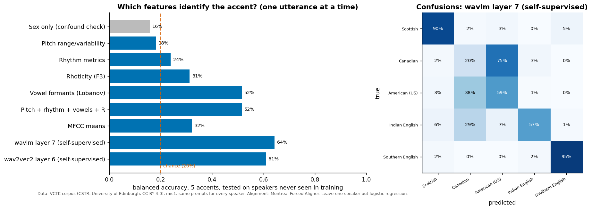

Balanced accuracy, one sentence at a time, speaker never seen in training (chance 20%):

| Feature set | Accuracy |
|---|---|
| Sex only (confound check) | 16% |
| Pitch range/variability | 18% |
| Rhythm metrics | 24% |
| Rhoticity (F3) | 31% |
| MFCC means | 32% |
| Vowel formants (Lobanov) | 52% |
| Pitch + rhythm + vowels + R | 52% |
| wav2vec2 layer 6 | 61% |
| **WavLM layer 7** | **64%** (71% when a speaker's sentences vote) |

Confusions (right): Scottish 90% and Southern English 95% correct; Canadian mostly called American
(75%), which is expected because Canadian and US accents share most vowels and VCTK's prompts were
not chosen to expose Canadian features; Indian English 57% with only 3 speakers.

### 11. Where the accent lives inside an AI speech model

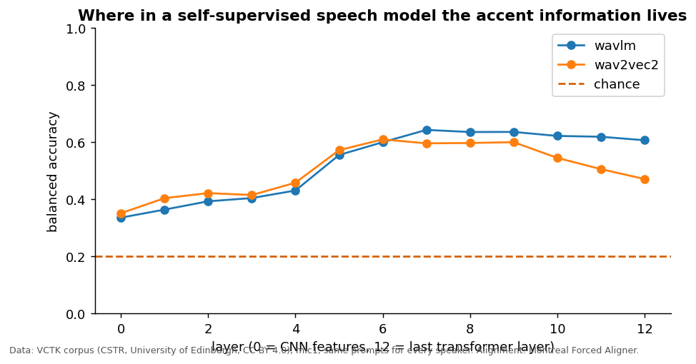

Accent information peaks in the middle layers (WavLM 7-9, wav2vec2 6-9) and fades towards the top.
This matches published findings that middle layers best match human accent perception
([Bartelds et al. 2022](https://doi.org/10.1016/j.wocn.2022.101137)).

### 12. Embedding maps

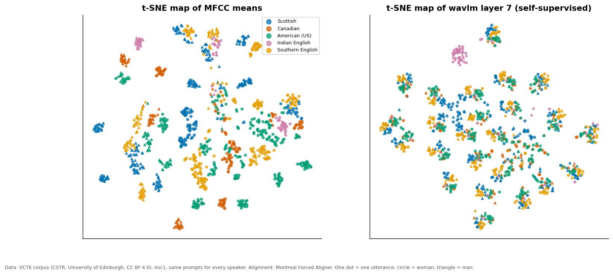

Each dot is one recording. With MFCCs (left) the dots cluster by *speaker*, not accent, so a naive
distance would mainly measure "is this the same person". WavLM (right) mixes speakers more and puts
Indian English and parts of the Southern English group into their own regions. Speaker identity
remains a confound for any embedding score.

### 13. Within-accent vs between-accent variability

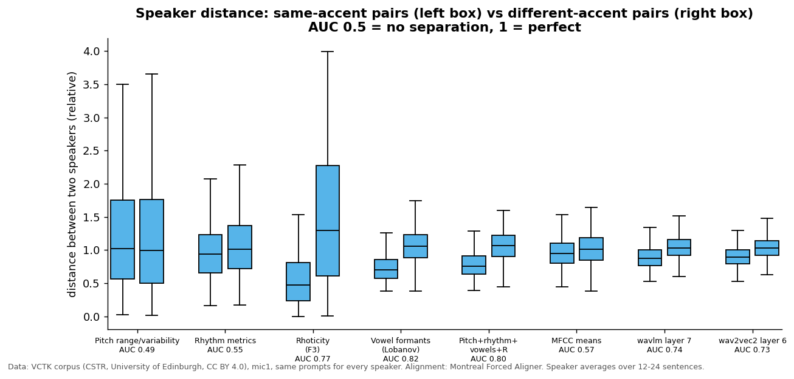

For every pair of speakers we measured the distance between their average features. A good accent
feature gives smaller distances to same-accent speakers. AUC (0.5 = no help, 1 = perfect): vowels
0.82, all hand-made features 0.80, rhoticity 0.77, WavLM 0.74, wav2vec2 0.73, MFCC 0.57, rhythm
0.55, pitch range 0.49.

### 14. The current game score does not separate accents

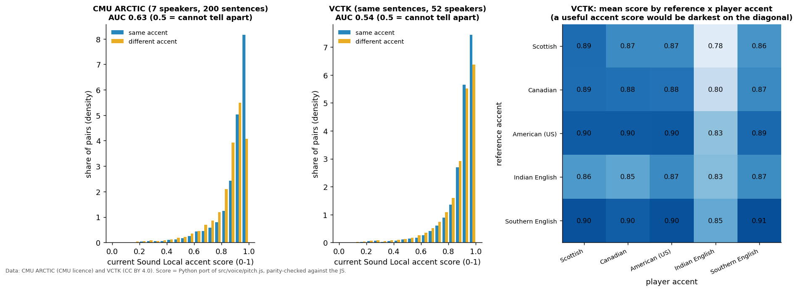

The parity-checked port of the live scorer, run on every pair of speakers reading the same sentence:

| Corpus | Pairs | Same-accent mean | Different-accent mean | AUC (score) | AUC melody only | AUC envelope only |
|---|---|---|---|---|---|---|
| ARCTIC (7 speakers, 200 sentences) | 8,400 | 0.892 | 0.854 | 0.63 | 0.54 | 0.69 |
| VCTK (52 speakers, 25 prompts) | 55,994 | 0.895 | 0.878 | 0.54 | 0.54 | 0.53 |

In the heat map (right) a useful score would be darkest on the diagonal. It is not: an American
reference gives Scottish, Canadian and English players the same 0.90. Indian English players score a
little lower against everyone. Most pairs score above 0.85, so the score is compressed near the top.
(Chart 13 compares speaker averages and chart 14 compares single sentences, so their AUCs are not
directly comparable; the point is that the current score is close to chance on either view.)

### 15. Does each measure survive a phone?

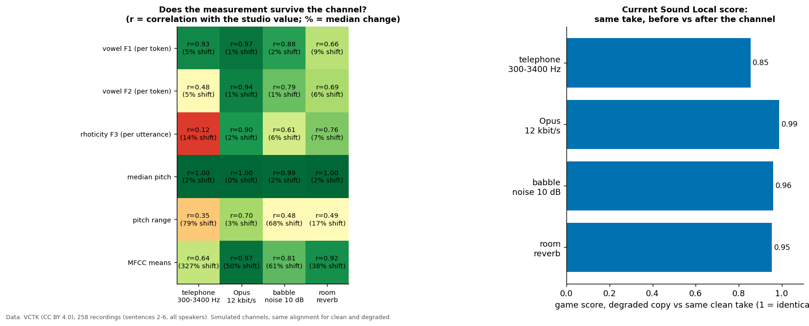

258 VCTK recordings, re-measured after four simulated channels with the *same* phone boundaries.
r = correlation with the studio value (1 = perfectly preserved):

| Measure | Telephone 300-3400 Hz | Opus 12 kbit/s | Babble noise 10 dB SNR | Room reverb |
|---|---|---|---|---|
| Vowel F1 (per token) | 0.93 | 0.97 | 0.88 | 0.66 |
| Vowel F2 (per token) | 0.48 | 0.94 | 0.79 | 0.69 |
| Rhoticity F3 (per utterance) | 0.12 | 0.90 | 0.61 | 0.76 |
| Median pitch | 1.00 | 1.00 | 0.99 | 1.00 |
| Pitch range | 0.35 | 0.70 | 0.48 | 0.49 |
| MFCC means | 0.64 | 0.97 | 0.81 | 0.92 |
| Current game score, same take before/after (1 = identical) | 0.85 | 0.99 | 0.96 | 0.95 |

Browsers record wideband audio, so the Opus column is closest to the game's real channel and the
telephone column is a worst case (ASSUMPTION: players use the browser mic, not a phone call). Noise
and room echo are the real threats: they hurt pitch *range* and F3 most. This matches a remote-
recording study that found F0 and F1 stable across devices but F2 and higher less so
([Rothman et al. 2021](https://doi.org/10.21437/Interspeech.2021-1122)). Note that babble noise left the
current game score at 0.96 for the same take, meaning the existing scorer is robust, but robust at
measuring something that does not separate accents.

---

## 3. Feature scorecard

Our measurements plus the literature in sections 5-7.

| Feature | Separates accents? (our data) | Literature | Phone-reliable? (chart 15) | Graphable for a player? |
|---|---|---|---|---|
| Normalised vowel F1/F2 | **Yes**: AUC 0.82, 52% 5-way | Strong for broad systems ([Labov et al. 2006](https://doi.org/10.1515/9783110206838)) | F1 good; F2 OK unless echo/narrowband | **Yes**: vowel map with target zone |
| Diphthong glide (FACE, GOAT, PRICE, MOUTH) | Yes, visible (charts 03-04) | Strong ([Fox & Jacewicz 2009](https://pubs.aip.org/asa/jasa/article/126/5/2603/901156/Cross-dialectal-variation-in-formant-dynamics-of)) | As vowels | **Yes**: arrow |
| Rhoticity (F3 near /r/) | **Yes** where accents differ: AUC 0.77 | Strong rhotic vs non-rhotic; graded in Glasgow ([Stuart-Smith et al. 2007](https://doi.org/10.1111/j.1467-9841.2007.00319.x)) | OK on Opus (0.90); fails narrowband | **Yes**: "R strength" meter |
| Pitch contour shape (current score) | **No** for whole read sentences: AUC 0.54 | Specific tunes do differ, e.g. Glasgow rises ([Mayo et al. 1997](http://hdl.handle.net/1842/1235)) | Good | Yes (already shown) |
| Pitch range | No: AUC 0.49 | Weak after normalisation | Poor (0.35-0.70) | Not recommended |
| Rhythm metrics (%V, nPVI...) | No: AUC 0.55, 24% | Fragile ([Arvaniti 2012](https://doi.org/10.1016/j.wocn.2012.02.003)) | Depends on alignment | Not recommended |
| MFCC means | Weak: 32%, mostly speaker identity | MFCC+DTW distance r = -0.71 with ratings ([Bartelds et al. 2020](https://doi.org/10.3389/frai.2020.00039)) | Absolute values shift | No (not explainable) |
| SSL embeddings (WavLM mid layers) | **Best**: 64% / 71% per speaker | Best match to perception ([Bartelds et al. 2022](https://doi.org/10.1016/j.wocn.2022.101137)) | Not tested (ASSUMPTION: like MFCC) | No: hidden check only |
| VOT, flapping, glottal T, TH-fronting, L-vocalisation | Not measured (no hand labels) | Medium-strong in controlled words ([Sirsa & Redford 2013](https://doi.org/10.1016/j.wocn.2013.07.004)) | Medium | Category bars / spectrogram |
| Voice quality (creak, breathiness), nasality | Not measured | Mostly social, not regional | Poor | Not recommended |

---

## 4. What Sound Local should do

### Ranked recommendation (effort vs expected accuracy)

| # | Measure | Why (evidence) | Effort | Where it runs |
|---|---|---|---|---|
| 1 | **Vowel-target score on signature words**: Lobanov-normalised F1/F2 at vowel midpoint plus 20%-80% glide, compared with the target accent's speaker distribution (z-distance to the target ellipse) | Best explainable separator in our data (AUC 0.82) and the literature; directly drawable | Medium: need the time span of each target vowel. Lines are scripted, so align audio to the known text | Formants on device (LPC, ASSUMPTION: feasible in JS at 10 ms hops); alignment on the server (MFA, or a small CTC phone model) |
| 2 | **"R strength" (F3 dip after vowels)** for rhotic vs non-rhotic targets | AUC 0.77; one number, one meter | Low once #1's alignment exists | Device |
| 3 | **Keep pitch melody, lower weight, target specific tunes**: e.g. Glasgow statement rise (L*H), Indian English pitch-accent placement | Whole-sentence pitch similarity is near chance (AUC 0.54); specific nuclear tunes are documented accent markers | Low: reuse `pitch.js`; add a rise/fall check on the last stressed syllable | Device (already) |
| 4 | **Hidden embedding distance** (WavLM Base+ layer ~7, DTW or mean-pool distance to several local reference speakers, never one) | Strongest classifier (64%/71%); literature support | Medium | Server (Modal). ~95M parameters, too heavy for phones (ASSUMPTION) |
| 5 | **Drop rhythm metrics from the score;** use speech rate only to normalise | 24% / AUC 0.55; rate shifts accent judgements ([Munro & Derwing 2001](https://doi.org/10.1017/S0272263101004016)) | Remove code | - |
| (later) | Consonant checks: glottal T (London, Glasgow), flap T (US/Canada), unaspirated stops and retroflex T/D (Mumbai), TH-stopping | Literature-backed, untested here | Medium-high: needs a phone classifier | Server |

Suggested first weighting (ASSUMPTION, to be tuned on recordings of real players): line score = 40%
words, 30% vowels, 10% R (only where the target accent differs from the player's), 20% melody.
Embedding distance as a sanity gate, not a weight.

### Charts to show the player on a phone

1. **Vowel map** (from chart 07): two or three dots, player vs target zone, for the word just said.
   Label in words ("tongue further back"), not formant numbers.
2. **Glide arrow** (from chart 03): for FACE/GOAT/MOUTH words. Short arrow = steady vowel (Glasgow,
   Mumbai), long arrow = glide.
3. **R meter**: one bar from "no r" to "strong r".
4. **Melody line** (already in the game): keep it, but highlight only the final rise or fall.

Avoid rhythm scatter plots, pitch-range numbers and embedding maps for players; they do not separate
accents or cannot be acted on.

### Signature words per accent

From the literature in sections 5-6 where cited there; items without a citation in this report (retroflex T/D, TRAP before nasals, LOT = THOUGHT) are standard textbook descriptions we did not re-verify tonight: ASSUMPTION.

| Accent | Vowel targets | Consonant / melody targets |
|---|---|---|
| Glasgow / Scottish | FOOT = GOOSE (*book/boot*), steady FACE and GOAT, Scottish Vowel Length Rule | Strong r (tapped or approximant), glottal T, statement rises |
| Toronto / Canadian | Canadian raising in MOUTH (*about*), Canadian Shift in DRESS/TRAP, LOT = THOUGHT | Rhotic, flap T |
| London / Southern English | BATH back (*bath, after*), fronted GOOSE | Non-rhotic, glottal T, TH-fronting, L-vocalisation |
| Mumbai / Indian English | Steady FACE and GOAT, backed GOOSE, less vowel reduction | Unaspirated /p t k/, retroflex T/D, distinct pitch-accent placement |
| General American | Rhotic NURSE/START, TRAP before nasals | Flap T, strong r |

### How much data per accent

- Our data: groups with 13-14 speakers were recognised 90-95% (Scottish, Southern English); 3
  Indian speakers gave 57%.
- Literature: near-gold dialect clustering from ~6 s per speaker with SSL models
  ([Bartelds & Wieling 2022](https://aclanthology.org/2022.naacl-main.273/)); dialect corpora use ~13-17
  speakers per area.
- Recommendation (ASSUMPTION): **15-30 local speakers per accent, about 5 minutes each, reading the
  game's own lines plus a fixed word list** that contains every signature word several times. Mixed
  ages and genders. Consent must cover scoring use.

### Risks

| Risk | What we saw | Mitigation |
|---|---|---|
| Gender / voice pitch | Raw formants and F3 differ by sex (chart 02, chart 09) | Lobanov normalisation; compare F3 within sex or normalise per speaker |
| Microphone, noise, echo | F2/F3 and pitch range degrade (chart 15) | Ask for quiet; reject clips with low SNR; never compare raw Hz across devices |
| Within-accent variation | Scottish FOOT-GOOSE gap SD 0.44; large spread in every group | Targets as zones built from many speakers; feedback relative to a zone |
| Speaker identity | MFCC maps cluster by speaker (chart 12) | Many reference speakers per accent; leave-one-speaker-out validation |
| Corpus/channel confounds | ARCTIC and VCTK differ in mic and room | Never mix corpora in one comparison; record our own references on phones |
| One reference clip per line | Current design compares with one voice actor | Compare with a distribution of local speakers |
| Kindness | Accent features carry social meaning | Feedback names sounds, never "correct/incorrect English" |

### Next steps

1. Record 5-10 Glaswegian speakers on phones reading the Scotland lines plus a word list; build the
   first vowel and R target zones.
2. Prototype the vowel-map feedback offline with the scripts here, then port formant tracking to JS.
3. Collect accentedness ratings from local listeners on 50-100 player clips and check which score
   correlates best (the literature's standard validation).
4. Re-run chart 15 with real phone recordings instead of simulated channels.

---

## 5. Literature: segmental features

### Executive summary

Segmental features are the individual vowels and consonants in words. They are often highly chartable. The strongest candidates for a phone game are vowel quality, vowel movement, selected consonant timing, and broad reduction patterns. Raw formants need normalization and device calibration. Mobile transmission can shift F1 by 29% on average [Byrne & Foulkes 2004](https://doi.org/10.1558/ijsll.v11i1.83). F2 and higher formants are also less stable in remote recordings [Rothman et al. 2021](https://doi.org/10.21437/Interspeech.2021-1122). Therefore, a game should score relative patterns inside one recording, not raw Hertz values against a lab reference.

### 5.1 Vowel quality: F1, F2, and vowel spaces

**What it is.** F1 tracks vowel height: higher F1 usually means a lower vowel. F2 tracks frontness: higher F2 usually means a fronter vowel. Plotting F1 against F2 gives a vowel-space chart. Different accents move the same lexical vowel to different regions.

**Measurement.** Track F1 and F2 near the middle of stable monophthongs with Praat or a comparable LPC tracker. Use speaker normalization. Adank, Smits and van Hout found that vowel-extrinsic and formant-intrinsic methods preserved sociolinguistic information better than vowel-intrinsic methods in 160 Dutch speakers [Adank et al. 2004](https://doi.org/10.1121/1.1795335). Flynn and Foulkes similarly found that vowel-extrinsic, formant-intrinsic, speaker-intrinsic methods performed best across 20 normalization methods [Flynn & Foulkes 2011](https://www.internationalphoneticassociation.org/icphs-proceedings/ICPhS2011/OnlineProceedings/RegularSession/Flynn/Flynn.pdf). Watt-Fabricius normalization maps speaker vowel spaces using a centroid and improves area/overlap compared with raw Hz and z/Bark mappings [Watt & Fabricius 2002](https://eprints.whiterose.ac.uk/id/eprint/7643/). Lobanov z-scores, Nearey, Bark and Watt-Fabricius can be compared with NORM [Kendall & Thomas, NORM](https://lingtools.uoregon.edu/norm/about_norm.php).

**Chart.** A scatterplot with F1 reversed vertically and F2 horizontally. Show each vowel as a point or ellipse. A second chart can show the centroid and vowel-space area.

**Accent separation.** This is strong for broad regional systems. The Atlas of North American English maps mergers, shifts and fronting across North America [Labov, Ash & Boberg 2006](https://doi.org/10.1515/9783110206838). Canadian English shows a lax-vowel shift [Clarke et al. 1995](https://doi.org/10.1017/S0954394500000995). Toronto work finds /ɛ/ and /æ/ lowering and retracting, with retraction the stronger recent direction [Hoffman & Walker 2010](https://doi.org/10.1017/S0008413100001614). Boberg's study of 86 young educated speakers proposed six Canadian phonetic regions [Boberg 2008](https://doi.org/10.1177/0075424208316648). Indian English vowels can differ in quality and duration, with some tense-lax contrasts relying on duration alone [Maxwell & Fletcher 2009](https://doi.org/10.1111/j.1467-971X.2008.01569.x).

**Phone reliability.** Only medium. A 2021 remote-recording study found comparable F0 and F1 across devices but large differences for F2 and higher formants [Rothman et al. 2021](https://doi.org/10.21437/Interspeech.2021-1122). Smartphone recordings can preserve broad vowel-space patterns, but low and back vowels are more affected [Morrison et al. 2023](https://doi.org/10.16995/labphon.10544). Use within-speaker normalized geometry and confidence checks.

**Game score.** Ask the player to say several target words. Score the distance between their normalized vowel centroid and the target accent's distribution. Show an animated vowel-space point moving toward the target. Do not score a single raw F1/F2 point.

### 5.2 Diphthongs and vowel shifts

**What they are.** Diphthongs move through vowel space. A monophthong stays relatively still. Vowel shifts are coordinated changes across several categories. Canadian raising changes /aɪ/ or /aʊ/ before voiceless consonants. The Canadian Shift retracts/lowers front lax vowels. The Northern Cities Shift and Southern Vowel Shift reorganize US vowel systems. Scottish English has the Scottish Vowel Length Rule and often more monophthongal FACE/GOAT realizations.

**Measurement.** Track F1/F2 every 5–10% of the vowel. Measure trajectory length, start/end positions, slope, and duration. Fox and Jacewicz analyzed 1,920 utterances from 48 women across North Carolina, Ohio and Wisconsin; dialect was a strong source of variation in dynamic formant change, and trajectory length was useful while vector length underestimated movement [Fox & Jacewicz 2009](https://pubs.aip.org/asa/jasa/article/126/5/2603/901156/Cross-dialectal-variation-in-formant-dynamics-of). For the Scottish Vowel Length Rule, measure vowel duration by following environment; it predicts long vowels in specified environments and short vowels elsewhere [Scobbie et al. 1999](https://www.internationalphoneticassociation.org/icphs-proceedings/ICPhS1999/papers/p14_2157.pdf).

**Chart.** Draw each token's F1-F2 trajectory as an arrow. Use a trajectory bundle for an accent. For vowel length, use a boxplot by following consonant. A Scottish Vowel Length score is a duration ratio across matched words.

**Accent separation.** Strong for Canadian Shift and major North American vowel systems [Labov et al. 2006](https://doi.org/10.1515/9783110206838). Toronto's shift is measurable but not a perfect chain shift [Hoffman & Walker 2010](https://doi.org/10.1017/S0008413100001614). Multicultural Toronto shows substantial interspeaker variability across goose-fronting, Canadian raising, ban/bag tensing, goat monophthongization and the Canadian Vowel Shift [Denis et al. 2023](https://doi.org/10.1177/00754242221145164). MLE has innovations in diphthongs and GOOSE-fronting, but not one uniform system [Cheshire et al. 2011](https://doi.org/10.1111/j.1467-9841.2011.00478.x). Scottish Vowel Length Rule can be robust in some speakers but is weakening and socially variable [Scobbie et al. 1999](https://www.internationalphoneticassociation.org/icphs-proceedings/ICPhS1999/papers/p14_2157.pdf).

**Phone reliability.** Medium for broad movement and duration; poor for fine endpoint positions when compression is heavy. Score trajectory shape and relative duration, not isolated endpoints.

**Game score.** Use several words that expose the contrast: /aɪ/ and /aʊ/ environments for Canadian raising; FACE/GOAT words for Scottish or London targets; /ɪ ɛ æ/ words for the Canadian Shift. Show the player's arrow over the reference corridor.

### 5.3 Rhoticity and /r/

**What it is.** Rhotic accents pronounce postvocalic /r/. Acoustic rhoticity often lowers F3 and changes the transition into /r/, but F3 is also affected by voice quality. Scottish /r/ can range from strong rhotic realizations to weak, tapped or vocalized forms.

**Measurement.** Measure F3 in the vowel before /r/, plus F1/F2/F3 transitions and duration. Do not use F3 alone. In historical Glasgow data, an apparent increase in F3 was partly caused by voice-quality change; after controlling for voice quality, only moderate female changes remained [Stuart-Smith et al. 2020](https://www.cambridge.org/core/journals/language-variation-and-change/article/abs/voice-quality-and-coda-r-in-glasgow-english-in-the-early-20th-century/19606DBE232F8F004F3FA65CAD5C0676). Ultrasound work found social differences in Scottish tongue shape: middle-class speakers used more bunched /r/ while working-class speakers used more tongue-tip/front-raised variants [Lawson et al. 2011](https://doi.org/10.1111/j.1467-9841.2011.00464.x).

**Chart.** Plot F3 trajectories through the vowel-r sequence. A second display can show a rhoticity continuum from strong transition to weak transition.

**Accent separation.** Strong between clearly rhotic and non-rhotic accents. Within Glasgow it is medium and socially graded [Stuart-Smith et al. 2007](https://doi.org/10.1111/j.1467-9841.2007.00319.x). Scottish articulatory variants correlate with a strong-to-weak auditory continuum [Lawson et al. 2011](https://doi.org/10.1111/j.1467-9841.2011.00464.x).

**Phone reliability.** F3 is medium-to-poor over narrow-band or compressed audio. Use multiple cues and reject low-confidence tracks.

**Game score.** Score a sequence rather than an F3 threshold: vowel-to-/r/ F3 fall, formant transition, and duration. Give feedback such as “more local rhotic movement” rather than “F3 too low.”

### 5.4 Stops, VOT, /t/ and glottalization

**What they are.** Voice onset time (VOT) is the interval between stop release and regular voicing. /t/ can be aspirated, flapped, or glottalized. These are strongly context-dependent.

**Measurement.** Detect release burst and onset of periodic voicing; measure milliseconds and classify the distribution by place and word context. A 2023 study measured 102 bilingual Indian English speakers and 28 British English speakers. Indian English voiceless stops had short positive VOT in word-initial and post-/s/ contexts, while British English distinguished the contexts with aspiration-related VOT [Baker et al. 2023](https://ojs.ub.uni-konstanz.de/jsal/index.php/jsal/article/view/214). For American flaps, acoustic work found vowel-duration differences and speaker/gender differences in flap frequency [Herd et al. 2010](https://kuppl.ku.edu/sites/kuppl/files/documents/publications/Herd_Jongman_Sereno_flaps_JPhon_2010.pdf). Glasgow work reports vigorous T-glottalling and changing /th/ patterns [Stuart-Smith et al. 2007](https://doi.org/10.1111/j.1467-9841.2007.00319.x).

**Chart.** VOT histogram by accent and context; categorical bars for flap/glottal/stop; spectrograms with release and voicing landmarks.

**Accent separation.** Medium to strong for Indian English vs British English in controlled stop contexts. Medium for American flapping and Glasgow glottalling because lexical, social and speaking-style conditioning are large.

**Phone reliability.** VOT can be measured reasonably from clean phone speech, but noise and automatic segmentation can move release/onset boundaries. Use confidence intervals and repeated tokens.

**Game score.** Use word pairs or short phrases with matched context. Score the player's distribution, not one token. Give a spectrogram overlay only when the landmarks are reliable.

### 5.5 Th-stopping/fronting and L-vocalisation

**What they are.** TH-fronting replaces dental fricatives with /f/ or /v/. TH-stopping uses /t/ or /d/. L-vocalisation turns coda dark /l/ into a vowel-like sound. These are salient but socially and geographically variable.

**Measurement.** Use spectral and temporal cues for fricatives, and classify consonant place/manner from spectrograms and formant transitions. L-vocalisation can be measured with loss of lateral noise and a vowel-like formant trajectory. Johnson and Britain describe coda /l/ vocalisation as widespread in south-eastern Britain and present in other English varieties [Johnson & Britain 2007](https://doi.org/10.1016/j.langsci.2006.12.022). Glasgow analysis found non-local TH-fronting among working-class adolescents [Stuart-Smith et al. 2007](https://doi.org/10.1111/j.1467-9841.2007.00319.x).

**Chart.** Token-level categorical bars, plus a spectrogram with frication and formant-transition landmarks.

**Accent separation.** Medium within a specified community; weak as a universal accent detector because the same feature occurs in multiple places and changes by age/class.

**Phone reliability.** Medium for broad categorical contrasts; noisy rooms can obscure frication. Use several tokens.

**Game score.** Treat as a word-context challenge, not a continuous pitch-like score. Give binary or graded feedback only when classification confidence is high.

### 5.6 Stress placement and vowel reduction

**What it is.** Stress changes duration, loudness, pitch and vowel quality. Unstressed vowels may reduce toward schwa. English varieties differ in how much reduction they use and where stress falls. Indian English can differ from American English in stress realization and placement.

**Measurement.** Measure stressed/unstressed duration, intensity, F0, F1/F2 distance from the speaker's vowel centroid, and spectral balance. Pickering and Wiltshire found Indian English accented syllables often had a relative F0 drop without reliable amplitude increase, unlike American English [Pickering & Wiltshire 2000](https://doi.org/10.1111/1467-971X.00167). Wiltshire and Moon confirmed acoustic differences but warned that stress labeling changes the result [Wiltshire & Moon 2003](https://doi.org/10.1111/1467-971X.00297). Remote vowel-reduction work found duration and Pillai measures robust, while normalized formants changed somewhat by recording method [Morrison et al. 2023](https://doi.org/10.16995/labphon.10544).

**Chart.** Show a stressed-to-unstressed bar chart for duration, intensity and F0, and plot unstressed vowels in the normalized F1-F2 space.

**Accent separation.** Medium. Indian English vs American English can differ, but the direction depends on stress position and speaker L1. L2 reduction is often useful for accentedness but is not equivalent to regional accent.

**Phone reliability.** Good for relative duration and broad intensity contours; medium for formant reduction; avoid raw loudness comparisons across devices.

**Game score.** Score reduction as a relative contrast inside each utterance: stressed vowel duration/intensity versus unstressed vowel centralization. Show “more reduced” or “more full” rather than a single perfect schwa target.

### 5.7 What a segmental scoring system should do

Use a small set of repeated target words. Normalize within speaker. Score distributions across tokens. Weight vowels and diphthong trajectories more heavily than fragile high-formant or fine frication measures. Calibrate the phone with a short sustained vowel and reject clips with clipping, low signal-to-noise ratio, or unstable formant tracks. The Speech Accent Archive provides a useful controlled-read model for future reference sets [Weinberger 2015](https://accent.gmu.edu/). Corpus classifiers can reach high results in matched conditions: ABI accent identification reached 95.18% with text-dependent ACCDIST and 89.6% with a phone-sequence-enhanced acoustic system, while human listeners reached 58.25% [Hanani et al. 2011](https://www.isca-archive.org/interspeech_2011/hanani11_interspeech.pdf). These numbers should not be presented as expected phone-game accuracy.

| Feature | Separates which accents | Strength | Phone-mic reliability | Chartable how |
|---|---|---|---|---|
| Normalized F1/F2 vowel quality | Canadian/US regions, Scottish, London, Indian English | Strong for broad systems; medium within cities | OK with normalization; F2 is device-sensitive | F1-F2 vowel ellipses and centroids |
| Diphthong trajectory | Canadian raising, MLE, Scottish FACE/GOAT, US shifts | Medium-strong | OK for broad arrows; poor for fine endpoints | F1-F2 trajectory arrows |
| Vowel duration/SVLR | Scottish vs many English varieties; context-conditioned systems | Medium | Good relatively | Duration ratios/boxplots |
| Rhoticity | Rhotic vs non-rhotic; Glasgow social continuum | Strong broadly; medium within Glasgow | OK if multiple cues; F3 alone poor | F3/formant-transition curves |
| VOT | Indian vs British stop systems; context-specific varieties | Medium-strong in controlled contexts | OK with clean audio | VOT distributions and spectrograms |
| Flapping/glottalling | American English, Glasgow and other UK varieties | Medium | OK categorically with repeated tokens | Category bars plus spectrogram |
| TH-fronting/L-vocalisation | London/Glasgow/other social varieties | Medium locally; weak universally | OK to poor in noise | Categorical bars and spectrogram |
| Stress/reduction | Indian vs American English; L2 vs native | Medium | Good for relative duration; OK for formants | Stress contrast bars and vowel-space movement |

*Drafted by a literature-research agent from abstracts/full texts read on 2026-11-15, then checked by script: every DOI was re-resolved against Crossref and every arXiv ID against the arXiv API; mismatches were corrected (see `sources.json`).*

---

## 6. Literature: prosody and voice quality

### Executive summary

Prosody is the melody, timing and voice quality spread across segments. It is highly chartable, but some popular metrics are less reliable than they appear. Intonation contours and relative timing are promising for a phone game. Rhythm metrics should be used as soft evidence because they change with speech rate, text and segmentation. Phone recordings are usually better for F0 and duration than for fine spectral measures.

### 6.1 Pitch and intonation

**What it is.** Fundamental frequency (F0) is the acoustic correlate of vocal-fold vibration rate. Intonation is the movement of F0 over phrases. Pitch range is the difference between a speaker's high and low values. Nuclear tone is the main pitch movement near the end of a phrase. Use semitones or speaker-normalized z-scores, not raw Hz.

**Measurement.** Track F0 with a voicing-confidence measure. Align contours to stressed syllables and phrase boundaries. ToBI labels accents and boundaries, but it is an annotation system, not a complete acoustic score [Beckman & Elam 1997](https://www.ling.ohio-state.edu/research/phonetics/E_ToBI/). The IViE corpus contains comparable speech from nine urban British Isles varieties and five speaking styles [Grabe 2004](https://www.phon.ox.ac.uk/old_IViE). The important chart features are peak/trough alignment, rise/fall slope, and final target.

Glasgow English uses frequent nuclear rises, often followed by a high plateau and final slump. GlaToBI represents its characteristic rise with L*H [Mayo et al. 1997](http://hdl.handle.net/1842/1235). Belfast and Glasgow both use statement rises but differ: Glasgow has earlier H alignment and a final L, while Belfast has a final H [Sullivan 2011](http://hdl.handle.net/10068/999236). New Zealand high-rising terminals are visible as F0 rises in declaratives [Warren 2009](https://www.cambridge.org/core/journals/journal-of-the-international-phonetic-association/article/abs/high-rising-terminals-in-new-zealand-english/73CF8F6336EE412DAF38E63F9F74DAAA). Question rises and uptalk can differ in rise-start alignment, and listeners use that cue [Warren 2016](https://www.journal-labphon.org/article/id/6198/).

Indian English has several pitch-accent patterns. In a four-L1 study, all speakers used high and rising accents, but H* versus L*+H distributions differed, and Tamil speakers had earlier H alignment [Maxwell & Fletcher 2018](https://www.isca-archive.org/speechprosody_2018/maxwell18_speechprosody.pdf). Earlier work found Indian English lexical accents often had a relative pitch drop without a reliable amplitude increase, unlike American English [Pickering & Wiltshire 2000](https://doi.org/10.1111/1467-971X.00167). Later analysis showed that stress placement and labeling affect this conclusion [Wiltshire & Moon 2003](https://doi.org/10.1111/1467-971X.00297).

**Chart.** Plot a speaker-normalized F0 trace over time, with target contour and a shaded tolerance band. Mark peak alignment and final target. A second chart shows pitch range in semitones.

**Accent separation.** Strong for some regional nuclear patterns, especially Glasgow/Belfast and NZE rises, but medium overall because age, gender, discourse and speaking style matter. Gender and age normalization is essential.

**Phone reliability.** Good to OK for voiced speech when SNR is adequate. A 2021 device study found F0 comparable across devices, while F2+, spectral moments and voice quality varied more [Rothman et al. 2021](https://doi.org/10.21437/Interspeech.2021-1122). Noise causes octave errors and voicing gaps, so use confidence-weighted contours.

**Game score.** Compare contour shape, alignment and relative range. Do not punish a naturally low or high voice. Give feedback on “rise starts earlier” or “final fall is missing,” not “your Hz is wrong.”

### 6.2 Pitch trackers and robustness

YIN combines autocorrelation modifications to reduce errors. Its reported error rate was about three times lower than the best competing methods on a laryngograph-evaluated database [de Cheveigné & Kawahara 2002](https://doi.org/10.1121/1.1458024). pYIN outputs multiple candidates and uses HMM/Viterbi smoothing; the authors report substantially improved recall and precision with low extra complexity [Mauch & Dixon 2014](https://doi.org/10.1109/ICASSP.2014.6853678). CREPE uses a waveform convolutional network, reports over 90% raw pitch accuracy at a 10-cent threshold in its evaluation, and is more noise-robust than the compared methods [Kim et al. 2018](https://doi.org/10.1109/ICASSP.2018.8461329).

For a browser game, pYIN or YIN with voicing confidence is a sensible baseline. CREPE is a useful fallback if model size and runtime permit. None of these tracker papers proves that a pitch contour separates accents; they establish measurement tools.

### 6.3 Rhythm and timing

**What it is.** Rhythm is the timing pattern of vowels, consonants, stresses and pauses. nPVI is the normalized pairwise difference between successive vowel durations. rPVI does the analogous calculation for consonantal intervals. %V is the percentage of the utterance occupied by vocalic intervals. DeltaC is the standard deviation of consonantal interval duration. VarcoV and VarcoC divide duration variability by mean duration, reducing speech-rate effects.

**Measurement.** Segment vowels/consonants and exclude pauses consistently. Low, Grabe and Nolan found that Singapore English had more nearly equal successive vowel durations than British English and that reduced vowels were more peripheral in F1/F2 [Low et al. 2000](https://doi.org/10.1177/00238309000430040301). Ramus, Nespor and Mehler used %V and deltaC over eight languages [Ramus et al. 1999](https://doi.org/10.1016/S0010-0277(99)00058-X). Grabe and Low's nPVI/rPVI approach found greater variability in prototypical stress-timed languages such as English than syllable-timed French/Spanish [Grabe & Low 2002](https://doi.org/10.1515/9783110197105.515). White and Mattys found delta measures strongly rate-sensitive, while VarcoV and nPVI-V were more discriminative [White & Mattys 2007](https://doi.org/10.1016/j.wocn.2007.02.003).

Indian versus British English can differ across duration, sonority, intensity, loudness, pitch and glottal-stop insertion. Fuchs's multidimensional work reports that listeners can identify the varieties from rhythm, but the book's abstract does not provide a single verified accuracy number [Fuchs 2016](https://link.springer.com/book/10.1007/978-3-662-47818-9). British dialect research found Celtic varieties, especially Irish, were singled out by duration features, but automatic categories overlapped heavily [Ferragne & Pellegrino 2004](https://www.isca-archive.org/interspeech_2004/ferragne04_interspeech.html). Articulation rate also differs regionally: Northern Wisconsin speakers were faster than North Carolina speakers; the overall means were 3.40 syll/s in reading and 5.12 syll/s in spontaneous talk [Jacewicz et al. 2009](https://doi.org/10.1017/S0954394509990093).

**Important limitation.** Arvaniti tested DeltaC, %V, PVIs and Varcos in English, German, Greek, Italian, Korean and Spanish. Classifications were inconsistent, cross-language differences were often nonsignificant, and elicitation method and syllable complexity had effects large enough to rival language [Arvaniti 2012](https://doi.org/10.1016/j.wocn.2012.02.003). Rhythm metrics are therefore medium or weak as stand-alone accent scores.

**Chart.** Show a timeline with vowel/consonant intervals, then a feature panel with nPVI, VarcoV, %V, pause rate and articulation rate. Compare the player with a broad reference distribution.

**Phone reliability.** Good for local duration and pause measures if recording is local; poorer for cloud-compressed audio. The 2021 study found local duration reliable but cloud duration unreliable [Rothman et al. 2021](https://doi.org/10.21437/Interspeech.2021-1122). Phone rhythm scores should be rate-normalized and text-matched.

**Game score.** Use rhythm as a low-weight, multi-feature component. Never tell a player that their language is “stress-timed” based on one sentence.

### 6.4 Prominence, stress and loudness

Prominence is the perceptual salience of a syllable. It can be marked by loudness, duration, pitch and spectral change. In seven British and Irish dialects and three speaking styles, classifiers trained against human prominence judgments found that loudness and duration were primary cues, while F0 played a minor role [Kochanski et al. 2005](https://doi.org/10.1121/1.1923349). The classifier used 452-ms windows centered on syllables.

**Chart.** Display intensity and duration envelopes around stressed syllables, with F0 as a secondary line. For Indian English, show the relative contribution of intensity, duration and F0 rather than expecting the American pattern.

**Phone reliability.** Relative envelope shape is OK. Absolute loudness is unreliable across microphones and rooms. Use normalized dB within a clip and avoid a loudness-only score.

**Game score.** Score whether prominence is placed on the expected syllable and whether the contrast is carried by duration/intensity. Do not use F0 alone.

### 6.5 Voice quality and nasality

**What it is.** Voice quality includes creaky, breathy, tense and harsh phonation. Nasality adds nasal resonance. These settings can be socially and regionally meaningful, but they are not the same as accent categories.

**Measurement.** Common acoustic proxies include H1-H2 or H1-A3 spectral tilt, cepstral peak prominence (CPP), periodicity, F0 and energy. Laver's framework treats voice quality as recurring phonatory, supralaryngeal and tension settings [Laver 1980](https://www.phonetik.uni-muenchen.de/~hoole/kurse/artikul/laver.pdf). Stuart-Smith's Glasgow study used Vocal Profile Analysis on 32 speakers and found clear class differences but few universal stereotypes [Stuart-Smith 1999](https://www.internationalphoneticassociation.org/icphs-proceedings/ICPhS1999/papers/p14_2553.pdf). A JASA conference abstract on Californian conversation reports lower H1-H2 (more creak) for women, and notes H1-H2 under-captures some creak [Podesva & Szakay 2013](https://doi.org/10.1121/1.4831581) (abstract only; the token counts are UNVERIFIED). Yuasa found more frequent creak among young California American women than comparable American men and Japanese women, with strong social meanings in perception [Yuasa 2010](https://doi.org/10.1215/00031283-2010-018).

Nasality can be estimated through spectral balance or nasalization measures, but remote-device work warns that device frequency response changes such measures. Personal-device recordings preserved broad vowel arrangements but altered some nasalization measurements [Rothman et al. 2021](https://doi.org/10.21437/Interspeech.2021-1122).

**Chart.** Show H1-H2/CPP over time, periodicity, and a nasalization confidence band. Use distributions, not a single “Glasgow voice” target.

**Accent separation.** Weak-to-medium for regional accent; stronger for social style or speaker identity. Glasgow voice quality has documented social stratification but does not reduce to one acoustic dimension.

**Phone reliability.** Poor-to-OK depending on the feature. H1-H2, CPP and nasality are sensitive to noise, microphone response, compression and pitch. Use them only with calibration and low weight.

**Game score.** Make voice quality an optional exploratory visualization, not a core correctness score. Avoid social judgments such as “more educated” or “more local.”

### 6.6 What a prosody scoring system should do

Use F0 contour shape, rise/fall alignment, relative pitch range, duration and pauses as the main features. Normalize pitch to semitones relative to the speaker's median or voiced baseline. Rate-normalize rhythm. Treat voice quality as exploratory. Use at least two short prompts so the score is not controlled by one phrase or one noisy frame.

| Feature | Separates which accents | Strength | Phone-mic reliability | Chartable how |
|---|---|---|---|---|
| Nuclear contour and peak alignment | Glasgow/Belfast; NZE uptalk; British Isles varieties | Medium-strong in controlled prompts | Good-OK with F0 confidence | Semitone F0 contour with peak/target markers |
| Pitch range/level | Many varieties, but also gender/age/style | Weak-medium after normalization | Good-OK | Range boxplot and normalized trace |
| Indian English pitch accents | Indian English L1 groups vs American/British patterns | Medium, variable by L1 | OK | H*/L*+H labels and peak alignment |
| nPVI/rPVI/VarcoV | British vs Singapore/Indian rhythm; broad language contrasts | Medium at best; critiques substantial | OK for local clean audio | Interval timeline and metric panel |
| %V/deltaC | Broad rhythm classes | Weak-medium; method-sensitive | OK | %V-deltaC scatter |
| Articulation rate/pauses | Northern vs Southern US; British dialect groups | Medium | Good locally; cloud worse | syll/s and pause timeline |
| Prominence envelope | British/Irish dialects; Indian vs American stress cues | Medium | OK for relative duration/intensity | Intensity-duration-F0 aligned windows |
| Creak/breathiness | Glasgow social groups; Californian social styles | Weak regionally, medium socially | Poor-OK | H1-H2/CPP/periodicity over time |
| Nasality | Some dialect/social contrasts | Weak-medium | Poor | Nasalization confidence trajectory |

### Bottom line for the game

The most defensible prosody score is a weighted contour-and-timing score: F0 shape and alignment first, relative duration and pauses second, and rhythm metrics as a soft third layer. The score should show uncertainty and explain which measurable feature moved it. A chart is useful when it shows the player a repeatable contour or timing difference, not when it presents noisy raw acoustic numbers as a fixed identity.

*Drafted by a literature-research agent from abstracts/full texts read on 2026-11-15, then checked by script: every DOI was re-resolved against Crossref and every arXiv ID against the arXiv API; mismatches were corrected (see `sources.json`).*

---

## 7. Literature: machine learning and scoring

*(Draft section for the Sound Local report. All citations link to the source; accessed 2026-11-15. Numbers are quoted exactly as reported in the source.)*

### The short version

- Machines can now tell English accents apart quite well **when the test speakers were not in the training data** — about 84% accuracy on the standard 8-accent benchmark, and up to 95% on Common Voice's accent labels. But several papers warn that many published numbers are inflated because the same speakers appear in train and test.
- What actually makes speech "sound local" is mostly **phonetics** (how vowels and consonants are produced) plus **prosody** (pitch, rhythm, stress, rate). Grammar and word choice affect how *understandable* speech is, but they are not what listeners use to judge accent.
- The best-validated automatic "how accented is this" scores are surprisingly simple: edit distance on phonetic transcriptions correlates r = -0.81 with human native-likeness ratings, and an MFCC + dynamic-time-warping distance gets r = -0.71 without any transcription.
- Goodness-of-Pronunciation (GOP) scoring, modernised with logits and ordinal regression, reaches human-parity correlation with expert ratings on the standard pronunciation benchmark.
- For Sound Local, the evidence points to combining: (1) a segmental distance score (MFCC/embedding DTW), (2) a phone-level GOP-style score, and (3) the prosodic measures we already use — while controlling for speaking rate, which alone shifts accent judgments.

### (a) How accurate are accent classifiers, on which data?

| Study | Data | Accents | Reported accuracy | Speaker-independent? |
|---|---|---|---|---|
| AESRC2020 winner (Huang et al.) [Huang 2021](https://arxiv.org/abs/2102.09828) | AESRC2020 challenge: 160 h train, phone-recorded read speech | 8 country-level accents | 83.63% average accuracy on the 16 h held-out test set (2 h per accent) | Test set is separate speakers; challenge rules forbid extra data. Channel is consistent (phones) but per-speaker device confound not analysed. |
| CommonAccent (Zuluaga-Gomez et al.) [CommonAccent 2023](https://arxiv.org/abs/2305.18283) | Mozilla Common Voice 7.0 English | accent labels from self-report (dozens of classes) | "as high as 95% accuracy" (ECAPA-TDNN / Wav2Vec 2.0 / XLSR classifiers) | Not stated in abstract — UNVERIFIED. Common Voice speakers are many, so leakage risk is lower, but the split must be checked. |
| Ge (2016) classical baseline [Ge 2016](https://arxiv.org/abs/1602.07394) | Foreign Accented English (FAE) corpus | 7 accent types | 54% accuracy with test segments as short as 20 s (GMM-UBM + phonetic vowels) | Not stated — UNVERIFIED. |
| XMUSPEECH (Tong et al.) [Tong 2022](https://doi.org/10.3390/app12031478) | AESRC2020 | 8 accents | Not an ID task: accent i-/x-vector embeddings cut accented ASR WER by 40.7% (dev) and 35.7% (eval) relative to baseline | n/a (ASR task). |
| Deng et al. self-supervised [Deng 2021](https://arxiv.org/abs/2109.07349) | AESRC2020 fine-tune after 960 h LibriSpeech pre-training | 8 accents | Accent-dependent ASR 6.5% relative WER reduction vs accent-independent; accent-ID accuracy not quoted in abstract | Challenge test split (speaker-disjoint by design). |
| DistilHuBERT re-evaluation [He 2026](https://arxiv.org/abs/2610.13440) | L2-ARCTIC + external English accent sets | L2-ARCTIC's 5 L1 groups | No single number; file-level vs speaker-disjoint splits compared | **Direct answer to the confound question:** file-level evaluation "substantially overestimates performance"; speaker-disjoint evaluation is the realistic one, and models trained on external data alone do not reliably generalise to L2-ARCTIC. |
| EdAcc benchmark [Sanabria 2023](https://arxiv.org/abs/2303.18110) | ~40 h dyadic video calls, 25 accent classes | ~25 accent classes, 29 L1 labels | Best public ASR model: 19.7% average WER (vs 2.7% on clean US read speech) | New speakers; shows spontaneous accented speech is far harder than read benchmarks. |

**How to read this table.** The two headline numbers — 83.63% (AESRC2020) and 95% (CommonAccent) — come from different, easier setups: fixed read sentences, clean phone audio, country-level labels. The newest, most careful evaluation ([He 2026](https://arxiv.org/abs/2610.13440)) shows that when speakers are held out and the corpus changes, accuracy drops a lot. For a game, we do not need to name the player's accent; we need a *distance* to a target accent, which is a much easier problem (see part b).

### (b) Scoring methods: what works, what it needs

| Method | What it needs | Correlation with human judgement (as reported) | Runs on a phone? | Build effort for us |
|---|---|---|---|---|
| Phonetic Levenshtein distance (edit distance on transcriptions) | Phonetic transcription of target + reference speech (manual or forced alignment + expert correction) | r = -0.81 with >1,000 native-likeness ratings ([Wieling 2014](https://doi.org/10.1163/22105832-00402001)); r = -0.77 cited as transcription-based state of the art ([Bartelds 2020](https://doi.org/10.3389/frai.2020.00039)) | No (needs offline expert work per clip) | High: transcription is the bottleneck. |
| Acoustic-only distance: MFCC + DTW, speaker-normalised | Audio only + a native reference speaker saying the same words; cepstral mean/variance normalisation | r = -0.71 (p < 0.0001) with >1,100 native-likeness ratings ([Bartelds 2020](https://doi.org/10.3389/frai.2020.00039)) | Yes (cheap DSP) | Low–medium: this is closest to what we already do, but on MFCC frames instead of pitch only. Sensitive to recording device — needs care with phone mics. |
| Neural acoustic distance (SSL embeddings + DTW) | wav2vec 2.0 / WavLM / XLSR model + DTW alignment | Matches human perception **better** than transcription- and MFCC-based distances ([Bartelds 2022](https://doi.org/10.1016/j.wocn.2022.101137)); middle transformer layers work best; captures intonation and duration that symbols cannot. 6 seconds of speech per dialect nearly matched the gold-standard clustering ([Bartelds & Wieling 2022](https://aclanthology.org/2022.naacl-main.273/)) | Possible with a small distilled model (e.g. DistilHuBERT); realistically server-side | Medium: one embedding model + DTW code we mostly have. |
| GOP (Goodness of Pronunciation), classic | Native-speaker acoustic model (GMM/DNN HMM) + forced alignment + canonical transcript | Usable phone-level agreement with human judges ([Witt & Young 2000](https://doi.org/10.1016/S0167-6393(99)00044-8)) | Possible with a small ONNX model | Medium. |
| GOP improved: aGOP/cGOP + ordinal regression | Same as GOP, plus a small regression trained on scored learner data | +26.9% Pearson correlation over conventional GOP; "human-parity level or better than human raters" on Microsoft mTutor ESL data ([Su 2020](https://arxiv.org/abs/2010.13339)) | Yes (small model + regression) | Medium — needs a few hundred scored utterances to calibrate. |
| Logit-based GOP | Same as GOP but using logits instead of softmax probabilities | Better classification than probability GOP; maximum-logit GOP "strongest alignment with human perception" (Dutch + Mandarin L2 English) ([Parikh 2025](https://arxiv.org/abs/2506.12067)) | Yes | Low once a GOP pipeline exists — just change the score. |
| Segmentation-free / alignment-free GOP | CTC acoustic model, no forced alignment | Comparable to frame-synchronous features on speechocean762 ([Cao 2025](https://arxiv.org/abs/2507.16838)); comparable to standard features on speechocean762 and Tamil ([Wong 2026](https://arxiv.org/abs/2603.25150)) | Yes | Medium; removes the fragile alignment step. |
| Discrete-token surprisal (SSL tokens + small LM) | SSL encoder + K-means codebook + token language model trained on native speech only | PCC 0.60 → 0.66 on speechocean762 with transcript guidance, "near supervised baselines"; gains hold on L2-ARCTIC ([Sara 2026](https://arxiv.org/abs/2606.19910)) | Yes (tiny models) | Medium; novel but simple. |
| Zero-shot APA (HuBERT masking score) | HuBERT + k-means tokens; no scored learner data | Comparable PCC to supervised baselines on speechocean762 ([Liu 2023](https://arxiv.org/abs/2305.19563)) | Maybe (HuBERT-small) | Medium. |
| Supervised multi-aspect APA (GOPT, MultiPA) | Scored learner corpus (speechocean762) + ASR model | State of the art on speechocean762 with only a public LibriSpeech ASR model ([Gong 2022](https://arxiv.org/abs/2205.03432)); multi-task prosody/fluency/accuracy generalises to open responses ([Chen 2023](https://arxiv.org/abs/2308.12490)) | Server-side realistically | High for us: needs labelled L2 data we do not have. |
| End-to-end mispronunciation detection (CTC-ATT, F1-max) | Labelled L2 mispronunciation data (L2-ARCTIC) | Beats GOP on L2-ARCTIC F1 ([Yan 2021](https://arxiv.org/abs/2108.13816), [Baranwal 2022](https://arxiv.org/abs/2201.10198)) | Server-side | High: needs annotated L2 corpora (licences are non-commercial). |
| Suprasegmental feature regression (rate, pause, pitch range, stress) | DSP prosodic features + small regression | Suprasegmental measures alone explain 50% of variance in proficiency/comprehensibility ratings ([Kang 2010 MLJ](https://doi.org/10.1111/j.1540-4781.2010.01091.x)); accent ratings best predicted by pitch range and word stress, comprehensibility by speech rate ([Kang 2010 System](https://doi.org/10.1016/j.system.2010.01.005)) | Yes | Low — extends what we already compute. Must control speaking rate ([Munro & Derwing 2001](https://doi.org/10.1017/S0272263101004016)). |

Two perception findings should shape the score design. First, **accent is phonology, not grammar**: listeners' accent ratings track rhythm, segmental and syllable-structure accuracy, while comprehensibility tracks grammar and vocabulary ([Trofimovich & Isaacs 2012](https://doi.org/10.1017/S1366728912000168); [Saito 2017](https://www.cambridge.org/core/journals/applied-psycholinguistics/article/abs/second-language-speech-production-investigating-linguistic-correlates-of-comprehensibility-and-accentedness-for-learners-at-different-ability-levels/9944A1B88B900F5C65EEE9040DC2D7CD)). Second, **self-supervised models really do encode accent**: probing shows accent strength is carried by phonological-feature-level information in middle layers of wav2vec-family models ([Venkateswaran 2025](https://arxiv.org/abs/2506.17542)), and embedding distances track human similarity judgments better than hand-built distances ([Bartelds 2022](https://doi.org/10.1016/j.wocn.2022.101137)).

### (c) Ranked recommendation

Our current score (pitch-contour DTW = 70% + loudness-envelope rhythm = 30%) measures only prosody. The literature says prosody is necessary but not sufficient: segmental (vowel/consonant) distance carries much of the accent signal, and the strongest validated metrics all combine segmental detail with prosody.

1. **Add a segmental distance term (MFCC + DTW against the target speaker), keep the prosodic terms.** Lowest effort, directly supported by [Bartelds 2020](https://doi.org/10.3389/frai.2020.00039) (r = -0.71 with human ratings, no transcription needed) and it fixes the "segmental blind spot" in the current score. Watch the recording-device sensitivity they report — normalise per session.
2. **Add phone-level GOP scoring with a small native-English acoustic model, scored with the max-logit variant.** Best human correlation per effort: the ORARS result ([Su 2020](https://arxiv.org/abs/2010.13339)) and the logit-GOP result ([Parikh 2025](https://arxiv.org/abs/2506.12067)) both beat classic GOP, and a public LibriSpeech-trained model is enough ([Gong 2022](https://arxiv.org/abs/2205.03432)). Runs on phone via ONNX; needs the target sentence's transcript (we have it).
3. **Replace the raw frame features with middle-layer SSL embeddings (wav2vec 2.0 / DistilHuBERT) for the DTW distance.** Better match to human perception than MFCC ([Bartelds 2022](https://doi.org/10.1016/j.wocn.2022.101137)) and captures duration/intonation jointly. Medium effort; server-side inference is fine for a game backend, and 6-second clips already gave near-gold clustering ([Bartelds & Wieling 2022](https://aclanthology.org/2022.naacl-main.273/)).
4. **Add explicit suprasegmental regression (pitch range, speech rate, pause pattern, word stress) alongside, not instead of, the distance scores.** Explains ~50% of rating variance on its own ([Kang 2010](https://doi.org/10.1111/j.1540-4781.2010.01091.x)) and tells the player *what* to fix ("your pitch range is too narrow"), which a single distance number cannot.
5. **Rate-normalise everything.** Speaking rate alone shifts accent judgments in a curvilinear way ([Munro & Derwing 2001](https://doi.org/10.1017/S0272263101004016)); otherwise fast talkers get free points.
6. **Do not build an accent *classifier* for scoring.** Classifiers answer "which accent", need large labelled corpora, and their headline accuracies are inflated by speaker overlap ([He 2026](https://arxiv.org/abs/2610.13440)). Distance-to-target scores generalise better and give the player a picture of the gap, which is what the game needs.

**What we should avoid:** end-to-end mispronunciation models trained on L2-ARCTIC-style data ([Yan 2021](https://arxiv.org/abs/2108.13816)) — best accuracy, but the corpora are non-commercial and the models judge "errors vs a native standard", which is the opposite of our goal (sound like a *Glaswegian*, not like a generic native).

*Caveats: nearly all correlation numbers above come from read or semi-read speech with a fixed text; our use is prompted read speech on a phone mic, so channel mismatch is the main risk to validate in-house.*

*Drafted by a literature-research agent from abstracts/full texts read on 2026-11-15, then checked by script: every DOI was re-resolved against Crossref and every arXiv ID against the arXiv API; mismatches were corrected (see `sources.json`).*

---

## 8. Datasets and licences

*(Draft section for the Sound Local report. Every licence name and link below was checked on the official project page; accessed 2026-11-15.)*

### Plain-English intro

There is no shortage of English speech data, but it falls into three buckets that matter for us:

1. **Licensed-open corpora we can legally use** — mostly read speech, a few spontaneous.
2. **Research-only or pay-per-use corpora** — the highest-quality dialect data (CORAAL, IViE, TIMIT dialect regions, AESRC2020) sits behind non-commercial or LDC licences.
3. **Our own recordings** — for the target accents that matter commercially (Glasgow, Toronto, Mumbai, London), no public corpus gives us the clean, consented, same-prompt audio a game needs. We will have to record it.

The single most important practical fact: **almost nothing with real dialect diversity is commercially usable.** The safe commercial core is Mozilla Common Voice (CC0), VCTK and LibriSpeech/LibriTTS/speechocean762 (CC BY 4.0), and GLOBE (CC0). Everything else is research-only until we record our own speakers.

### The big table

| Dataset | Size | Accents / labels | Speech type | Licence (exact) | Commercial use? | How to get it |
|---|---|---|---|---|---|---|
| Speech Accent Archive | ~2,000 speakers | ~200 L1 backgrounds, labelled by native language | Same read paragraph | CC BY-NC-SA 4.0 | **No** (non-commercial, share-alike) | OSF after accepting terms ([accent.gmu.edu/download](https://accent.gmu.edu/download/)) |
| L2-ARCTIC | 10 speakers, ~1 h each | 5 L1 pairs (Hindi, Korean, Mandarin, Spanish, Arabic) with phone-level mispronunciation labels | Read, prompted | CC BY-NC 4.0 | **No** | Registration form ([psi.engr.tamu.edu/l2-arctic-corpus](https://psi.engr.tamu.edu/l2-arctic-corpus/)) |
| CMU ARCTIC | 18 voices, ~1 h each | Scottish (awb), Canadian (jmk), Indian (ksp, aup), US and others | Read, phonetically balanced | CMU licence in each archive's `COPYING` file (checked by us) | **Yes** (keep copyright notice) | Direct download ([festvox.org/cmu_arctic](http://festvox.org/cmu_arctic/)) |
| Mozilla Common Voice (English v27) | 88.43 GB; ~900k+ speakers overall; English subset incl. scotland 69,286 clips/272 speakers | Self-reported free-text accent (since mid-2022; ~15,341 unique entries in one ACM count) | Read sentences (fixed prompts) | CC0-1.0 | **Yes** — but terms forbid re-hosting/re-sharing and forbid identifying speakers | Mozilla Data Collective / commonvoice.mozilla.org |
| CORAAL | 220+ speakers, ~1M words | US regional varieties (Atlanta…Washington DC) | Spontaneous conversation | CC BY-NC-SA 4.0 | **No** | Direct tar.gz ([coraal.org](https://www.coraal.org/)) |
| IViE | ~36 h, ~120 speakers | 9 urban British Isles dialects (London…Belfast) | Spontaneous conversation | Free for academic research/teaching only | **No** | Registration form ([phon.ox.ac.uk/files/apps/IViE](http://www.phon.ox.ac.uk/files/apps/IViE/)) |
| ANAE / Telsur | ~50 US/Canada cities | Regional vowel systems | Spontaneous interviews | Mostly public formant/text data | Unclear for raw audio | [telsurweb.ling.upenn.edu](https://telsurweb.ling.upenn.edu/) |
| Nationwide Speech Project | 60 speakers, ~60 h | 6 US dialect regions | Spontaneous + read | LDC licence; "not available for commercial purposes" | **No** (negotiate) | LDC fee ([LDC2007S15](https://www.ldc.upenn.edu/catalog/LDC2007S15)) |
| VCTK | 44 h, 110 speakers | Various English accents, labelled per speaker | Read speech, studio quality | CC BY 4.0 | **Yes** (moral rights: no derogatory use) | [datashare.ed.ac.uk](https://datashare.ed.ac.uk/handle/10283/3443) |
| GLOBE | 535 h, 23,519 speakers | 164 accent labels from Common Voice self-reports | Read speech, cleaned for TTS | CC0-1.0 | **Yes** | [globecorpus.github.io](https://globecorpus.github.io/) / HF MushanW/GLOBE_V2 |
| EdAcc | ~40 h, 120 speakers | ~25 accent classes, 29 L1 labels | Spontaneous video calls | CC BY-SA | Share-alike; verify commercial reading | [groups.inf.ed.ac.uk/edacc](https://groups.inf.ed.ac.uk/edacc/) + HF |
| speechocean762 | 5,000 utterances, 250 speakers | Mandarin-L1 English learners; expert scores | Read | CC BY 4.0 | **Yes** | [OpenSLR 101](https://www.openslr.org/101/) |
| LibriSpeech / LibriTTS | ~1,000 h / ~585 h | No accent labels (speaker IDs only) | Read audiobooks | CC BY 4.0 | **Yes** | [OpenSLR 12](https://www.openslr.org/12) / [60](https://www.openslr.org/60) |
| AccentDB | 19,111 files (extended) | 9 accent classes (Indian + native) | Read + spontaneous mix | CC BY-NC 4.0 | **No** | [accentdb.org](https://accentdb.org/) |
| Indic TIMIT | several speakers × sentences | Indian English, L1-varied | Read, phonetically balanced | Institutional/LDC-style licence | Unclear — verify | [speech.iitm.ac.in](http://speech.iitm.ac.in/indictts/indic-timit.html) |
| TIMIT | 630 speakers | 8 US dialect regions | Read, hand-transcribed | LDC fee ($250/$150) | Paid licence | [LDC93S1](https://catalog.ldc.upenn.edu/LDC93S1) |
| Buckeye | 40 speakers, ~40 h | One US city (Columbus OH) | Spontaneous conversation | Free for non-commercial use | **No** | Registration ([buckeyecorpus.osu.edu](https://buckeyecorpus.osu.edu/)) |
| SCOTS | mixed | Scottish varieties | Written + spoken | Academic terms; verify | **No** (likely) | [scottishcorpus.ac.uk](https://www.scottishcorpus.ac.uk/) |
| Sounds of the City | fieldwork set | Glasgow/Scottish city speech | Spontaneous | Restricted academic access | **No** | [soundsofthecity.arts.gla.ac.uk](https://soundsofthecity.arts.gla.ac.uk/) — UNVERIFIED download availability |
| IDEA | ~127 varieties, ~800+ speakers | Same two texts read worldwide | Read | Website terms; non-commercial restriction — verify | **No** (likely) | [idearchive.org](https://www.idearchive.org/) |
| British Library accents/dialects | large archive | UK regional + heritage | Spontaneous interviews | Mixed; some public, many restricted | Mostly **No** | [sounds.bl.uk](https://sounds.bl.uk/) |
| ICE (spoken parts) | ~1M words per variety | Post-colonial varieties (India, Singapore, Canada…) | Mixed spoken/written | Academic licence per component | Unclear | [ice-corpora.uzh.ch](https://www.ice-corpora.uzh.ch/en.html) |
| Toronto English corpora | modest per group | Canadian English + ethnolects | Word lists + sentences | UNVERIFIED (link returned 404 on 2026-11-15) | Unclear | UNVERIFIED |
| AESRC2020 data | 180 h | 10 country-level accents | Read, phone-recorded | Commercial vendor licence | Paid | [aishelltech.com](http://www.aishelltech.com/) |
| HF 'accented English' subsets | small | Various, derived from above | Varies | Inherits source licence; some re-hosting may violate terms | Risky — prefer source corpora | [huggingface.co/datasets](https://huggingface.co/datasets?search=accent) |

### Best for Sound Local

#### (a) For research charts now (free or academic use is fine)

1. **Speech Accent Archive** — same paragraph from ~2,000 L1 backgrounds. The foundation for every validated accent-distance number in the literature ([Wieling 2014](https://doi.org/10.1163/22105832-00402001), [Bartelds 2020](https://doi.org/10.3389/frai.2020.00039)). Perfect for building and sanity-checking distance metrics against published correlations.
2. **IViE + SCOTS** — the two UK-urban-dialect corpora. IViE gives London/Leeds/Manchester etc.; SCOTS gives Scottish coverage. Academic-use only, but fine for internal research charts.
3. **CORAAL** — the US regional side, if we expand beyond the UK.
4. **Common Voice English** — the only large corpus we can *ship* things derived from commercially. Use it now to prototype accent classifiers/distance measures at scale (CC0), while remembering its accent labels are self-reported free text — clean them.

#### (b) To build commercial target-accent profiles

Nothing off-the-shelf is both commercially licensed and dialect-rich enough. The realistic stack:

1. **GLOBE (CC0)** as the backbone: 535 h across 164 self-reported accent labels — enough to find and verify candidate Glaswegian/Toronto/Indian-English speakers at scale.
2. **Common Voice (CC0)** directly for anything GLOBE's cleaning dropped.
3. **VCTK / speechocean762 / LibriTTS (CC BY 4.0)** as native-English reference speech and for pronunciation-scoring calibration.
4. Then **record our own speakers** for the accents we actually ship — see (c). This is unavoidable: Glasgow/Scottish English in particular has essentially no commercially-licensed open corpus (SCOTS and SoTC are academic-only).

#### (c) Where we must record our own speakers — and how many

Accent *profiles* (the "what does local sound like" target) need stable estimates of segmental and prosodic distributions. The literature suggests:

- **Accent classification stabilises with surprisingly little audio per speaker**: Bartelds & Wieling ([NAACL 2022](https://aclanthology.org/2022.naacl-main.273/)) got near-gold-standard dialect clustering from **~6 seconds of speech per speaker** (100+ dialects). For a *distance-to-target* profile rather than classification, tens of seconds per speaker is enough for embeddings.
- **For stable prosodic statistics** (pitch range, speech rate, pause patterns), the perception literature used samples of a few minutes per speaker: Kang et al. analysed 5-minute lectures ([Kang 2010 System](https://doi.org/10.1016/j.system.2010.01.005)); Munro & Derwing used short read + spontaneous samples ([Munro & Derwing 2001](https://doi.org/10.1017/S0272263101004016)). A practical minimum is **~3–5 minutes of varied speech per speaker**.
- **Speaker count**: dialect corpora suggest 20–40 speakers per accent cell for sociolinguistic work (IViE ~120 across 9 areas ≈ 13/area; CORAAL 220+ across ~13 areas ≈ 17/area; ANAE hundreds per region). For a game target profile, **15–30 speakers per accent × ~5 minutes ≈ 1.5–2.5 hours per accent** is a defensible starting point — enough to compute means/variances of pitch, duration and MFCC distances without overfitting to individuals. UNVERIFIED: no paper gives an exact "minimum speakers for a stable accent centroid"; this is extrapolated from corpus design practice.
- **Recording protocol**: same fixed sentence set across all speakers (like Speech Accent Archive and IDEA do — this makes cross-speaker DTW comparison valid), plus ~2 minutes spontaneous speech for prosody. Consent must explicitly cover voice-model use, storage and commercial deployment — none of the open corpora's consent language covers cloning, which is exactly why our own recordings are necessary for shipping voices.

*Drafted by a literature-research agent from abstracts/full texts read on 2026-11-15, then checked by script: every DOI was re-resolved against Crossref and every arXiv ID against the arXiv API; mismatches were corrected (see `sources.json`).*

---

## 9. Study catalogue

All 113 sources from [`sources.json`](sources.json) (78 studies, reviews and books; 28 datasets; 7 tools). Accessed 2026-11-15. "Read" says whether the abstract or the full text was read.

### Segmental features (22)

| Study | Authors | Year | Accents / data | What was measured | What separated them | Read |
|---|---|---|---|---|---|---|
| [A comparison of vowel normalization procedures for language variation research](https://doi.org/10.1121/1.1795335) | Adank, P.; Smits, R.; van Hout, R. | 2004 | Dutch regional varieties | F0 and F1-F3; vowel-intrinsic/extrinsic and formant-intrinsic/extrinsic normalization | Across 80 female and 80 male Dutch talkers, vowel-extrinsic methods generally preserved regional information better than vowel-intrinsic methods; formant-intrinsic methods outperformed formant-extrinsic alternatives. | abstract |
| [Comparing vowel formant normalization methods](https://www.internationalphoneticassociation.org/icphs-proceedings/ICPhS2011/OnlineProceedings/RegularSession/Flynn/Flynn.pdf) | Flynn, N.; Foulkes, P. | 2011 | English speakers, sociophonetic comparison | 20 normalization methods; F1-F2 vowel-space equalization and alignment | Vowel-extrinsic, formant-intrinsic, speaker-intrinsic methods performed best overall; vowel-intrinsic transformations performed poorly, though better than raw Hz. | full text |
| [Evaluation of a technique for improving the mapping of multiple speakers’ vowel spaces in the F1-F2 plane](https://eprints.whiterose.ac.uk/id/eprint/7643/) | Watt, D.; Fabricius, A. | 2002 | English speakers | F1/F2; Watt-Fabricius centroid normalization | Centroid-based ratios improved agreement in vowel-triangle area and overlap compared with linear Hz and z/Bark mappings. Chart: normalized F1-F2 vowel triangles. | abstract |
| [The Atlas of North American English](https://doi.org/10.1515/9783110206838) | Labov, W.; Ash, S.; Boberg, C. | 2006 | North American English, US and Canada | Telephone survey; vowel systems, mergers, shifts, diphthong movement | Provides the first broad acoustic account of North American vowel systems and maps regional patterns including the Northern Cities Shift, low-back merger, and /uw, ow, aw/ fronting. Exact feature values vary by region and speaker. | abstract |
| [The third dialect of English: Some Canadian evidence](https://doi.org/10.1017/S0954394500000995) | Clarke, S.; Elms, F.; Youssef, A. | 1995 | Canadian English | Lax-vowel F1/F2 shifts; cot-caught merger; back-vowel fronting | Canadian English lax vowels showed a substantial shift, with /æ/ retraction and lowering of /ɛ/ and /ɪ/ discussed in relation to the low-back merger; following voicing and manner and speaker gender conditioned outcomes. | abstract |
| [Regional phonetic differentiation in Standard Canadian English](https://doi.org/10.1177/0075424208316648) | Boberg, C. | 2008 | Six Canadian regions | Acoustic vowel and phonetic variables in 86 young educated speakers | The study proposed six phonetic regions of Standard Canadian English: British Columbia, Prairies, Ontario, Quebec, Maritimes, and Newfoundland, refining the Atlas's three-region account. | abstract |
| [The Canadian Shift in Toronto](https://doi.org/10.1017/S0008413100001614) | Hoffman, M.; Walker, J. | 2010 | Mainstream Toronto English | Apparent-time acoustic F1/F2 of /ɪ, ɛ, æ/ and low-back vowels | Toronto data showed lowering and retraction of nonhigh front lax vowels, with retraction more prominent in recent change; the authors found no evidence for a classic chain shift and proposed a parallel shift. | abstract |
| [Exploring the Vowel Space of Multicultural Toronto English](https://doi.org/10.1177/00754242221145164) | Denis, D.; Elango, V.; Nor Kamal, N. S.; Prashar, S.; Velasco, M. | 2023 | Multicultural Toronto English | GOOSE fronting, Canadian Vowel Shift, Canadian raising, ban/bag tensing, GOAT monophthongization | Young Greater Toronto Area speakers showed substantial interspeaker variability and little coherent covariation across five vocalic phenomena, consistent with a variable multiethnolect repertoire rather than one uniform vowel system. | abstract |
| [Contact, the feature pool and the speech community: the emergence of Multicultural London English](https://doi.org/10.1111/j.1467-9841.2011.00478.x) | Cheshire, J.; Kerswill, P.; Fox, S.; Torgersen, E. | 2011 | Multicultural London English | Diphthongs, GOOSE-fronting and other sociophonetic variables across age/community | MLE innovations included diphthong changes; adolescent incrementation was strongest for global changes such as BE LIKE and GOOSE-fronting, while other features followed community-internal patterns. | abstract |
| [Acoustic and durational properties of Indian English vowels](https://doi.org/10.1111/j.1467-971X.2008.01569.x) | Maxwell, O.; Fletcher, J. | 2009 | Indian English by Hindi and Punjabi L1 speakers | Monophthong F1/F2, vowel duration, tense-lax contrasts and diphthongs | Hindi- and Punjabi-background Indian English speakers showed a modified vowel inventory; some tense-lax contrasts were realized through quality and duration, others through duration alone. Diphthongs also showed L1-linked variation. | abstract |
| [The effects of native language on Indian English sounds and timing patterns](https://doi.org/10.1016/j.wocn.2013.07.004) | Sirsa, H.; Redford, M. A. | 2013 | Indian English by Hindi and Telugu L1 speakers | Vowels, obstruent consonants, retroflex/stop-related measures and temporal patterns; listener judgments | Naive listeners distinguished Hindi and Telugu phrases well, while experienced listeners distinguished IE speaker backgrounds; acoustic measures separated native languages, but only three measures separated the IE groups. This warns against treating “Indian English” as acoustically uniform. | abstract |
| [An acoustic study of voiceless stops in Indian English](https://ojs.ub.uni-konstanz.de/jsal/index.php/jsal/article/view/214) | UNVERIFIED author list; et al. | 2023 | Indian English and British English | VOT in word-initial and post-/s/ bilabial and dorsal voiceless stops | Across 102 bilingual Indian English speakers and 28 British English speakers, Indian English stops had short positive VOT in both contexts, while British English distinguished the contexts with aspiration-related VOT differences; vowel-onset F0 did not differ significantly by context. | abstract |
| [The social stratification of tongue shape for postvocalic /r/ in Scottish English](https://doi.org/10.1111/j.1467-9841.2011.00464.x) | Lawson, E.; Scobbie, J. M.; Stuart-Smith, J. | 2011 | Scottish English | Ultrasound tongue imaging of CVr; bunched vs tongue-tip/front raised articulations; auditory rhoticity | Middle-class speakers used more bunched /r/, while working-class speakers used more tongue-tip/front-raised variants. Articulatory variants correlated with a socially stratified strong-to-weak rhotic continuum. | abstract |
| [Voice quality and coda /r/ in Glasgow English in the early 20th century](https://www.cambridge.org/core/journals/language-variation-and-change/article/abs/voice-quality-and-coda-r-in-glasgow-english-in-the-early-20th-century/19606DBE232F8F004F3FA65CAD5C0676) | Stuart-Smith, J.; Lawson, E.; Scobbie, J. M. | 2020 | Historical Glasgow English | Acoustic F3 and auditory /r/, with voice-quality control | Initial F3 increase suggested weakening /r/, but voice-quality change explained much of the shift; after controlling voice quality, moderate changes remained mainly for females. F3 alone is therefore not a safe rhoticity score. | abstract |
| [‘Talkin’ Jockney’? Variation and change in Glaswegian accent](https://doi.org/10.1111/j.1467-9841.2007.00319.x) | Stuart-Smith, J.; Timmins, C.; Tweedie, F. | 2007 | Glaswegian English | Eight consonantal variables in read and spontaneous speech from 32 speakers | Working-class adolescents increased non-local TH-fronting and reduced expected Scottish postvocalic /r/; middle-class speakers maintained more traditional Scottish features. The study used multivariate social-pattern analysis rather than one acoustic cue. | abstract |
| [L-vocalisation as a natural phenomenon: explorations in sociophonology](https://doi.org/10.1016/j.langsci.2006.12.022) | Johnson, W.; Britain, D. | 2007 | South-eastern British and other English varieties | Dark /l/ vocalization in syllable codas; sociophonetic distribution | Coda /l/ vocalization is widespread in south-eastern Britain and occurs in other English varieties. The feature can be treated as a categorical/gradient coda consonant variable, but its social distribution is location-dependent. | abstract |
| [Vowel duration in Scottish English speaking children](https://www.internationalphoneticassociation.org/icphs-proceedings/ICPhS1999/papers/p14_2157.pdf) | Scobbie, J. M.; Hewlett, N.; Turk, A. | 1999 | Scottish English children | Duration of /i/ and /u/ in Scottish Vowel Length Rule and voicing contexts | In seven children aged 6–9, four showed a robust Scottish Vowel Length pattern with a minimal voicing effect; children with two non-Scottish parents showed absent or weaker patterns. | full text |
| [Cross-dialectal variation in formant dynamics of American English vowels](https://pubs.aip.org/asa/jasa/article/126/5/2603/901156/Cross-dialectal-variation-in-formant-dynamics-of) | Fox, R. A.; Jacewicz, E. | 2009 | Western North Carolina, Central Ohio, Southern Wisconsin English | F1/F2 trajectories, duration, vector/trajectory length and spectral rate for five vowels; 48 women, 1,920 utterances | Dialect was a strong source of variation in dynamic vowel spectral change. Position and movement in F1-F2, duration, trajectory length (but not vector length), and spectral rate effectively characterized regional differences. | abstract |
| [The Mobile Phone Effect on vowel formants](https://doi.org/10.1558/ijsll.v11i1.83) | Byrne, C.; Foulkes, P. | 2004 | English speakers; mobile transmission | F1-F3 from simultaneous direct and mobile recordings of 12 speakers | Mobile transmission raised F1 by 29% on average relative to direct recordings; F2 was generally not significantly affected and F3 was mostly stable except for some high-F3 speakers. Raw F1 comparisons across phones are unsafe. | abstract |
| [How Reliable Are Phonetic Data Collected Remotely?](https://doi.org/10.21437/Interspeech.2021-1122) | UNVERIFIED author list; et al. | 2021 | English speech recorded on smartphones, laptops and Zoom | Duration, F0, F1/F2+, spectral moments and voice quality across devices, rooms and cloud recording | Devices were comparable for F0 and F1, but differed substantially for F2+, spectral moments and voice-quality measures. Local recording was reliable for duration; cloud recording was not. Smartphone/Zoom recordings were more suitable for prosody than fine segmental contrasts. | abstract |
| [Examining recording quality from two methods of remote data collection in a study of vowel reduction](https://doi.org/10.16995/labphon.10544) | Morrison, G. S.; et al. | 2023 | English vowel reduction; smartphone and web recordings | Relative duration, Euclidean distance, Pillai scores and normalized stressed/unstressed formants | Temporal measures and Pillai scores were unaffected by recording method; Euclidean distance and normalized formants showed some significant changes but broadly tracked lab results. Smartphone recording affected low/back vowels more strongly. | abstract |
| [Hanani, Russell and Carey 2011 accent classification](https://www.isca-archive.org/interspeech_2011/hanani11_interspeech.pdf) | Hanani, A.; Russell, M.; Carey, M. | 2011 | 14 regional accents of British English in ABI corpus | ACCDIST and acoustic language-identification systems; speaker-independent evaluation | Text-dependent ACCDIST reached 95.18% accuracy; a conventional text-independent acoustic system reached 89.6% when phone-sequence information was added; human listeners reached 58.25% in the reported task. These are corpus results, not phone-mic guarantees. | abstract |

### Prosody and voice quality (25)

| Study | Authors | Year | Accents / data | What was measured | What separated them | Read |
|---|---|---|---|---|---|---|
| [Intonational variation in urban dialects of English spoken in the British Isles](https://www.phon.ox.ac.uk/files/apps/IViE/publications.php) | Grabe, E. | 2004 | Nine urban British Isles varieties in IViE | F0 contour, pitch accents, boundary tones and speaking style | The IViE project provides directly comparable recordings from London, Cambridge, Cardiff, Leeds, Bradford, Liverpool, Newcastle, Belfast and Dublin, with dialect and style differences in intonation. Exact effect sizes were not verified in the abstract-level source. | abstract |
| [Intonational variation in four dialects of English: the high rising tune](https://www.phon.ox.ac.uk/files/apps/IViE/publications.php) | Fletcher, J.; Grabe, E.; Warren, P. | 2004 | Four English dialects including New Zealand English | F0-trajectory shape and high-rising terminal alignment | High-rising tunes vary in their phonetic realization across English dialects. The relevant chart is an aligned F0 contour normalized by speaker baseline; no single rise shape should be treated as universal. | abstract |
| [High Rising Terminals in New Zealand English](https://www.cambridge.org/core/journals/journal-of-the-international-phonetic-association/article/abs/high-rising-terminals-in-new-zealand-english/73CF8F6336EE412DAF38E63F9F74DAAA) | Warren, P. | 2009 | New Zealand English | F0 plots of declarative HRT contours from Wellington recordings | HRTs are a salient, socially evaluated feature of NZE. F0 plots show statement-final rises; the feature overlaps with question intonation, so rise alignment and discourse context matter. | abstract |
| [The interpretation of prosodic variability in the context of accompanying sociophonetic cues](https://www.journal-labphon.org/article/id/6198/) | Warren, P. | 2016 | New Zealand English | Rise-start alignment, F0 contour and sociophonetic vowel cue interaction | Question rises in younger NZE speakers started earlier than uptalk rises; listeners used this alignment distinction, but interpretation was influenced by the speaker's vowel realization. Prosody interacts with segmental social cues. | abstract |
| [Prosodic transcription of Glasgow English: an evaluation study of GlaToBI](http://hdl.handle.net/1842/1235) | Mayo, C.; et al. | 1997 | Glasgow English | Pitch accents, peak alignment and phrase-final contour; GlaToBI labels | Glasgow uses frequent nuclear rises, often followed by a high plateau and final slump. GlaToBI represents the characteristic rise as L*H and handles the plateau-slump differently from standard ToBI. | abstract |
| [Approaching intonational distance and change](http://hdl.handle.net/10068/999236) | Sullivan, A. | 2011 | Belfast and Glasgow English | Nuclear-rise peak alignment and scaling in read and Map Task speech | Glasgow and Belfast both use statement rises but differ: Glasgow has earlier H alignment and a final L target, while Belfast has a final H target. These alignment/scaling parameters are directly chartable. | abstract |
| [Pitch accent types and tonal alignment of the accentual rise in Indian English(es)](https://www.isca-archive.org/speechprosody_2018/maxwell18_speechprosody.pdf) | Maxwell, O.; Fletcher, J. | 2018 | Indian English by Hindi, Bengali, Tamil and Telugu L1 speakers | H*, L*+H, H*+L and L* pitch accents; peak alignment | All speakers used high and rising accents, but H* vs L*+H distributions differed by L1. Tamil speakers had earlier H alignment; the study reports substantial intra- and inter-speaker variation. | full text |
| [Pitch accent in Indian-English teaching discourse](https://doi.org/10.1111/1467-971X.00167) | Pickering, L.; Wiltshire, C. | 2000 | Indian English and American English | F0 and amplitude on lexically accented syllables in teaching discourse | Indian English accented syllables often showed a relative F0 drop without reliable amplitude increase, whereas American English reliably increased both F0 and amplitude in comparable contexts. The authors analyzed IE as pitch-accent-like, though later work challenged the stress-position interpretation. | abstract |
| [Phonetic stress in Indian English vs. American English](https://doi.org/10.1111/1467-971X.00297) | Wiltshire, C.; Moon, R. | 2003 | Indian English and American English | Pitch, amplitude and duration correlates of stress | The study confirms that IE and AE stressed syllables differ in acoustic realization, but argues that earlier findings of falling pitch may have misidentified the stressed syllable. Stress position may also differ. | abstract |
| [The prosody of Focus and Givenness in Hindi and Indian English](https://doi.org/10.1075/sl.40.2.02fer) | Féry, C.; Pandey, P.; Kentner, G. | 2016 | Hindi and Indian English | Prosodic phrasing and prominence in focus/givenness experiments | The authors propose that focus in Hindi and Indian English is realized mainly through enhanced phrasing rather than prominence of the same kind as pitch-accent languages. This is chartable through phrase boundaries and F0/intensity timing, not F0 alone. | abstract |
| [Quantitative characterizations of speech rhythm: syllable-timing in Singapore English](https://doi.org/10.1177/00238309000430040301) | Low, E. L.; Grabe, E.; Nolan, F. | 2000 | British English and Singapore English | Vowel-duration variability and vowel quality/reduction | Singapore English had more nearly equal successive vowel durations than British English; reduced vowels were more peripheral in F1/F2. The authors found their vowel variability index more successful than Ramus et al.'s measures for their comparison. | abstract |
| [Correlates of linguistic rhythm in the speech signal](https://doi.org/10.1016/S0010-0277(99)00058-X) | Ramus, F.; Nespor, M.; Mehler, J. | 1999 | Eight languages including English, Dutch, French, Spanish and Japanese | %V and deltaC from consonant/vowel segmentation | Measurements of vocalic percentage and consonantal-duration variability supported broad rhythm classes in the eight-language sample. The study used four speakers per language and five sentences per speaker; metrics are chartable but sensitive to segmentation and sample design. | abstract |
| [Durational variability in speech and the Rhythm Class Hypothesis](https://doi.org/10.1515/9783110197105.515) | Grabe, E.; Low, E. L. | 2002 | Multiple languages including English, Dutch, German, French and Spanish | Normalized vocalic nPVI and raw intervocalic rPVI | nPVI/rPVI compare successive interval durations. Their values supported greater durational variability for prototypical stress-timed languages such as English than syllable-timed French/Spanish, but later work finds non-prototypical languages overlap. | abstract |
| [Calibrating rhythm: First language and second language studies](https://doi.org/10.1016/j.wocn.2007.02.003) | White, L.; Mattys, S. L. | 2007 | English, Dutch, Spanish and French; L2 speech | nPVI-V, rPVI-C, deltaV, deltaC, %V, VarcoV and VarcoC | Delta measures were strongly rate-sensitive; VarcoV and nPVI-V discriminated hypothesized rhythm classes, with VarcoV most useful for L1 influence on L2 rhythm. These are normalized duration features suitable for plots, not categorical accent truths. | abstract |
| [The usefulness of metrics in the quantification of speech rhythm](https://doi.org/10.1016/j.wocn.2012.02.003) | Arvaniti, A. | 2012 | English, German, Greek, Italian, Korean and Spanish | DeltaC, %V, PVIs and Varcos under spontaneous, read and controlled elicitation | Across eight speakers per language, classifications were inconsistent; cross-linguistic differences were often nonsignificant, while interspeaker variation and elicitation/syllable-complexity effects were large and sometimes comparable to language effects. Rhythm metrics should be scored cautiously. | abstract |
| [A comparative account of the suprasegmental and rhythmic features of British English dialects](https://www.isca-archive.org/interspeech_2004/ferragne04_interspeech.html) | Ferragne, E.; Pellegrino, F. | 2004 | 14 British Isles regions in ABI corpus | Automatically extracted duration features and vowel reduction | Celtic-country dialects, especially Irish, were singled out by duration features, but automatic classification showed overlapping rather than crisp dialect categories because of high interspeaker variability. Vowel reduction patterns differed more by gender than dialect. | abstract |
| [Articulation rate across dialect, age, and gender](https://doi.org/10.1017/S0954394509990093) | Jacewicz, E.; Fox, R. A.; O’Neill, C.; Salmons, J. | 2009 | Northern Wisconsin and North Carolina American English | Articulation rate in syllables/second; reading vs spontaneous speech | Northern speakers spoke significantly faster than Southern speakers. Mean rates were 3.40 syll/s in reading and 5.12 syll/s in spontaneous speech; age, gender and task also affected rate. | abstract |
| [Loudness predicts prominence: Fundamental frequency lends little](https://doi.org/10.1121/1.1923349) | Kochanski, G.; Grabe, E.; Coleman, J.; Rosner, B. | 2005 | Seven British and Irish English dialects | 452-ms syllable-centered windows; loudness, duration, F0 and other measures; classifiers against human prominence judgments | Across seven dialects and three styles, loudness and duration were primary prominence cues; F0 played a minor role. A useful game score should not equate pitch movement with prominence by itself. | abstract |
| [Voice quality in Glaswegian](https://www.internationalphoneticassociation.org/icphs-proceedings/ICPhS1999/papers/p14_2553.pdf) | Stuart-Smith, J. | 1999 | Glaswegian English | Vocal Profile Analysis of conversational/read speech from 32 socially stratified speakers | The study found few universal stereotypes but clear social differences in voice-quality settings; middle-class profiles were largely characterized by absence of typical working-class settings. Voice quality can carry local social information, but is not a simple accent label. | abstract |
| [Creaky voice: A new feminine voice quality for young urban-oriented upwardly mobile American women?](https://doi.org/10.1215/00031283-2010-018) | Yuasa, I. P. | 2010 | Northern and Californian American English; Japanese comparison | Conversational creak frequency and matched-guise judgments | Young California American women used creaky voice more frequently than comparable American men and Japanese women in the sample. Listeners associated the voice with social meanings such as informal, educated and urban-oriented; this is social-indexical rather than a pure regional cue. | abstract |
| [Gender differences in the acoustic realization of creaky voice](https://doi.org/10.1121/1.4831581) | Podesva, R. J.; Szakay, A. (per Crossref; the summariser had listed Esposito, C.) | 2013 | Northern California English | H1-H2 at vowel midpoints in 362,429 tokens from 30 speakers | H1-H2 was significantly lower for female speakers, indicating greater creak, although H1-H2 under-captures some creak. Linguistic factors including F0, intensity, stress and phrase position also affected the measure. Published JASA conference abstract; token counts quoted here are UNVERIFIED. | abstract |
| [Laver’s phonetic description of voice quality](https://www.phonetik.uni-muenchen.de/~hoole/kurse/artikul/laver.pdf) | Laver, J. | 1980 | General voice-quality theory | Phonatory, supralaryngeal and tension settings; articulatory settings | Provides the descriptive framework for voice quality as recurring articulatory/phonatory settings rather than segment-only properties. Modern acoustic proxies include spectral tilt, CPP and periodicity, but they are not one-to-one with Laver's settings. | abstract |
| [YIN, a fundamental frequency estimator for speech and music](https://doi.org/10.1121/1.1458024) | de Cheveigné, A.; Kawahara, H. | 2002 | Speech and music; pitch tracking | Autocorrelation-based F0 estimation with error-prevention modifications | YIN reported error rates about three times lower than the best competing methods in its laryngograph-evaluated database. It is efficient and low-latency, but browser use still needs voicing confidence and noise handling. | abstract |
| [pYIN: A fundamental frequency estimator using probabilistic threshold distributions](https://doi.org/10.1109/ICASSP.2014.6853678) | Mauch, M.; Dixon, S. | 2014 | Speech pitch tracking | Multiple YIN candidates, probabilistic thresholds and HMM/Viterbi smoothing | pYIN improves on framewise YIN by preserving multiple candidates and using temporal smoothing; the authors report substantially higher recall and precision with low added computational complexity. It is appropriate for contour extraction but not itself evidence that accents differ. | abstract |
| [CREPE: A Convolutional Representation for Pitch Estimation](https://doi.org/10.1109/ICASSP.2018.8461329) | Kim, J. W.; Salamon, J.; Li, P.; Bello, J. P. | 2018 | Monophonic speech pitch tracking | Waveform convolutional neural network; noise robustness | CREPE matched or exceeded pYIN and was reported as more noise-robust; it maintained over 90% raw pitch accuracy at a strict 10-cent threshold in the reported evaluation. This is a tracker benchmark, not an accent-classification result. | abstract |

### Machine learning and scoring (34)

| Study | Authors | Year | Accents / data | What was measured | What separated them | Read |
|---|---|---|---|---|---|---|
| [The Accented English Speech Recognition Challenge 2020: Open Datasets, Tracks, Baselines, Results and Methods](https://arxiv.org/abs/2102.10233) | Shi, X.; Yu, F.; Lu, Y.; Liang, Y.; Feng, Q.; Wang, D.; Qian, Y.; Xie, L. | 2021 | 10 English accents by country of recording: Chinese, American, British, Korean, Japanese, Russian, Indian, Portuguese, Spanish, Canadian | Accent recognition track (track 1) and accented speech recognition track (track 2); 160 h labelled training data (20 h per accent for 8 accents), 20 h unlabelled test incl. 2 unseen accents | Defines the standard benchmark: 180 h total, phone-recorded read speech. Winning accent-ID system reached 83.63% average accuracy on the challenge test set (reported in Huang et al. 2021). Baseline systems and per-accent WER tables are published in the paper. | abstract |
| [AISPEECH-SJTU accent identification system for the Accented English Speech Recognition Challenge](https://arxiv.org/abs/2102.09828) | Huang, H.; Xiang, X.; Yang, Y.; Ma, R.; Qian, Y. | 2021 | 8 country-level English accents in AESRC2020 training data (China, US, UK, Korea, Japan, Russia, India, Portugal) | Accent ID with ASR phone posteriorgram (PPG) features, TTS-based data augmentation, test-time augmentation and embedding fusion | Winning AESRC2020 track-1 system: 83.63% average accuracy on the challenge evaluation data, 'ahead of the others by more than 10% in absolute terms'. Training used 160 h accented data plus auxiliary LibriSpeech. | abstract |
| [Improving Accent Identification and Accented Speech Recognition Under a Framework of Self-supervised Learning](https://arxiv.org/abs/2109.07349) | Deng, K.; Cao, S.; Ma, L. | 2021 | 8 English accents in AESRC2020 (English, America, China, Japan, Russia, India, Portugal, Korea) | Self-supervised pre-training (wav2vec 2.0 style) on 960 h unlabelled LibriSpeech, fine-tuned on AESRC2020; standard-deviation-constraint loss for accent ID plus accent-dependent ASR | Accent-dependent ASR system 'significantly ahead of the AESRC2020 baseline' with 6.5% relative WER reduction vs the accent-independent system. Shows self-supervised features transfer to accent ID/ASR. | abstract |
| [CommonAccent: Exploring Large Acoustic Pretrained Models for Accent Classification Based on Common Voice](https://arxiv.org/abs/2305.18283) | Zuluaga-Gomez, J.; Ahmed, S.; Visockas, D.; Subakan, C. | 2023 | English accents labelled in Mozilla Common Voice 7.0 (plus Italian, German, Spanish in multilingual experiments) | ECAPA-TDNN and Wav2Vec 2.0/XLSR classifiers (SpeechBrain recipe) on Common Voice accent labels; t-SNE analysis of embedding structure | New state of the art for English accent classification 'with as high as 95% accuracy'. Embeddings show clustering by phonological similarity. Speaker-independent split details not stated in abstract (flag: verify). | abstract |
| [The Edinburgh International Accents of English Corpus: Towards the Democratization of English ASR (EdAcc)](https://arxiv.org/abs/2303.18110) | Sanabria, R.; Bogoychev, N.; Markl, N.; Carmantini, A.; Klejch, O.; Bell, P. | 2023 | Wide range of L1 and L2 English varieties; ~25 accent classes and 29 L1 labels in released metadata (62 speaker groups in HF release) | ~40 h of dyadic video-call conversations between friends with linguistic background profiles; benchmark of public and commercial ASR models | Best public model (trained on 680k h) gets 19.7% average WER on EdAcc vs 2.7% on clean US English read speech; biggest drops on Indian, Jamaican and Nigerian English. Spontaneous conversational domain — harder than read-speech benchmarks. | abstract |
| [Improved Accent Classification Combining Phonetic Vowels with Acoustic Features](https://arxiv.org/abs/1602.07394) | Ge, Z. | 2016 | 7 major accented-English types in the Foreign Accented English (FAE) corpus | GMM-UBM classifier on normalized PLP features + phonetic vowel information, PCA + HLDA | 54% classification accuracy with test segments as short as 20 seconds — a mid-2010s classical baseline, far below modern embedding classifiers but with tiny data needs. | abstract |
| [Revisiting Accent Classification with DistilHuBERT: Speaker-Disjoint Evaluation and Cross-Corpus Generalization](https://arxiv.org/abs/2610.13440) | He, X.; Beigi, H. | 2026 | L2-ARCTIC accents (Hindi, Korean, Mandarin, Spanish, Arabic L1s) plus multiple external English accent datasets | DistilHuBERT accent classification under file-level vs speaker-disjoint splits; cross-corpus evaluation; teacher-student pseudo-labelling | Large gap between in-corpus and external evaluation: file-level evaluation 'substantially overestimates performance', speaker-disjoint evaluation is the realistic estimate. Models trained on external data alone do not reliably generalize to L2-ARCTIC. Key warning for anyone reporting accent-ID accuracy. | abstract |
| [The XMUSPEECH System for Accented English Automatic Speech Recognition](https://doi.org/10.3390/app12031478) | Tong, F.; Li, T.; Liao, D.; Xia, S.; Li, S.; Hong, Q.; Li, L. | 2022 | 8 country-level English accents in AESRC2020 | Comparison of i-vector and x-vector embeddings (speaker and accent variants) as extra features for accented ASR; TDNN-LSTM acoustic model + LM rescoring | x-vector embedding outperformed i-vector embedding; accent embeddings improved accented ASR with relative WER improvements of 40.7% (dev) and 35.7% (eval) vs baseline. Shows i/x-vector embeddings carry usable accent information, not just speaker information. | abstract |
| [Probing for Phonology in Self-Supervised Speech Representations: A Case Study on Accent Perception](https://arxiv.org/abs/2506.17542) | Venkateswaran, N.; Tang, K.; Wayland, R. | 2025 | Indian English vs American English (Hindi-background speakers, CSLU Foreign Accented English corpus) | Layer-wise probing of Wav2Vec2-BERT and WavLM representations against phonological feature probabilities and native-speaker accent ratings | Accent strength is best predicted by a subset of pretrained features where perceptually salient phonological features (contrasting expected American vs realized Indian segments) get prominent weighting; segment distances from American/Indian baselines strongly associate with accent-rating odds. SSL representations encode accent-relevant phonological detail usable for interpretable scoring. | abstract |
| [Mispronunciation detection using self-supervised speech representations](https://arxiv.org/abs/2307.16324) | Vidal, J.; Riera, P.; Ferrer, L. | 2023 | L2 English: L2-ARCTIC (5 L1s) and EpaDB (Spanish L1) | SSL representations (wav2vec 2.0, HuBERT etc.) for mispronunciation detection; phone-recognition vs target-task downstream training | Downstream model trained directly on the target task performs best; most upstream SSL models perform similarly for mispronunciation detection. Phone-level error detection on L2-ARCTIC and EpaDB. | abstract |
| [Evaluating Logit-Based GOP Scores for Mispronunciation Detection](https://arxiv.org/abs/2506.12067) | Parikh, A.K.; Tejedor-Garcia, C.; Cucchiarini, C.; Strik, H. | 2025 | L2 English: Dutch and Mandarin speakers | Logit-based vs probability-based Goodness of Pronunciation scores; classification performance and correlation with human ratings | Logit-based GOP outperforms probability-based GOP in classification; the maximum-logit GOP 'shows the strongest alignment with human perception'. Hybrid GOP methods combining probability and logit features suggested. | abstract |
| [Segmentation-free Goodness of Pronunciation](https://arxiv.org/abs/2507.16838) | Cao, X.; Fan, Z.; Svendsen, T.; Salvi, G. | 2025 | L2 English: speechocean762 and CMU Kids | Self-alignment GOP (GOP-SA) and segmentation-free GOP (GOP-SF) for CTC-trained ASR models; theoretical normalization across acoustic-model peakiness | Removes the forced-alignment dependency of classic GOP so modern CTC acoustic models (incl. weakly-supervised multilingual ones) can be used for mispronunciation detection. No headline correlation number in abstract. | abstract |
| [Goodness-of-pronunciation without phoneme time alignment](https://arxiv.org/abs/2603.25150) | Wong, J.H.M.; Chen, N.F. | 2026 | English (speechocean762) and Tamil (low-resource) | Phoneme posteriors from frame-asynchronous weakly-supervised ASR via phoneme confusion network; cross-attention fusion of phoneme and frame features, no forced alignment | Performs comparably to standard frame-synchronous GOP features on speechocean762 and extends pronunciation scoring to low-resource languages where forced alignment is unavailable. | abstract |
| [ASR-Free Pronunciation Assessment](https://arxiv.org/abs/2005.11902) | Cheng, S.; Liu, Z.; Li, L.; Tang, Z.; Wang, D.; Zheng, T.F. | 2020 | Japanese L2 English (ERJ dataset) | Scoring from marginal distribution of raw speech signals without ASR; combined with GOP to fix phone-competition problem | ASR-free score combined with GOP beats the GOP baseline on ERJ. A non-ASR path to pronunciation scoring using only target-language speech statistics. | abstract |
| [Improving pronunciation assessment via ordinal regression with anchored reference samples](https://arxiv.org/abs/2010.13339) | Su, B.; Mao, S.; Soong, F.; Xia, Y.; Tien, J.; Wu, Z. | 2020 | Mandarin L1 English learners (Microsoft mTutor ESL dataset) | average GOP (aGOP) and confusion GOP (cGOP) features with ordinal regression and anchored reference samples | 26.9% relative improvement in Pearson correlation with human ratings over conventional GOP averaging; performance described as 'at a human-parity level or better than human raters'. Direct evidence that simple GOP post-processing can match human scoring. | abstract |
| [Phone-level pronunciation scoring and assessment for interactive language learning](https://doi.org/10.1016/S0167-6393(99)00044-8) | Witt, S.M.; Young, S.J. | 2000 | Non-native English (mixed L1 backgrounds, specially recorded database) | Original Goodness of Pronunciation (GOP): likelihood-based phone score from HMM/DNN acoustic model posterior vs canonical phone, with per-phone thresholds from native confidence and human rejection stats | The canonical GOP paper: likelihood-based phone-level scoring 'can achieve usable performance' and improved with native-language and expected-error modelling. Basis of nearly all later pronunciation scoring. | abstract |
| [speechocean762: An Open-Source Non-native English Speech Corpus For Pronunciation Assessment](https://arxiv.org/abs/2104.01378) | Zhang, J.; Zhang, Z.; Wang, Y.; Yan, Z.; Song, Q.; Huang, Y.; Li, K.; Povey, D.; Wang, Y. | 2021 | 250 non-native English speakers, all Mandarin L1 (half children) | 5000 English utterances with sentence/word/phoneme-level scores from five independent expert annotators; Kaldi baseline | Standard benchmark for pronunciation assessment with multi-aspect human scores; free for commercial and non-commercial use (CC BY 4.0). | abstract |
| [Transformer-Based Multi-Aspect Multi-Granularity Non-Native English Speaker Pronunciation Assessment (GOPT)](https://arxiv.org/abs/2205.03432) | Gong, Y.; Chen, Z.; Chu, I.-H.; Chang, P.; Glass, J. | 2022 | Mandarin L1 English learners (speechocean762) | GOP-feature Transformer with multi-task learning for accuracy/fluency/completeness/prosody at phoneme/word/sentence levels; public LibriSpeech ASR acoustic model | Best results on speechocean762 using only a public Librispeech-trained ASR model — evidence that off-the-shelf native-English ASR features suffice for strong pronunciation scoring. | abstract |
| [Zero-Shot Automatic Pronunciation Assessment](https://arxiv.org/abs/2305.19563) | Liu, H.; Shi, M.; Wang, Y. | 2023 | Mandarin L1 English learners (speechocean762) | HuBERT features with masking, k-means tokenization, and a scoring module counting wrongly recovered tokens; no scored training data | Comparable Pearson correlation to supervised regression baselines on speechocean762 and beats non-regression baselines — scoring possible without any labelled learner data. | abstract |
| [MultiPA: A Multi-task Speech Pronunciation Assessment Model for Open Response Scenarios](https://arxiv.org/abs/2308.12490) | Chen, Y.-W.; Yu, Z.; Hirschberg, J. | 2023 | Non-native English, open-response speech (new out-of-domain set collected) | Multi-task model predicting sentence accuracy, fluency, prosody and word accuracy for spontaneous responses | State-of-the-art on existing in-domain sets and generalizes to a new out-of-domain open-response dataset; multi-task learning across aspects helps. | abstract |
| [Light-weight Pronunciation Assessment via Discrete Speech Token Surprisal](https://arxiv.org/abs/2606.19910) | Sara, S.F.A.; Chowdhury, S.A. | 2026 | speechocean762 (Mandarin L1) and L2-ARCTIC (5 L1s) | SSL-encoded discrete tokens + K-means codebook; token language model surprisal on native speech; Text2DUnit-DTW alignment with reference text | PCC improves from 0.60 to 0.66 on speechocean762 with transcript guidance, 'near supervised baselines', trained only on native speech; consistent gains cross-dataset on L2-ARCTIC. A lightweight phone-feasible candidate. | abstract |
| [Maximum F1-score training for end-to-end mispronunciation detection and diagnosis of L2 English speech](https://arxiv.org/abs/2108.13816) | Yan, B.-C.; Jiang, S.-W.F.; Chao, F.-A.; Chen, B. | 2021 | L2 English: L2-ARCTIC (Hindi, Korean, Mandarin, Spanish, Arabic L1s) | End-to-end MDD with discriminative F1-maximizing objective vs cross-entropy; compared to GOP baseline | Considerable F1 improvements over state-of-the-art E2E MDD approaches and the celebrated GOP method on L2-ARCTIC. Direct phone-error detection beats likelihood scoring when labelled L2 data exists. | abstract |
| [Improved Mispronunciation detection system using a hybrid CTC-ATT based approach for L2 English speakers](https://arxiv.org/abs/2201.10198) | Baranwal, N.; Chilaka, S. | 2022 | L2 English speakers | Hybrid CTC/attention mispronunciation detection vs GMM-HMM and DNN-HMM GOP approaches | Reviews the GOP lineage (GMM-HMM/DNN-HMM posterior likelihood) and proposes a hybrid CTC-ATT detector; notes consensus that pronunciation teaching should target intelligibility rather than native-likeness. | abstract |
| [DTW-SiameseNet: Dynamic Time Warped Siamese Network for Mispronunciation Detection and Correction](https://arxiv.org/abs/2303.00171) | Anantha, R.; Bhasin, K.; de la Parra Aguilar, D.; Vashisht, P.; Williamson, B.; Chappidi, S. | 2023 | Multi-lingual/dialect TTS named-entity mispronunciation (not strictly accent scoring; included for DTW-based comparison) | Siamese network over DTW-aligned speech embeddings for mispronunciation detection and correction without ground-truth pronunciation annotation | DTW over learned embeddings detects mispronounced named entities precisely without expensive pronunciation annotation — direct descendant of the DTW-distance idea used in Sound Local's pitch scoring. | abstract |
| [Automatic Pronunciation Assessment - A Review](https://arxiv.org/abs/2310.13974) | El Kheir, Y.; Ali, A.; Chowdhury, S.A. | 2023 | L2 learners across languages (survey) | Taxonomy of phonemic and prosodic pronunciation assessment methods, challenges, resources | Updated survey of pronunciation assessment: segmental (GOP-family) and prosodic (duration, pitch, rhythm) methods, open problems in data scarcity and multi-aspect scoring. | abstract |
| [A New Acoustic-Based Pronunciation Distance Measure](https://doi.org/10.3389/frai.2020.00039) | Bartelds, M.; Richter, C.; Liberman, M.; Wieling, M. | 2020 | Non-native English accents vs native American English (Speech Accent Archive) | Word-based acoustic distances on MFCCs with speaker-based cepstral mean/variance normalization, computed with dynamic time warping; no phonetic transcription needed | Strong correlation r = -0.71 (p < 0.0001) with native-likeness judgments of >1,100 raters, only slightly below the transcription-based r = -0.77; sensitive to segmental, intonational and durational differences but not immune to recording-device differences. | abstract |
| [Neural representations for modeling variation in speech](https://doi.org/10.1016/j.wocn.2022.101137) | Bartelds, M.; de Vries, W.; Sanal, F.; Richter, C.; Liberman, M.; Wieling, M. | 2022 | Non-native English vs native American English; Norwegian dialects | Acoustic embeddings from self-supervised neural models (Transformers best); word-based pronunciation distances compared with human similarity judgments; layer analysis | Transformer-based SSL representations match human perception of pronunciation differences better than phonetic-transcription and MFCC-based approaches; best features come from middle hidden layers, not the final layer; representations capture intonation and duration that discrete phonetic symbols cannot. | abstract |
| [Quantifying Language Variation Acoustically with Few Resources](https://aclanthology.org/2022.naacl-main.273/) | Bartelds, M.; Wieling, M. | 2022 | 100+ Dutch regional dialects (plus three other regional languages) | wav2vec 2.0 / XLSR-53 embeddings + dynamic time warping for pairwise pronunciation distances; clustering vs gold standard | Acoustic model distances beat traditional transcription-based dialect distances with no phonetic transcriptions; best with multilingual XLSR-53 fine-tuned on the target language; 'on the basis of only six seconds of speech, the resulting clustering closely matches the gold standard' — very little audio needed per speaker. | abstract |
| [Measuring Foreign Accent Strength in English: Validating Levenshtein Distance as a Measure](https://doi.org/10.1163/22105832-00402001) | Wieling, M.; Bloem, J.; Mignella, K.; Timmermeister, M.; Nerbonne, J. | 2014 | Non-native English accents vs native American English (Speech Accent Archive) | Modified Levenshtein (string edit) distance on phonetic transcriptions of the same elicitation paragraph; validated against human native-likeness ratings | Correlates strongly with average 'native-like' judgments of >1,000 native US raters: r = -0.81 (p < 0.001). Phonetic-transcription distance is the classic validated accent-strength metric, but requires manual transcription. | abstract |
| [Disentangling accent from comprehensibility](https://doi.org/10.1017/S1366728912000168) | Trofimovich, P.; Isaacs, T. | 2012 | 40 native French speakers of English (L2) | 19 speech measures (segmental, prosodic, temporal, lexical, grammatical) related to accent and comprehensibility ratings by 60 novice raters and 3 experienced teachers | Accent is uniquely related to phonology — rhythm, segmental and syllable-structure accuracy — while comprehensibility is chiefly linked to grammatical accuracy and lexical richness. Accent scoring should therefore weight phonological/phonetic detail, not grammar. | abstract |
| [Modeling Perceptions of the Accentedness and Comprehensibility of L2 Speech: The Role of Speaking Rate](https://doi.org/10.1017/S0272263101004016) | Munro, M.J.; Derwing, T.M. | 2001 | English L2 users from a variety of L1 backgrounds | Two experiments relating speaking rate to accentedness and comprehensibility judgments; rate manipulated with compression-expansion software | Significant curvilinear relationship: listeners rate slightly-faster-than-typical L2 speech highest; very fast and very slow speech rated lower. Speaking rate alone shifts perceived accentedness — any accent score must control for rate or it will mislead. | abstract |
| [Suprasegmental Measures of Accentedness and Judgments of Language Learner Proficiency in Oral English](https://doi.org/10.1111/j.1540-4781.2010.01091.x) | Kang, O.; Rubin, D.; Pickering, L. | 2010 | 26 iBT TOEFL examinees (L2 English) | Instrumental suprasegmental measures (speech rate, pause, intonation/pitch) via CSL; proficiency and comprehensibility judgments by 188 raters | Suprasegmental measures collectively accounted for 50% of the variance in oral proficiency and comprehensibility ratings. Pitch, rhythm and pausing carry half the perceptual signal of 'how accented' speech sounds. | abstract |
| [Relative salience of suprasegmental features on judgments of L2 comprehensibility and accentedness](https://doi.org/10.1016/j.system.2010.01.005) | Kang, O. | 2010 | 11 international teaching assistants (L2 English) | Acoustic analysis of 5-min lectures for speech rate, pauses, stress and pitch range (Praat); comprehensibility/accentedness ratings by 58 US undergraduates | Suprasegmental features independently contribute to accent and comprehensibility judgments; accent ratings best predicted by pitch range and word-stress measures, comprehensibility mostly by speaking rate. | abstract |
| [Second language speech production: Investigating linguistic correlates of comprehensibility and accentedness for learners at different ability levels](https://www.cambridge.org/core/journals/applied-psycholinguistics/article/abs/second-language-speech-production-investigating-linguistic-correlates-of-comprehensibility-and-accentedness-for-learners-at-different-ability-levels/9944A1B88B900F5C65EEE9040DC2D7CD) | Saito, K.; Trofimovich, P.; Isaacs, T. | 2017 | 120 Japanese learners of English (beginner, intermediate, advanced) | Segmental, prosodic, temporal, lexical and grammatical analyses of extemporaneous speech vs native-speaker global judgments | Accentedness strongly tied to segmentals and prosody across all proficiency levels; comprehensibility additionally involves vocabulary, rate and grammar. Segmental + prosodic coverage is what an accent score must capture. | abstract |

### Datasets (27)

| Study | Authors | Year | Accents / data | What was measured | What separated them | Read |
|---|---|---|---|---|---|---|
| [Speech Accent Archive](https://accent.gmu.edu/) | Weinberger, S. | 2015 | ~2,000 speakers of 200+ native languages/L1 backgrounds reading the same English passage; labelled by L1 language; native-American-English speakers included as reference | Same short read paragraph per speaker, designed for accent strength research; used by Wieling et al. 2014 and Bartelds et al. 2020/2022 | The canonical L2-accent corpus for phonetic-distance work: native-likeness ratings on a subset correlate r=-0.81 with phonetic edit distance and r=-0.71 with MFCC+DTW acoustic distance. Download via OSF after accepting terms. | abstract |
| [L2-ARCTIC: A Non-native English Speech Corpus](https://psi.engr.tamu.edu/l2-arctic-corpus/) | Zhao, G.; Mou, W.; Chen, S.; Zhu, H.; Saghir, H.; AlBadrashiny, M.; Kurmanji, M.; Liu, Y.; Chitkara, N.; Rudzicz, F.; Jin, Z. | 2018 | 10 non-native English speakers from 6 L1s (Arabic x2, Hindi x2, Korean x2, Mandarin x3, Spanish x1) | Read speech, ~150 utterances per speaker, ~1 h each; utterances manually annotated for mispronunciations at phone level | Small but deeply annotated L2 corpus; standard testbed for mispronunciation detection (used by Yan 2021, Baranwal 2022, Sara 2026, He 2026). Licence CC BY-NC 4.0 — research only, no commercial use. | abstract |
| [CMU ARCTIC speech database](https://www.festvox.org/cmu_arctic/) | Kominek, J.; Black, A.W. | 2004 | 18 speakers: 7 US English (mostly), plus Scottish, Indian, Canadian, German-accented, etc., paired male/female per accent | ~1132 phonetically balanced sentences per speaker (~1 h each), studio-quality read speech at 16 kHz | Classic TTS corpus with several non-native English accents. Licence allows research and commercial use with restrictions (BSD-style; verify current terms at festvox.org). | abstract |
| [Mozilla Common Voice (English v27.0)](https://commonvoice.mozilla.org/) | Ardila, R.; Branson, M.; Davis, K.; et al. (Mozilla Foundation) | 2020 | Self-reported accent field in free text since mid-2022: ~907k speakers, ~15,341 unique accent entries (per ACM study); English subset incl. scotland 69,286 clips / 272 speakers in v27 | Read sentences from a fixed prompt set; validated clips; English v27.0 is 88.43 GB | Largest crowd-sourced labelled-English-accent resource. Licence CC0-1.0 via Mozilla Data Collective. Terms forbid re-hosting/re-sharing and forbid attempts to identify speakers. | abstract |
| [CORAAL — Corpus of Regional American English](https://www.coraal.org/) | Gunter, S.; Kendall, T.; Farrington, C. | 2021 | American regional varieties: Atlanta, Bay Area, Charlotte, Erie, Evanston, Herron, Huntsville, Memphis, New Orleans, Raleigh, Rochester, South Atlanta, Washington DC; 220+ speakers | Spontaneous sociolinguistic interviews/conversation, ~1M words total | The main US regional-dialect speech corpus. Licence CC BY-NC-SA 4.0 — non-commercial share-alike. Direct tar.gz download. | abstract |
| [IViE — International Variation in English](http://www.phon.ox.ac.uk/files/apps/IViE/) | Griffiths, P. | 2007 | Urban British Isles Englishes: London, Leeds, Liverpool, Manchester, Newcastle, Nottingham, Cardiff, Edinburgh, Belfast | ~36 h spontaneous conversation from ~120 speakers across 9 urban dialect areas | Standard British-urban-dialect corpus. Free for academic research and teaching only via registration; not for commercial use. | abstract |
| [Atlas of North American English (ANAE) speech data](https://telsurweb.ling.upenn.edu/) | Labov, W.; Ash, S.; Boberg, C. | 2006 | US and Canadian regional vowel systems; ~50 cities, thousands of speakers | Spontaneous sociolinguistic interviews analysed for vowel formants (F1/F2), chains of vowel shifts; acoustic rather than full audio corpus publicly | Source of the canonical Northern-Cities Shift / regional vowel map; most data is public formant/text data rather than raw audio. Use for accent-typology charts, not as training audio. | abstract |
| [Nationwide Speech Project (NSP) corpus](https://www.ldc.upenn.edu/catalog/LDC2007S15) | Hillenbrand, J.; American Dialect Society | 2005 | 60 speakers from 6 US dialect regions (inland north, south, New England, midland, west, etc.) | Spontaneous conversation and read speech, ~60 h | Classic US dialect corpus. LDC licence; LDC terms state corpus is 'not available for commercial purposes' — commercial use requires negotiation. | abstract |
| [VCTK Corpus](https://datashare.ed.ac.uk/handle/10283/3443) | Yamagishi, J.; Veaux, C.; MacDonald, K. | 2019 | 110 speakers of various English accents (with accent labels per speaker) | ~44 h read speech (newspaper sentences), 48 kHz studio quality | Standard multi-speaker TTS corpus; accent labels included. Licence CC BY 4.0 — commercial use allowed; speakers' moral rights: no derogatory use. | abstract |
| [GLOBE English TTS corpus](https://globecorpus.github.io/) | Mushan W.; (GLOBE project, globecorpus.github.io) | 2024 | 164 English accent labels derived from Common Voice self-reports | 535 h, 23,519 speakers, derived/cleaned from Mozilla Common Voice; designed for TTS and ASR with accent labels | Largest ready-made multi-accent English TTS corpus. Licence CC0-1.0. Check HF model card for redistribution terms. | abstract |
| [EdAcc — Edinburgh International Accents of English Corpus](https://groups.inf.ed.ac.uk/edacc/) | Sanabria, R.; Bogoychev, N.; Markl, N.; Carmantini, A.; Klejch, O.; Bell, P. | 2023 | ~25 accent classes, 29 L1 labels, 120 speakers in ~62 speaker groups (Hugging Face release) | ~40 h of dyadic video calls between friends (spontaneous conversational) | Modern conversational accented-English benchmark; CC BY-SA licence per corpus page; Hugging Face distribution. | abstract |
| [speechocean762](https://www.openslr.org/101/) | Zhang, J.; Zhang, Z.; Wang, Y.; Yan, Z.; Song, Q.; Huang, Y.; Li, K.; Povey, D.; Wang, Y. | 2021 | 250 Mandarin-L1 speakers (125 children, 125 adults) | 5000 read English utterances, sentence/word/phoneme expert scores from 5 annotators | Standard pronunciation-assessment benchmark. Licence CC BY 4.0 — free for commercial and non-commercial use. | abstract |
| [LibriSpeech / LibriTTS](https://www.openslr.org/12) | Panayotov, V.; Chen, G.; Povey, D.; Khudanpur, S. | 2015 | US English audiobooks (LibriVox); no accent labels — speaker IDs only | LibriSpeech ~1000 h read speech; LibriTTS ~585 h with speaker IDs | Both CC BY 4.0. Valuable as the 'native American' reference class in accent-ID systems, but no accent metadata — cannot be split by accent without external labels. | abstract |
| [AccentDB](https://accentdb.org/) | Joglekar, S.; et al. (THST IIT Bombay) | 2021 | 9 accent classes in core set (4 Indian non-native + 5 native incl. metropolitan Indian); accentdb_extended with 19,111 files | Connected/sentence read speech and spontaneous utterances | Indian-English accent classification dataset. Licence CC BY-NC 4.0 — non-commercial only. | abstract |
| [Indic TIMIT](http://speech.iitm.ac.in/indictts/indic-timit.html) | Kumar, A.; et al. (IIT Madras) | 2017 | Indian English spoken by native speakers of several Indian languages | Phonetically balanced read sentences per speaker | Indic-accented read speech. Access via LDC/institutional agreement — fee/licence terms; verify current terms before use. | abstract |
| [TIMIT](https://catalog.ldc.upenn.edu/LDC93S1) | Garofolo, J.S.; Lamel, L.F.; Fisher, W.M.; Fiscus, J.G.; Santen, J.P.; Stern, R.M. | 1993 | 630 speakers across 8 US dialect regions (dr1 New England … dr8 Army Brat) | Read phonetically-balanced speech with hand-checked phonetic transcription | The classic dialect-labelled corpus. LDC licence; paid ($250 non-member / $150 reduced member at catalog time). The dialect regions are coarse (speaker dialect region self/analyst-labelled), not accent recordings. | abstract |
| [Buckeye Corpus of Conversational Speech](https://buckeyecorpus.osu.edu/) | Pitt, M.A.; Johnson, K.; Hume, E.; Kiesling, S.; Raymond, W. | 2005 | 40 speakers from Columbus, Ohio — effectively one urban US accent | ~40 h spontaneous conversation, ~1 h per speaker | Freely available for non-commercial use via registration form; commercial use unclear/negotiable. Only one dialect, so limited value for multi-accent modelling but useful as native-US conversational speech. | abstract |
| [Scottish Corpus of Texts and Speech (SCOTS)](https://www.scottishcorpus.ac.uk/) | SCOTS project (University of Glasgow / Scottish Corpus of Texts and Speech) | 2005 | Scottish varieties: written corpus plus spoken corpus from across Scotland | Mixed written and spoken texts; spoken part contains read and spontaneous speech | Primary source for Scottish English language/accent research. Registration/login; licence terms academic, non-commercial — verify before commercial use. | abstract |
| [Sounds of the City (SoTC) — Glasgow speech corpus](https://soundsofthecity.arts.gla.ac.uk/) | Stuart-Smith, J.; Mearns, L.; et al. | 2017 | Glasgow (and other Scottish city) speech, multiple age/socioeconomic groups | Fieldwork recordings of spontaneous speech (interviews, conversation) | The Glasgow-accent corpus behind the 'Sounds of the City' project. Public access is limited/arranged through the project; UNVERIFIED whether downloadable audio is available — likely restricted academic access. | abstract |
| [International Dialects of English Archive (IDEA)](https://www.idearchive.org/) | Kirk, J.; Anderson, A. | 1999 | ~127 English varieties worldwide, speakers from many countries | Each speaker reads a standard text (two short passages) — read speech | Same-text read speech from ~800+ speakers; excellent for accent typology. Access via website; usage terms restrict commercial reuse — check terms before any commercial use. | abstract |
| [British Library Sounds / Accents and Dialects (Evolving English)](https://sounds.bl.uk/) | British Library | 2014 | UK regional and heritage accents; dialect recordings across Britain | Spontaneous speech interviews/dialect recordings | Some collections public with download; many under non-commercial or request-access terms; UK accent focus. | abstract |
| [Corpus of Regional African American Language (CORAAL predecessor: Corpus of African American Language / DCA)](https://web.unc.edu/coral/) | Kendall, T.; Wolfram, W. | 2020 | African American English varieties across the US | Spontaneous conversation recordings | Research access terms (academic, request-based); non-commercial restrictions apply. | abstract |
| [ICE — International Corpus of English (spoken components)](https://www.ice-corpora.uzh.ch/en.html) | Greenbaum, S.; Nelson, G. | 1990 | National/variety components: Indian, Singapore, Philippines, Canada, Hong Kong, New Zealand, etc., ~1M words each | Mixed spoken (private/public dialogue, lectures) and written; spoken parts partly transcribed with audio available for some components | Audio access varies by national component; generally academic licence; useful for post-colonial English varieties. | abstract |
| [Toronto English corpora (Toronto Dominance/Variety Corpus etc.)](https://sites.utoronto.ca/ling/hamann/CANVAR/WAV-index.html) | Rosenfelder, I. | 2011 | Canadian English varieties incl. Toronto and ethnolects (e.g. Cantonese-accented, Portuguese-accented English) | Controlled word-list + sentence read speech | Free for research; sizes are modest (word lists/sentence sets per speaker group). Key for Toronto English targets. UNVERIFIED: the listed URL returned HTTP 404 on 2026-11-15; corpus name and access terms not confirmed. | abstract |
| [AESRC2020 — Accented English Speech Recognition Challenge data](http://www.aishelltech.com/) | AESRC2020 organising committee (Nexdata / DataTang) | 2020 | 10 accents by country of recording (Chinese, American, British, Korean, Japanese, Russian, Indian, Portuguese, Spanish, Canadian); 8 with 20 h labelled train each | 160 h labelled training (20 h per accent) + 20 h unlabelled test; phone-recorded read speech | The standard accent-ID benchmark. Distribution via commercial data vendor — paid commercial licence; academic use arrangements vary. | abstract |
| [Hugging Face 'accented English' subsets / accent-classification datasets](https://huggingface.co/datasets?search=accent) | Various community uploads | 2023 | Various: Common Voice-derived accent splits, EdAcc subsets, GLOBE | Varies by upload — many are small curated subsets of Common Voice with accent labels | Convenient for prototyping, but licences are inherited from the source corpus; several are redistributions of non-redistributable data — UNVERIFIED compliance; prefer downloading source corpora directly. | abstract |
| L2-ARCTIC / Speech Accent Archive mirrors (link UNVERIFIED) | Various (unofficial mirrors) | 2024 | Same as originals | Mirrors of the official corpora | Mirrors may violate licence terms (Common Voice explicitly forbids re-hosting). Use official download channels only. | abstract |

### Tools used in our pipeline (5)

| Study | Authors | Year | Accents / data | What was measured | What separated them | Read |
|---|---|---|---|---|---|---|
| [Montreal Forced Aligner: Trainable Text-Speech Alignment Using Kaldi](https://doi.org/10.21437/Interspeech.2017-1386) | McAuliffe, M.; Socolof, M.; Mihuc, S.; Wagner, M.; Sonderegger, M. | 2017 | Any (used here with english_us_arpa models for all VCTK speakers) | Forced phone/word alignment | Used in this repo to find vowel/consonant boundaries for VCTK. Alignment locates phones; it does not judge accent. | abstract |
| [Introducing Parselmouth: A Python interface to Praat](https://doi.org/10.1016/j.wocn.2018.07.001) | Jadoul, Y.; Thompson, B.; de Boer, B. | 2018 | n/a | Praat pitch and formant tracking from Python | Used in this repo for F0 (autocorrelation) and Burg formant tracking. | abstract |
| [Classification of Russian Vowels Spoken by Different Speakers](https://doi.org/10.1121/1.1912396) | Lobanov, B. M. | 1971 | Russian (method paper) | Speaker z-score normalisation of formants | Origin of Lobanov normalisation (z-score F1/F2 per speaker), which this repo uses for every vowel chart and vowel classifier. | abstract |
| [WavLM: Large-Scale Self-Supervised Pre-Training for Full Stack Speech Processing](https://doi.org/10.1109/JSTSP.2022.3188113) | Chen, S.; Wang, C.; Chen, Z.; Wu, Y.; Liu, S.; Chen, Z.; et al. | 2022 | n/a | Self-supervised speech representations | microsoft/wavlm-base-plus is one of the two embedding models tested layer-by-layer in this repo. | abstract |
| [wav2vec 2.0: A Framework for Self-Supervised Learning of Speech Representations](https://arxiv.org/abs/2006.11477) | Baevski, A.; Zhou, H.; Mohamed, A.; Auli, M. | 2020 | n/a | Self-supervised speech representations | facebook/wav2vec2-base is the second embedding model tested layer-by-layer in this repo. | abstract |

---

## 10. Limitations

**Data limits (measured, not hidden):**
- Small groups: VCTK has only 3 Indian English and 8 Canadian speakers; ARCTIC has one speaker per non-US accent. Indian English results are indicative only.
- VCTK accent labels are self-reported broad regions ("Scottish", "American"), not city accents. Glasgow, Toronto, Mumbai and London as such are not in the open data we used.
- Read speech in a studio. Spontaneous phone speech will be harder; the literature shows large drops on spontaneous accented speech ([Sanabria et al. 2023](https://arxiv.org/abs/2303.18110)).
- One forced-alignment model (US English) for all accents. It locates phones well enough for vowel midpoints, but phone labels follow a US dictionary (e.g. BATH words were re-labelled by word list in `analyze_vctk.py`).
- Phone robustness used simulated channels, not real phones.
- Classifiers were simple (logistic regression) on mean features; better models would score higher. The point was to compare feature families fairly, not to maximise accuracy.

**UNVERIFIED:**
- Download availability and licences for Sounds of the City, SCOTS audio, IDEA, British Library sound archive, Indic TIMIT and the Toronto corpora (pages unreachable or ambiguous from our machine on 2026-11-15).
- CommonAccent's speaker split ([Zuluaga-Gomez et al. 2023](https://arxiv.org/abs/2305.18283)) and Ge (2016)'s split were not stated in the abstracts.
- Token counts in the creaky-voice JASA abstract (Podesva & Szakay 2013).
- Two segmental entries in `sources.json` carry an "UNVERIFIED author list" marker.

**ASSUMPTION:**
- Players use the browser microphone (wideband, Opus-like), not a phone call.
- Formant tracking (LPC) is feasible in JavaScript on a phone; WavLM is too heavy for on-device use.
- 15-30 speakers x ~5 minutes per accent is enough for stable targets.
- The suggested score weights in section 4.

## Reproduce

See [README.md](README.md). Every chart above is produced by a script in [`scripts/`](scripts/) from the original recordings; no audio is stored in the repository.
