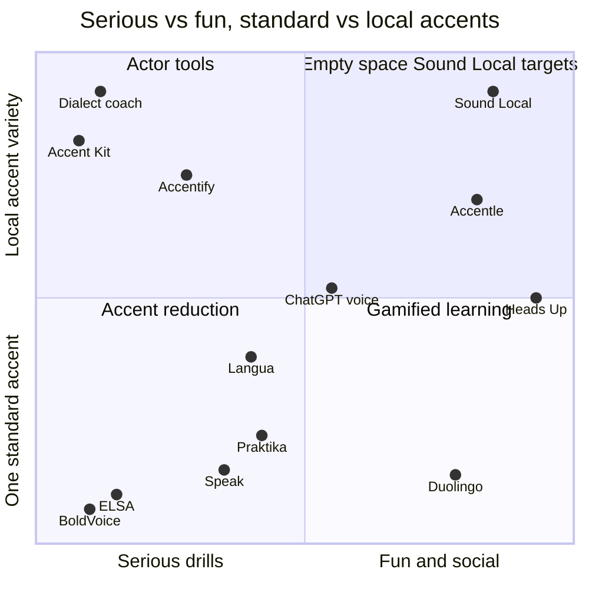
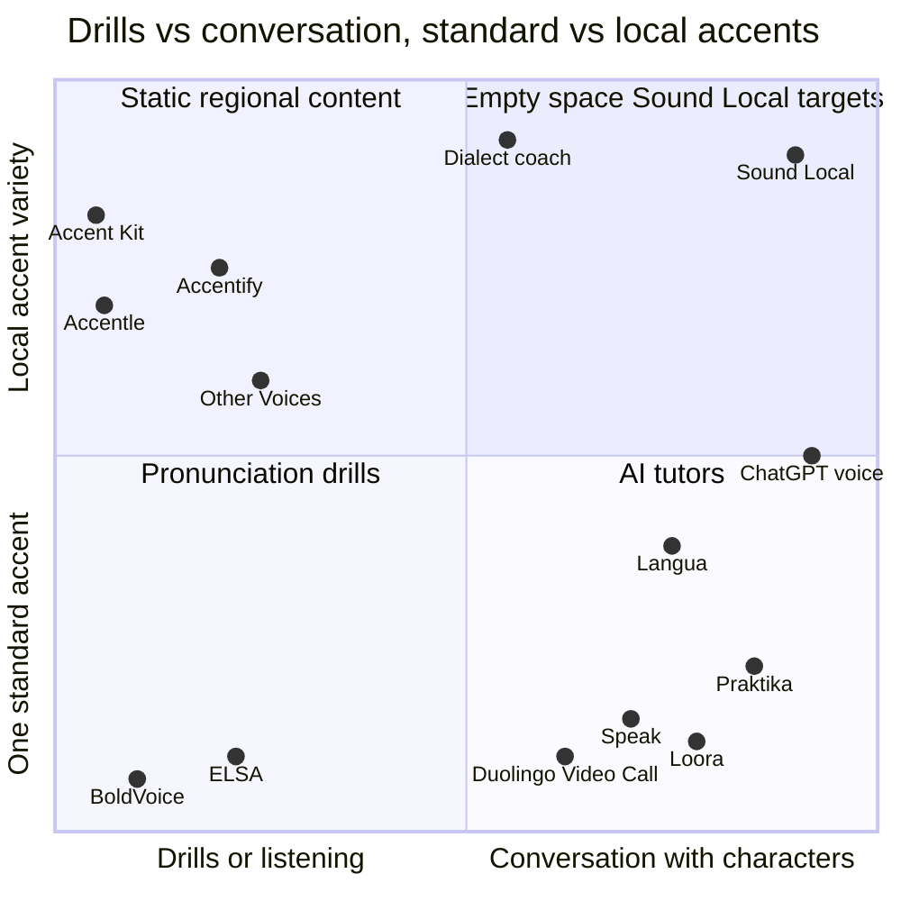

# Sound Local: market and competitor analysis

*15 November 2026. Written for the founder. Docs only; no game code was changed.*

**How to read this.** Every outside number links to its source, and every source was accessed on 15 Nov 2026 (full list in [`sources.md`](sources.md); raw data in [`data/`](data/)). Labels:
- **WEAK**: an analyst estimate or aggregator figure with no visible method.
- **UNVERIFIED**: we could not confirm it from a primary page.
- **ASSUMPTION**: our own estimate, with the reasoning shown.
- **DERIVED**: our own arithmetic on sourced numbers.

Where a sentence says what Sound Local *should* do, that is our recommendation, not a fact.

---

## Executive summary (read this if nothing else)

**The space Sound Local wants is empty at scale, but no longer empty of ideas.** We looked at 60+ products: 30 accent and pronunciation apps, 13 big language and tutor apps, 11 accent games and party games, and 6 AI voice platforms and suppliers. **None with real users teaches fluent English speakers a regional accent through play, scored, by talking with characters.**
- The big accent apps (ELSA, 10M+ Google Play installs; BoldVoice, over $10M a year in revenue) do the opposite. They help non-native speakers sound "standard" American.
- The closest competitor is **Accentify** (UK). It sells "Duolingo-style" accent lessons to actors and native speakers, and human coaches mark the recordings. It is small: 10K+ installs, and its founder reports about 270 paying subscribers.
- In 2026 at least five tiny indie apps appeared that score your accent (Accent Coach, Accentuate, AnyAccent, Mimic, Accent Lab). None has more than 24 ratings.
- The window is open, but others are now trying the same idea, so expect it to last months, not years.

**The money is smaller and narrower than the PRD suggests.**
- "1.5 billion English speakers" is a headcount, not a market.
- Our bottom-up estimates are all WEAK and assumption-driven, with the method in section 1:
  - Everyone who could plausibly pay (TAM): about **$0.9bn a year**.
  - What Sound Local can reach in about three years (SAM): about **$210M**.
  - A realistic year-3 revenue share (SOM): about **$1.4M ARR**, in a range of $0.7–3M.
- The PRD's "1M users × 5% paying × $60 = $3M" needs top-decile conversion. The median freemium app converts about 2% ([RevenueCat](https://www.revenuecat.com/pdf/state-of-subscription-apps-2025.pdf)).

**Who pays is not who plays.**
- **Actors, drama students and voice creators** already pay $120–180 an hour for dialect coaches. Actors buy a $9.99 "North Glasgow Male" audio kit that does not even score them.
- **International students and new arrivals** in the UK and Canada (about 1.4M people) want to understand locals. They are the best fit for paying.
- **Teens and young adults playing for fun** bring reach and shareable clips, not much subscription revenue.

So price and package the product for performers and students, and make the content for fun players.

**The threats that matter are free general AI and Duolingo, not other accent apps.**
- ChatGPT voice will already do a Glaswegian accent and coach you for free.
- Duolingo ships new verticals fast (Chess, Video Call with AI characters) and has 64.9M daily users.
- Scoring pitch and rhythm is not a moat on its own: a Steam party game (Mimic Party) and an indie app (Accent Coach) already do it.
- What *can* be defended:
  - **local authenticity**: real local voices with consent, Local Accent Leads, and slang and context;
  - **the game and its characters**;
  - **being the place where accent content and creators gather first**.

**Growth in this category comes from creators.**
- Praktika went from about $1M to $12M ARR in a month after creators copied a viral video ([RevenueCat](https://www.revenuecat.com/blog/growth/adam-turaev-praktika-sub-club-podcast-2026)).
- BoldVoice's paid growth started with about $200 paid to one YouTuber.
- Accent videos are a proven thing people watch: single Glasgow and Scottish-accent YouTube videos have 4–9M views each.
- Paid installs ($1.5–4 each) do not pay back at a fun-game conversion rate. Lead with creators and shareable clips.

**Reviews of competitors show four openings.** These come from 469 reviews across 9 apps (section 3):
1. Scoring people don't trust.
2. "One correct accent" bias.
3. Microphone bugs.
4. Trial and paywall traps.

Users also call the accent apps "monotonous" drills. A kind, free-to-start, mic-first game with characters and a sense of place answers all of these.

### Top five takeaways
1. **Nobody at scale owns "regional accents as play".** The nearest rival (Accentify) is a lesson app with about 270 payers, and five tiny scored-accent apps appeared in 2026. Move now.
2. **Plan on $0.7–1.5M ARR at 1M registered users, not $3M.** Reaching $3M needs a performer- and student-heavy user mix.
3. **Performers and international students pay. Fun players spread the word.** Build the paid tier for the first two and the free game for the third.
4. **The real threats are ChatGPT voice and Duolingo.** The defence is local authenticity (Accent Leads, consented local voices), characters and the game, and getting to creators first. Pitch scoring alone is not a defence.
5. **Growth will come from creators and shareable clips, not paid ads.** A "locals rate my accent" share loop is the single most important GTM feature.

### Three things to do first
1. **Make the first 60 seconds work on a phone.** When we played it, the mic failed with no fallback, it took about 40 seconds to reach the first prompt, and at 844×390 the free-talk record button was off-screen. Mic bugs are the #1 complaint in competitor reviews. Add a mic check, a "type instead" fallback and a landscape layout before any marketing.
2. **Run a two-week Glasgow creator test for about $1,500–2,000.** Use 10 nano creators at $50–200 a video in a "Glaswegians rate my Glaswegian" format, with a share card in the game. Measure plays, shares and return visits.
3. **Pre-sell a performer tier to 3–5 drama schools or dialect coaches.** Offer the Production Pass at $39–49, and put a hard cap on AI turns for free players. This tests the segment most likely to pay before building more regions.

### Decisions you need to make (detail in section 8)
| # | Decision | Our recommendation |
|---|---|---|
| 1 | First paying segment | Performers (actors, drama students, voice creators), then international students |
| 2 | Region after Glasgow | Toronto (home market, students, low backlash risk); Mumbai only with Indian Accent Leads in place |
| 3 | Web or app stores first | Web first, with Stripe passes; apps once retention is proven |
| 4 | Pricing | Free game + $9.99/mo or $59.99/yr Pro with an AI fair-use cap; Production Pass $49 for 8 weeks; Party Pass $2.99/week |
| 5 | Free-tier AI | 3 AI conversations a week; scripted, cached lines for everything else |
| 6 | Age floor | 13+ declared, with an age gate; stay out of Kids categories |
| 7 | Business sales | Drama schools yes; call centres no (for now) |
| 8 | How to describe the score | "How a local hears you", never "accent accuracy %" |

---

## 1. Market size

### 1.1 What the segments look like
| Segment | Size signal | What they pay today | Strength |
|---|---|---|---|
| **Language-learning apps overall** | $1.54bn consumer app revenue in 2025, +18.8%, 327M downloads ([Business of Apps](https://www.businessofapps.com/data/language-learning-app-market/)). All non-Duolingo apps together made about $0.44bn in-app in 2024 ([Appfigures](https://appfigures.com/resources/insights/20250103?f=3)) | Duolingo Super $12.99/mo, $83.99/yr; about $85 of subscription bookings per paying user per year (DERIVED from the [Q3 2026 letter](https://investors.duolingo.com/static-files/e1ee336e-b024-486f-875c-afd722653067)) | medium |
| **Duolingo itself** | Q3 2026: 64.9M DAU (+29%), 153.1M MAU, 13.1M paying subscribers, $309.0M revenue; FY2026 guidance $1,221M ([Q3 2026 letter](https://investors.duolingo.com/static-files/e1ee336e-b024-486f-875c-afd722653067)) | 8.6% of MAU pay (DERIVED) | strong |
| **English speakers and learners** | 1.528bn speakers (390M first-language + 1.138bn second-language) ([Ethnologue via Visual Capitalist](https://www.visualcapitalist.com/ranked-the-worlds-most-spoken-languages-in-2025/)); British Council: "1.4 billion" learning or wanting to learn ([British Council](https://www.britishcouncil.org/english-assessment/teaching)) | A headcount, not spend | medium |
| **Pronunciation and accent apps** | Visible consumer spend of at least about $110M a year: Speak more than $100M annualised ([Forbes ME](https://www.forbesmiddleeast.com/innovation/startups/this-startup-is-racing-duolingo-to-replace-human-language-tutors-with-ai)) + BoldVoice more than $10M ARR ([PR Newswire](https://www.prnewswire.com/news-releases/boldvoice-raises-21m-series-a-to-give-a-billion-non-native-english-speakers-their-own-ai-voice-coach-302671777.html)); ELSA undisclosed. Analyst "accent training market" $1.1–1.45bn (WEAK: [Dataintelo](https://dataintelo.com/report/accent-training-market), [TBRC](https://www.researchandmarkets.com/reports/6259936/accent-reduction-platforms-market-global-report)) | ELSA $89.99–99.99/yr; BoldVoice $89.99–199.99/yr | medium / WEAK |
| **Speech coaching** | Public-speaking training $3.6bn; voice-training software $4.2bn (both WEAK; [GII](https://www.gii.tw/report/smrc1871949-public-speaking-training-market-forecasts-global.html), [Dataintelo](https://dataintelo.com/report/global-voice-training-software-market)) | A neighbouring market, not core | WEAK |
| **Accents as entertainment** | Glasgow and Scottish accent YouTube videos: 8.7M ([Graham Norton](https://www.youtube.com/watch?v=YRo9d4Gxj3I)), 7.9M ([Gerard Butler, Vanity Fair](https://www.youtube.com/watch?v=c42dvgPIfSk)), 4.8M ([“glaswegian accent”](https://www.youtube.com/watch?v=AXGP4Sez_Us)); "One Woman, 17 British Accents" 12.0M ([YouTube](https://www.youtube.com/watch?v=FyyT2jmVPAk)). TikTok #accents shows 71.4K posts logged out ([TikTok](https://www.tiktok.com/tag/accents)); view totals need a login (BLOCKED) | Watching is free. Accentle charges $1.99 for a day pass and $4.99/mo ([press page](https://accentle.com/press/)) | strong (views) |
| **Actors and voice talent** | SAG-AFTRA 160K ([site](https://www.sagaftra.org/about)), Equity UK 49,294 ([accounts](https://www.equity.org.uk/media/d1vbzj41/equity-annual-accounts-2025.pdf)), ACTRA 30K+ ([site](https://www.actra.ca/about-us/)); 4M registered on Voices.com (registrations, not working pros) ([Voices](https://www.voices.com/company/about)) | Dialect coaches $120–180/hr in the US ([Paul Meier](https://www.paulmeier.com/product/zoom-phone-coaching/), [Braden Lynch](https://www.bradenlynchstudio.com/accent-coaching)), £100–135/hr in the UK ([Rachel Coffey](https://www.rachelcoffeycoaching.com/actors-dialect)); The Accent Kit sells "North Glasgow Male" for $9.99 ([App Store](https://apps.apple.com/us/app/the-accent-kit/id854413379)) | strong |
| **International students** | US 1,177,766 ([IIE](https://www.iie.org/news/open-doors-2025-press-release/)); UK 685,565 ([HESA via British Council](https://opportunities-insight.britishcouncil.org/short-articles/news/new-data-releases-ucas-and-hesa)); Canada 691,215 study-permit holders, falling under the caps ([IRCC](https://www.canada.ca/en/immigration-refugees-citizenship/corporate/transparency/committees/cimm-may-04-2026/international-students.html)); Australia about 739K unique students Jan–Aug 2026 ([DoE](https://www.education.gov.au/international-education-data-and-research/international-student-monthly-summary-and-data-tables)) | ELSA and BoldVoice prices ($90–150/yr) | strong |
| **Immigrants** | 304M international migrants worldwide ([UN DESA via Migration Data Portal](https://www.migrationdataportal.org/themes/international-migrant-stocks-overview)); not all move to English-speaking countries | — | strong (headcount) |
| **Call-centre and business English** | Philippines contact-centre workforce 1.68M FTE ([IBPAP](https://admin.ibpap.org/storage/hub-resources/7Hv9U2uoLJVx2kxyRMObNm6W6L0MR57l9dZfrez7.pdf)); India business-process revenue $54.6bn ([NASSCOM](https://nasscom.in/sites/default/files/media_pdf/Nasscom%20SR%20Press%20release.pdf)). Software is replacing training: Krisp accent conversion runs on 10,000 seats at Everise ([Krisp](https://krisp.ai/customers/everise/)) | A 40-hour group course in India costs INR 12,800 ([IIFLS](https://iifls.com/accent-neutralization-course-fees/)) | strong (size); poor fit |

**Growth.** Language-app spend is growing about 19% a year (Business of Apps), and Duolingo's DAU is up 29%. AI speaking apps are the fastest-growing part:
- **Praktika:** its CEO says $55M ARR ([podcast](https://exa.ai/library/podcast/6rv4cjd8krv/episode/m0lyl3b2344)).
- **Loora:** "tens of millions" of ARR.
- **Speak:** more than $100M.

Most of the growth is AI conversation, and that is the format Sound Local uses.

### 1.2 TAM / SAM / SOM (method shown; all WEAK)
**Top-down check.** About $1.54bn of consumer language-app spend, of which at least about $0.11bn is visible speaking and pronunciation spend. Analysts put "accent training" at $1.1–1.45bn, but that probably includes call-centre services. Spend on *regional-accent* practice is not reported anywhere, because it is a new category. Top-down gives a relevant pool of **$0.1–1.5bn**.

**Bottom-up TAM** (everyone who could pay, at a realistic annual price):
| Segment | People | Paying share | $/yr | TAM |
|---|---|---|---|---|
| Performers (actors, students, voice, comedians) | ~1.0M (ASSUMPTION: ~240K union members + students + aspiring) | 100% | $100 (ASSUMPTION) | $100M |
| International students (US, UK, CA, AU) | ~3.3M (DERIVED) | 100% | $90 (ELSA anchor) | $297M |
| Current language-app payers who want a local accent | 20M payers (ASSUMPTION) × 25% (ASSUMPTION) | — | $60 | $300M |
| Fun players aged 13–34 in English-speaking countries | ~145M (US Census 99.7M + ASSUMPTION for others) × 2.18% (RevenueCat median) | — | $30 | $95M |
| Call-centre agents (Philippines + India) | ~2.14M (DERIVED) | 100% | $60 (ASSUMPTION) | $128M |
| **Total** | | | | **≈ $0.92bn (range $0.5–1.5bn)** |

**SAM** (what a browser game with Glasgow, Toronto, Mumbai and Singapore can serve within about 3 years):
- performers 30% ($30M);
- UK and Canada students only, × 50% ($62M);
- paying learners 20% ($60M);
- fun players 50% ($47M);
- call centres 10% ($13M).

That totals **≈ $212M (range $100–300M)**.

**SOM, year 3** (based on the PRD's 1M registered users; mix and conversion are ASSUMPTIONS):
| Mix | Users | Paying | $/payer/yr | ARR |
|---|---|---|---|---|
| Fun players 70% | 700K | 2% | $30 | $420K |
| Learners and students 15% | 150K | 4% | $60 | $360K |
| Performers 10% | 100K | 6% | $90 | $540K |
| School pilots | 2 × 1,000 seats | — | $40 | $80K |
| **Total** | | | | **≈ $1.4M (range $0.7–3M)**, before store fees and AI costs |

**What this means for the PRD's numbers** (detail in [`raw/lane-market-sizing.md`](raw/lane-market-sizing.md)):
- **"1.5bn speakers":** correct as a headcount. Don't use it as TAM.
- **$60/yr:** fine as a list price. After weekly passes and store fees, realised revenue is more like $30–50 per payer per year.
- **5% conversion:** optimistic. The median freemium app converts 2.18%, and the top 10% reach 7.9% ([RevenueCat](https://www.revenuecat.com/pdf/state-of-subscription-apps-2025.pdf)). Duolingo's 8.6% is measured against *monthly active* users, after more than ten years of tuning.
- **Revenue per user:** BoldVoice makes about $2 per download (>$10M ARR / 5M downloads, DERIVED) with a hard paywall. A teen-heavy game is more likely to make **$0.7–1.5 per registered user**.

### 1.3 AI cost per user (a pricing constraint)
The PRD estimates AI cost at $0.25–0.55 per eight-turn conversation (ASSUMPTION, from the PRD). For a $9.99/mo Pro user (ASSUMPTION):
- After a 15–30% store fee, about $7–8.50 is left. The fee rate that applies is UNVERIFIED.
- 15 conversations a month costs $3.75–8.25 (DERIVED). That uses up roughly half to all of the margin.

So **Pro needs a fair-use cap** (we suggest 30 AI conversations a month, plus unlimited scripted play) until real per-conversation costs are measured.

Supplier prices that could lower this:
- Azure pronunciation assessment: about $1 per audio hour ([Azure docs](https://learn.microsoft.com/azure/ai-services/speech-service/how-to-pronunciation-assessment); price from secondary sources because the pricing page was blocked, so treat it as MEDIUM).
- SpeechSuper: about $0.006 per sentence ([SpeechSuper](https://www.speechsuper.com/pricing)).

Both are listed in [`data/competitors_games_ai.csv`](data/competitors_games_ai.csv). They score against standard US/UK (and Indian) English, not Glaswegian, so at best they are a backup scorer.

---
## 2. Competitors (60+ products, 5 groups)

**Threat** means how likely the product is to take Sound Local's players or money in the next 18 months. It is our judgement.
- **Regional** = teaches regional accents (Glasgow, Scouse and so on), not just "American" or "British".
- **Scored** = you speak and get feedback.
- **Game/chars** = game loop or characters you talk to.

Full fields and links: [`data/competitors_direct.csv`](data/competitors_direct.csv), [`data/competitors_bigapps.csv`](data/competitors_bigapps.csv), [`data/competitors_gapfill.csv`](data/competitors_gapfill.csv), [`data/competitors_games_ai.csv`](data/competitors_games_ai.csv). All the rows below are also in [`data/competitors_master.csv`](data/competitors_master.csv). Store figures are from the US App Store and Google Play on 15 Nov 2026.

### 2.1 Direct accent and pronunciation apps
| Product | What it is | Scale | Price (US) | Regional | Scored | Game/chars | Threat |
|---|---|---|---|---|---|---|---|
| ELSA Speak | AI pronunciation coach for non-native learners | 10M+ GP installs; iOS 4.75 (114,812); ~$60M raised ([TechCrunch](https://techcrunch.com/2023/09/12/elsa-series-c/)) | $19.99/mo, $99.99/yr | No (mainly US) | Yes (phoneme) | AI role-play | Medium |
| BoldVoice | Accent coaching for non-native professionals | 1M+ GP; >$10M ARR, 5M downloads, $21M Series A ([PR](https://www.prnewswire.com/news-releases/boldvoice-raises-21m-series-a-to-give-a-billion-non-native-english-speakers-their-own-ai-voice-coach-302671777.html)) | $14.99–24.99/mo, $89.99–199.99/yr | No (US) | Yes | No | Medium |
| Speakometer | AI accent scoring, US/UK | 500K+ GP | $4.99/mo, $29.99/yr | No | Yes | No | Low |
| Speechling | Non-profit; human coaches mark recordings | 500K+ GP | Free; $19.99/mo | No | Human | No | Low |
| Say It (Oxford/Phona) | Compares your waveform to a model | iOS 4.12 (248); Google Play page 404 | $13.49/mo, $105.99/yr | No (UK/US) | Yes | No | Low |
| (How to) Pronounce | Reference audio | iOS 4.79 (33,431) | $0.99–4.99 packs | Some | No | No | Low |
| Accent Training | American "melody" drills | iOS 4.65 (11,055) | $4.99/mo, $39.99/yr | No | Listen-repeat | No | Low |
| YouGlish | Search YouTube by accent (US, UK, AU, CA, IE, SCO, NZ, ZA) | 500K+ GP | Free (paid tiers UNVERIFIED) | Filter only | No | No | Low |
| ChatterFox | AI + human American accent coaching | 10K+ GP | ~$55 per item | No | Yes | No | Low |
| Sounds Right (British Council) | Free phonemic chart | Google Play page 404 (appears delisted) | Free | No | No | No | None |
| **Accentify** | "Duolingo-style" accent lessons for actors and natives; human coaches + AI coach | 10K+ GP; ~270 paying subscribers (founder, [LinkedIn](https://www.linkedin.com/posts/elijahkhan_startups-voiceai-accents-activity-7472309832667238400-oPmO), self-reported) | $3.99/wk, $4.99–9.99/mo, $39.99/yr | **Yes** (Scottish, Scouse, Irish, Southern US…) | Human + AI | No | **High** |
| The Accent Kit | Dialect-coach audio kits for actors | 50K+ GP; iOS 3.17 (24) | $9.99 per accent (incl. "North Glasgow Male") | **Yes** (100+) | No | No | Medium |
| Accentuate (app) | Accent coach for actors, 5 scored courses + 35 voices (incl. a Scottish "Isla") | 10+ GP (launched Sep 2026) | Pro $5.99 | Partly | Yes | No | Medium (idea overlap) |
| Accent Coach: Master Accents | On-device scoring of sounds, rhythm and melody; 27 accents | iOS 2.0 (1 rating) | Free; Mac $10 | Yes | Yes (rhythm/melody) | No | Low today; shows pitch scoring is easy to copy |
| AnyAccent | AI "closeness" score, UK/US/AU | 0 ratings | $4.99/mo, $99.99/yr | Partly | Yes | AI personas | Low |
| Mimic: Accent Training | On-device score, UK/US packs | 10+ GP | $9.99 per pack | No | Yes | No | Low |
| The Voice Café | Accent audio for actors (Geordie, Cockney…) | iOS 2.89 (9) | $2.99 per accent | Yes | No | No | Low |
| IDEA archive | Free dialect recordings, ~1,800 samples from 135 countries ([IDEA](https://www.dialectsarchive.com/)) | Web | Free | Yes | No | No | Low (also a possible partner) |

*Blabby (on the brief's list) turned out not to be an accent-training app, so it is excluded.*

### 2.2 Big language apps and AI speaking apps
| Product | What it is | Scale | Price (US iOS) | Accent angle | Threat |
|---|---|---|---|---|---|
| **Duolingo** | Gamified languages + chess + maths; Video Call with AI characters | 500M+ GP; 64.9M DAU; $1.22bn FY26 guidance | Super $12.99/mo, $83.99/yr | Blog covers English dialects ([blog](https://blog.duolingo.com/english-dialects/)); no selectable regional English course (UNVERIFIED) | **High** (fast copier with huge reach) |
| Babbel | Subscription lessons + Babbel Speak AI + live classes | 50M+ GP; 2024 revenue €284.9M ([register via firmendata](https://firmendata.com/en/company/berlin-charlottenburg/HRB267419/babbel-group-gmbh)) | $12.95+ | Varieties only across languages | Low |
| Speak | Speaking-first AI tutor, OpenAI-backed | 10M+ GP; >$100M annualised (Forbes ME; an older report says ~$50M, a conflict); $1B valuation ([TechCrunch](https://techcrunch.com/2024/12/10/openai-backed-speak-raises-78m-at-1b-valuation-to-help-users-learn-languages-by-talking-out-loud/)) | $17.99–39.99/mo | Reviewers ask for dialect choice | Medium |
| Praktika | AI avatar tutors | 10M+ GP; CEO: $55M ARR, ~0.5M payers | $9.99/mo, $59.99–139.99/yr | US/UK/AU/"Asian" tutor voices ([help](https://intercom.help/praktika-ai/en/articles/10707916-learning-process)) | Medium-High (could add "local" avatars) |
| Loora | English-only AI conversation coach | 10M+ GP; "tens of millions" ARR; $43M raised | ~$11–156 per item (GP) | US or UK ([support](https://www.loora.com/support/features/british-or-american-english)) | Medium |
| Talkpal | GPT-based chat and call tutor, 130+ languages | 5M+ GP | $19.99–119.99 (GP) | "English (British)" option | Low |
| Langua | AI conversation using voices cloned from real native speakers | 100K+ GP; founder: $308K MRR (self-reported) | $19.90–199.90 (GP) | **Country-specific dialect voices**: the nearest big-app feature to Sound Local | Medium |
| Busuu (Chegg) | Courses + native-speaker community feedback | 50M+ GP; bought by Chegg for ~$436M ([Chegg](https://investor.chegg.com/Press-Releases/press-release-details/2021/Chegg-to-Enter-Rapidly-Expanding-Digital-Language-Learning-Market-with-Acquisition-of-Busuu)) | ~$10.50/mo, $62.99/yr (third-party price check) | None found | Low |
| Memrise | Native-speaker video clips + AI chat partners | 50M+ GP; ~$25M raised (CB Insights) | Varies widely and A/B-tested (WEAK) | None | Low |
| Rosetta Stone (IXL) | Immersion lessons; TruAccent speech scoring | 10M+ GP | $19.99/mo, $159/yr, $299 lifetime ([buy page](https://www.rosettastone.com/buy)) | TruAccent scores against native speakers, not regions | Low |

### 2.3 Tutors and human coaching
| Product | What it is | Price | Threat |
|---|---|---|---|
| Cambly | On-demand native-speaker video tutors | ~$8.65–18.75 per 30-min lesson depending on plan ([Cambly](https://www.cambly.com/en/subscribe?currency=USD)); ~$60M raised ([Forbes](https://www.forbes.com/sites/kenrickcai/2022/06/08/cambly-series-b-english-language-app-profitable/)) | Low |
| Preply | Tutor marketplace; $150M Series D at $1.2B (Jan 2026, [Preply](https://preply.com/en/blog/preply-raises-150-million-to-shape-the-future-of-education-through-human-led-ai-enhanced-learning/)) | Tutors set prices; platform takes the trial lesson + 33%→18% ([Preply](https://preply.com/en/teach)). Example: British pronunciation tutor $60 per 50 min ([Preply](https://preply.com/en/tutor/5484243)) | Low |
| italki | Tutor marketplace, 150+ languages | $5–120 per lesson; 15–21% commission ([italki](https://support.italki.com/hc/en-us/articles/206352068-How-does-italki-charge-a-commission)) | Low |
| Dialect coaches | 1:1 coaching for actors | $120–180/hr in the US; £100–135/hr in the UK; £65 discounted actor rate | Low (a partner channel, and the price anchor) |
| The Accent Bank | Coach-led courses and social channels; £40 Scottish DIY course; claims 1.4M+ followers ([site](https://www.theaccentbank.com/learn-accents)) | £37–140 | Medium (content competitor, possible partner) |
| 21 Accents (Amy Walker) | YouTube membership academy | $4.99 or $8.99/mo ([site](https://www.21accents.com/21accentsacademy)) | Low |

### 2.4 Accent games and entertainment
| Product | What it is | Price | Threat |
|---|---|---|---|
| Accentle | Daily "guess the accent" web game, 126 accents; pub licence | Free; $1.99/day, $4.99/mo, $7.99/mo pub licence ([press](https://accentle.com/press/)) | Medium (listening only, but owns "Wordle for accents") |
| DialectGuessr, AccentGuessr | Free web guessing toys | Free | Low |
| Other Voices: Accent Game | Android: perform an accent, earn points for "accuracy and expression" ([Play](https://play.google.com/store/apps/details?id=com.othervoices)) | Free with ads; 100+ installs | Low (the closest concept, no traction) |
| The Accent Game, Guess the Accent | Listening quizzes | Free | Low |
| Heads Up! (Warner Bros.) | Party guessing game with an Accents deck | iOS $1.99 + decks; 10M+ GP | Low (could add a scored deck) |
| Accentuate / Utter Nonsense board games | Read cards aloud in accents; people judge | ~£23–29 | Low |
| Mimic Party (Steam) | Voice party game; a local AI scores pitch and rhythm ([Steam](https://store.steampowered.com/app/5053820)) | UNVERIFIED | Low, but proves pitch scoring is a commodity |
| Accent creators (TikTok/YouTube) | Kallmekris, Amy Walker, WIRED's Erik Singer, Glasgow comedians | Free | Competes for attention; best partners |

### 2.5 AI voice platforms (copy threats and suppliers)
| Product | Role | Threat |
|---|---|---|
| **OpenAI (ChatGPT voice, gpt-realtime)** | Free voice chat that can imitate and coach accents on request | **High** for casual use. No game, calibrated score, characters or progression |
| Google (Gemini Live, Translate practice) | Accent and character switching in Gemini Live; pronunciation practice in Translate | Medium-High |
| ElevenLabs | Sound Local's own speech-to-text and voice supplier; accent-filterable voice library; Agents at ~$0.08/min ([pricing](https://elevenlabs.io/pricing)) | Medium (a supplier that could build a consumer demo) |
| Azure, Speechace, SpeechSuper | Pronunciation-scoring APIs scored against standard US/UK/Indian English | Supplier only |
| Voicemod | Real-time voice changer | Low |
| Krisp accent conversion | Software that changes call-centre agents' accents live | Low for consumers; it erodes the call-centre training market |

---

## 3. What users love and hate (review mining)

**Method.** We read 469 store and Trustpilot reviews of 9 products: ELSA, BoldVoice, Duolingo (speaking-related reviews only), Speechling, Speak, Praktika, Babbel (speaking-related reviews only), Cambly and The Accent Kit. That gave 848 theme codes. We also read 6 Reddit threads.
- The sample is **star-stratified**: about equal numbers of 1–5 star reviews per app. So the counts show what people *talk about*, not what share of users feel it.
- One AI coder did the coding, with no second check.
- Reddit rate-limited us, so Reddit evidence is qualitative only.

Data: [`data/review_mining.csv`](data/review_mining.csv) (one row per review × theme, with links) and [`data/review_themes.csv`](data/review_themes.csv). Full write-up: [`raw/lane-review-mining.md`](raw/lane-review-mining.md).

| App | n | Top complaints (count) | Top praise (count) |
|---|---|---|---|
| ELSA Speak | 64 | Bugs, mic, crashes (28); paywall (12); billing (9) | Felt progress (10); content (7) |
| BoldVoice | 69 | Paywall (14); billing (10); scoring accuracy (10) | Felt progress (12); useful feedback (9) |
| Duolingo (speaking) | 70 | Bugs, mic (19); scoring accuracy (17); paywall (13) | **Fun and gamification (12)**; progress (10) |
| Speechling | 45 | Bugs, mic (12); UX (8); support (7) | Useful feedback (8); human coaches (7) |
| Speak | 44 | Scoring accuracy (12); paywall (10) | Progress (6); fun (5) |
| Praktika | 44 | AI conversation quality (14); billing (8) | AI conversation (6); progress (5) |
| Babbel (speaking) | 45 | Content (17); scoring accuracy (9) | Structure (12) |
| Cambly | 43 | UX (8); price (5) (14 of 43 reviews were by tutors) | Friendly tutors (8) |
| The Accent Kit | 45 | Audio and download bugs (19); **accent choice and authenticity (11)** | **Fit for actors and natives (7)** |

**Short quotes** (verbatim, under 15 words; links in the CSV):
- Scoring cuts both ways: "it marks you wrong even if your correct" (Duolingo). "app keeps giving a 100% score (or close) even when I sound nothing like" (BoldVoice).
- One correct accent: "it would be awesome if you could choose what dialect to speak in." (Speak). On Reddit, about Britain: "We have about 1000 accents in this country".
- Conversation quality: "The avatar constantly interrupts" and "very often it simply doesn't hear me." (Praktika).
- Recognition: "at least half of the time it doesn't recognize what I said correctly." (Babbel).
- Paywalls: "you literally can't do anything in the free version." (Speak).
- Drills are boring: "Very Monotonous and repetitive content" (BoldVoice).
- Actors want this: "Super handy when I need to perfect an accent for an audition" and "my drama students use it everytime we are rehearsing a play." (The Accent Kit).
- Authenticity matters: "it didnt sound anything like people here!" (The Accent Kit).

**Openings for Sound Local** (our inference):
1. **Explain the score kindly.** Show *why* a local heard you a certain way, such as "your vowels were spot on, your melody went up at the end". Never show a bare percentage. Reviewers distrust scores whether they are too harsh or too generous.
2. **Make regional accents the product.** Every big app treats one accent as "correct", and reviewers notice.
3. **Treat the mic as the product.** Mic and audio bugs are the #1 complaint for ELSA, Duolingo and The Accent Kit. Add a mic check on the first screen and a text fallback.
4. **Don't trap people with trials.** Billing and trial anger is the angriest theme across the paid apps. Free to play in the browser with no card; passes that don't auto-renew for the Party and Production options.
5. **Turn-taking and voice quality decide whether a conversation feels real.** Use push-to-talk, short replies from characters and lifelike ElevenLabs voices.
6. **Beat drills with place and story.** Duolingo's fun is the bar. Accent apps feel like homework.
7. **Authenticity is a quality bar, not just a respect issue.** Users can tell when a voice "didn't sound anything like people here". Local Accent Leads sign off every region.

---

## 4. Positioning maps

Positions are our judgement from the products' own descriptions. GitHub renders these charts.

**Map A: serious vs fun × one standard accent vs local variety**

**Map B: drills or listening vs character conversation × standard vs local**

**How to read them.** The top-right corner of both maps is empty except for Sound Local. The two nearest threats come from different directions:
- **ChatGPT voice** (middle right) already does conversation and can do any accent, but has no game, local authenticity or score.
- **Accentify, The Accent Kit and dialect coaches** (top left) own regional content for actors, but as lessons or audio.

Sound Local wins by being further right than the actor tools and further up than ChatGPT. That means the characters and the authentic local voices have to be the product, not decoration.

---
## 5. How Sound Local wins

### 5.1 Advantages (what we have that others don't)
- **The concept is unclaimed at scale**: regional accents, for fluent speakers, through play, by talking to characters. See section 2.
- **Glasgow is a strong first region.** Glasgow and Scottish accents are proven content: four videos with 4.8–8.7M views each (section 1). Actors already buy Glasgow kits.
- **Local characters with a point of view.** A Glaswegian who reacts to how you sound is content people want to share. A phoneme score is not.
- **The Respect Charter and Local Accent Leads.** These are a real difference in a category where getting it wrong means backlash. Reviewers notice voices that "didn't sound anything like people here".
- **Free in the browser.** People can play from a TikTok link with no install or card, which answers the paywall complaints.

### 5.2 Weaknesses (seen when we played it, 15 Nov 2026)
Screenshots: [`img/product-*.png`](img/).
- **Mic failure and no fallback.** In our VM the placement test said "Didn't catch that" and free talk said "Could not use the microphone". This was a VM limit, but there is no "type instead" path.
- **Slow start.** About 40–45 seconds from opening to the first prompt. This was measured informally, not under controlled conditions.
- **Phone layout.** At 844×390 landscape the free-talk panel pushes the record and replay buttons off-screen (`img/product-phone-landscape.png`).
- **Only one region** (Scotland) can be played. The map shows other regions as locked.
- **Scoring is unvalidated.** We have no evidence yet that the score matches what real Glaswegians hear. Speech-to-text and pitch can be thrown by background noise and by accents themselves.
- **AI cost** grows with every conversation (section 1.3).
- **A small team against well-funded copiers.**

### 5.3 SWOT
| | Helpful | Harmful |
|---|---|---|
| **Internal** | **Strengths:** unclaimed concept; characters and humour; Respect Charter; browser and zero install; modern voice stack (ElevenLabs + Claude) | **Weaknesses:** mic and phone UX; one region; unvalidated score; AI cost per user; no audience yet |
| **External** | **Opportunities:** performers already pay for regional accents; 1.4M international students in the UK and Canada; accent content is proven on TikTok and YouTube; creators drive this category; drama-school licences | **Threats:** ChatGPT/Gemini voice; Duolingo copying; Accentify adding AI conversation; 2026 indie wave; accent-mocking backlash; app-store AI and data rules |

### 5.4 The wedge (where to start)
**"Glaswegians rate your Glaswegian."** It is a 3-minute browser challenge:
1. Talk to a Glasgow character.
2. Get a kind, specific verdict.
3. Share a card or clip.
4. Locals reply.

It is fun first. Underneath, the same engine becomes a **Production Pass for actors** preparing a Scottish role, which is the first thing to charge for.

Toronto comes next. It is the home market, has a large international-student population, and "Canadian accent" content travels well with low backlash risk.

### 5.5 Features that decide whether it wins
1. **A mic check and a text fallback on the first screen.** Being heard reliably is the product.
2. **Feedback that explains itself.** The character says why ("your 'o' was pure Glasgow, but your sentence went up at the end like a question"). No bare percentages.
3. **A share card or clip** with your verdict, sized for TikTok and Reels. This is the growth loop.
4. **Locals in the loop.** Local Accent Leads record the reference lines and sign off each region. Later, community "rate this tourist" voting.
5. **An actor mode.** Script import, a slow replay of the reference, and comparing one sound against a near-miss ("minimal pairs"). Accent Kit reviewers ask for exactly this.
6. **A no-guilt progression.** Neighbourhoods, characters and slang unlock as you play. Streaks are optional.
7. **A cost-controlled AI.** Scripted and cached lines for most of the free game; AI conversation as the paid reward.

### 5.6 Long-term moat (in order of strength)
1. **Licensed local voice data and the Accent Lead network.** Consented recordings of real locals in each city, plus a paid community of locals. This is hard for Duolingo or OpenAI to fake credibly, and it improves scoring over time.
2. **A brand and community owning "same language, different voice".** Creators, duets and region launches.
3. **Characters and world IP.** People come back for characters, as Duolingo shows with Duo and Lily.
4. **A scoring model tuned per region**, using the voice data from point 1. This is the *weakest* moat alone, because pitch and rhythm scoring is already in indie apps and Mimic Party.

### 5.7 What to avoid
- **Becoming "accent reduction".** That is ELSA's and BoldVoice's fight, against non-native speakers' insecurity. Stay "accent acquisition", for fun and craft.
- **"Accent accuracy %" claims.** They invite the trust complaints in section 3 and could be read as saying an accent is "wrong".
- **Launching Mumbai, Singapore or other non-white accents without local leads and consent.** The backlash risk is highest there.
- **Unlimited free AI chat.** The cost per user kills the margin.
- **Auto-renew trials and hard paywalls.** These cause the angriest competitor reviews.
- **Call-centre sales for now.** It is the wrong product (they want neutral, not regional), and software like Krisp is replacing that training anyway.

---

## 6. Go-to-market

### 6.1 How competitors grew (benchmarks in [`data/gtm_benchmarks.csv`](data/gtm_benchmarks.csv))
- **Praktika:** one creator video format, copied by creators, took ARR from ~$1M to $12M in a month ([RevenueCat](https://www.revenuecat.com/blog/growth/adam-turaev-praktika-sub-club-podcast-2026)).
- **BoldVoice:** about $200 paid to one YouTube creator unlocked paid growth. It now spends six figures a month across Meta, Google, TikTok and Apple Search Ads ([RevenueCat blog](https://www.revenuecat.com/blog/), company-reported, MEDIUM).
- **Speak:** a repeatable TikTok format reached about 300M views (agency case study, MEDIUM). Apple Search Ads case study: [Apple](https://ads.apple.com/app-store/success-stories/speak).
- **ELSA:** a creator programme paying 10% commission ([ELSA creators](https://elsaspeak.com/en/creators/)).
- **Duolingo:** about 80% of users came by word of mouth (2023). It is moving to paid creators as organic TikTok reach falls (Business Insider, 2026; MEDIUM).

### 6.2 Cost benchmarks
| Item | Benchmark | Strength |
|---|---|---|
| Cost per install, iOS / Android, all apps | $1.5–3.5 / $1.5–4 ([Business of Apps](https://www.businessofapps.com/ads/cpi/research/cost-per-install/)) | MEDIUM |
| Education CPI | ~$2.91 ([AppRevs](https://apprevs.com/benchmarks/education/)) | WEAK |
| Freemium download → paid (35 days) | 2.18% median, 7.9% top 10% ([RevenueCat](https://www.revenuecat.com/pdf/state-of-subscription-apps-2025.pdf)) | STRONG |
| Nano TikTok creator | ~$50–200 per video; $350–850 at 5K–25K followers ([agency blog](https://awisee.com/blog/tiktok-influencer-rates/)) | WEAK |

**What this means (DERIVED).** At $3 per install and 2% conversion, one paying user costs about $150 in ads. That is more than two years of Pro. **Paid ads only work later, for performer and student targeting with proven conversion.** Use creators and organic clips first.

### 6.3 Channels, in order
1. **TikTok and Reels: each local-accent unit is a clip.** Every region unit (a Glasgow slang word, a Toronto "eh") gets a 15–30 second "can you say it like a local?" clip featuring a character. Formats:
   - "Locals rate tourists": locals duet player attempts.
   - "Glaswegian reacts to your Glaswegian".
   - Accent-offs between creators.
   - Ask local comedians to duet (Glasgow comedians already do accent TikToks).
2. **Nano and micro creators**: accent creators, drama students and expat creators. Pay per video, plus an affiliate cut on passes (ELSA's 10% model).
3. **Performers**: drama schools, Equity/ACTRA/SAG-AFTRA newsletters, audition-prep communities, and dialect coaches as affiliates (offer them a coach dashboard).
4. **Universities**: international-student welcome weeks and international offices in Glasgow (Glasgow, Strathclyde, Caledonian) and Toronto (U of T, TMU, York, Humber). Pitch it as "understand your new city", with a free semester code for student unions (ASSUMPTION: not tested).
5. **Press and community**: local press (Glasgow Live, The Courier already cover accent TikTokers) and r/glasgow-style communities, done respectfully.
6. **Paid** (later): Apple Search Ads on "Scottish accent", "accent for actors" and similar searches, once conversion is measured.

### 6.4 Launch plan (first 12 weeks)
| Weeks | What | Success metric |
|---|---|---|
| 0–2 | Fix the mic check, text fallback, phone layout and a sub-15-second start; add a share card; cap free AI | 80%+ of sessions reach the first verdict |
| 2–4 | Glasgow creator test: 10 nano creators, ~$1.5–2K; 3 Glasgow locals as Accent Leads on camera | 100K+ clip views; 5%+ of visitors share |
| 3–6 | Performer pilot: 3–5 drama schools or coaches; Production Pass at $39–49 | 30+ paid passes; coach testimonials |
| 6–8 | University pilot in Glasgow and Toronto (welcome-week codes) | 1,000 student plays; return rate in week 2 |
| 8–12 | Toronto region launch event ("Torontonians rate your Toronto"); Pro subscription on the web | D7 retention ≥15%; 2%+ of actives on a paid plan |

### 6.5 Pricing recommendation
| Tier | Price | What's in it | Why |
|---|---|---|---|
| Free | $0 | All scripted scenes in one region; 3 AI conversations a week; share cards | Answers paywall anger; keeps AI cost low |
| Party Pass | $2.99 a week, **no auto-renew** | Unlimited scripted play + 15 AI conversations, all regions, party mode | Impulse buy for fun players; Accentle charges $1.99 a day |
| **Pro** | **$9.99/mo or $59.99/yr** | All regions; 30 AI conversations a month (fair use); progress history | Matches Praktika ($9.99) and sits under Duolingo ($12.99) and ELSA ($19.99) |
| **Production Pass** | **$49 for 8 weeks** (PRD: $39) | Actor mode: script import, slow replay, minimal pairs, unlimited practice on one accent | Still under half of one coaching hour ($120+); competes with $9.99 static kits by adding scoring |
| Schools | ~$40 per seat per year (ASSUMPTION) | Teacher dashboard | Drama-school licences; test in the pilot |

Sell on the web first, through Stripe. That avoids app-store fees while the game is browser-only, and lets passes be one-off. When native apps launch, Apple's rules for auto-renewing subscriptions (3.1.2) apply.

---

## 7. Risks and mitigations
| Risk | Likelihood | Impact | Mitigation |
|---|---|---|---|
| **Duolingo or Praktika copies "accents"** | Medium-High if accents trend | High | Move first with creators; own regional authenticity (Accent Leads, licensed local voices); characters and humour; partner with locals Duolingo can't easily sign |
| **ChatGPT/Gemini voice "good enough" for free** | High for casual users | Medium | Offer what a chatbot doesn't: a game, progression, a shareable verdict, authentic recorded locals, an actor toolkit |
| **AI cost per user eats the margin** | High at current prices | High | Free cap; caching; scripted lines; fair use on Pro; measure real cost per conversation weekly; cheaper speech-to-text options |
| **Accent backlash ("mocking" a culture)** | Medium; highest for Indian, Singaporean, Caribbean and other non-white accents | High | Respect Charter as a product rule; local Accent Leads paid and credited; the player is the joke, never the locals; launch sensitive regions only with local co-creators; fast takedown and report flow |
| **App-store and data rules** | Certain once apps launch | Medium | Apple 5.1.2(i) (Nov 2025) requires explicit permission before sharing personal data with third-party AI ([Apple](https://developer.apple.com/news/?id=ey6d8onl)), so ask before sending voice to ElevenLabs or Anthropic; Google Play AI content policy requires a way to report AI output ([Play](https://support.google.com/googleplay/android-developer/answer/14094294?hl=en)); privacy policy names suppliers and retention |
| **Children's voice data (COPPA)** | Medium if under-13s play | High | Amended COPPA (effective June 2025) counts a child's voice recording as personal information ([eCFR](https://www.ecfr.gov/on/2025-06-23/title-16/chapter-I/subchapter-C/part-312)); declare 13+, add an age gate, stay out of Apple Kids and Play Families, delete audio right after scoring. A lawyer should review this (UK/EU children's rules NOT RESEARCHED) |
| **Scoring is wrong or biased** | Medium | High (trust) | Validate against Accent Lead ratings before launch; describe the score as "how a local hears you"; let players appeal or replay |
| **Mic friction kills the funnel** | High in browsers | High | Mic check, text fallback, clear permission copy, test on iOS Safari |
| **An indie competitor gets traction first** (Accentify, Accentuate) | Medium | Medium | Ship the creator test within weeks; consider partnering or licensing with coaches |

Policy notes with quotes: [`raw/lane-store-policy.md`](raw/lane-store-policy.md).

---

## 8. Decisions for the founder
1. **Which segment pays first?** *Recommendation: performers*, with a Production Pass and a drama-school pilot. International students are second. Fun players are the free audience and the growth engine.
2. **Which region after Glasgow?** *Recommendation: Toronto.* It is the home market, has many international students (691K study-permit holders in Canada, though falling), and low backlash risk. Mumbai or Singapore come only after Local Accent Leads are signed and the Respect Charter process is proven.
3. **Web or app stores first?** *Recommendation: web first, with Stripe passes.* Zero install suits TikTok traffic, and there are no store fees or review delays. Build native apps once week-4 retention is proven.
4. **Pricing?** *Recommendation:* the table in 6.5. Keep the PRD's $9.99/$59.99 for Pro but add an AI fair-use cap. Raise the Production Pass to $49. Make passes non-renewing.
5. **How much free AI?** *Recommendation: 3 AI conversations a week*, with scripted and cached content for the rest. Review this monthly against measured cost.
6. **Age floor?** *Recommendation: 13+, declared, with an age gate.* Stay out of Apple Kids and Google Play Families. Delete voice right after scoring. Get a privacy lawyer's review before the native app launch.
7. **Business-to-business?** *Recommendation: drama schools yes* (small pilots now). *Call centres no*: they need neutral, not regional, accents, and Krisp-style software is replacing that training.
8. **How to describe the score?** *Recommendation: "how a local hears you"*, with spoken, specific feedback. Never "accent accuracy %", and never "correct" versus "wrong" accent.
9. **Accent Lead model?** *Recommendation:* pay locals per recorded set plus a revenue share in their region, and credit them in the game. This is both the ethics and the moat.
10. **Respond to Accentify?** *Recommendation: watch it, and consider a partnership.* Their human coaches and our game loop complement each other. Don't compete on lessons.

---

## Appendix A: What is complete, what is weak

**Complete:**
- market sizing with method;
- 60+ products across 5 groups (direct-app and big-app store data from 15 Nov 2026);
- review mining (469 reviews, 9 apps);
- positioning maps, SWOT, GTM plan, pricing, risks and decisions.

**Weak or unverified (don't quote these without checking):**
- All analyst market sizes and our TAM/SAM/SOM, which are ASSUMPTION-driven.
- Revenue figures for ELSA, Babbel and Speak (conflicting or estimated).
- Accentify's ~270 payers (self-reported).
- TikTok view totals (blocked by a login wall).
- Creator rates and CPI (agency and aggregator figures).
- Busuu and Memrise prices (third-party price checks).
- Mimic Party details.

**Not researched:**
- Liftoff and AppsFlyer CPI reports.
- Instagram Reels creator rates.
- Toronto and Singapore creators.
- UK and EU children's data rules.
- Glasgow-specific dialect-coach prices.
- Review mining for Talkpal, Busuu and Accentify (too few reviews).

**Product walkthrough:** done in a VM browser. The mic did not work there, so we could not complete a voice turn, and we did not check console errors.

## Appendix B: Files
- [`sources.md`](sources.md): every source, with URL, title, access date and what it supports.
- [`data/`](data/): competitor tables (direct, big apps, gap-fill, games and AI, master), pricing tables, review mining, market sizes, GTM benchmarks.
- [`raw/`](raw/): each research lane's full notes and source lists.
- [`img/`](img/): product walkthrough screenshots, plus store screenshots of competitors (`img/stores/`, `img/direct/`).
